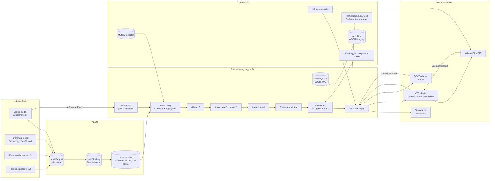
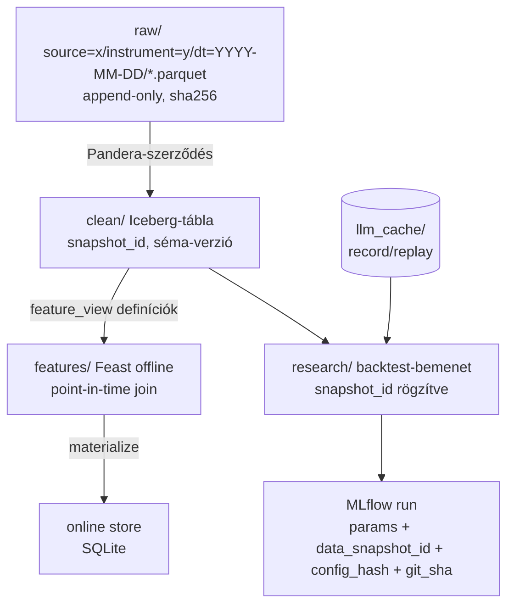
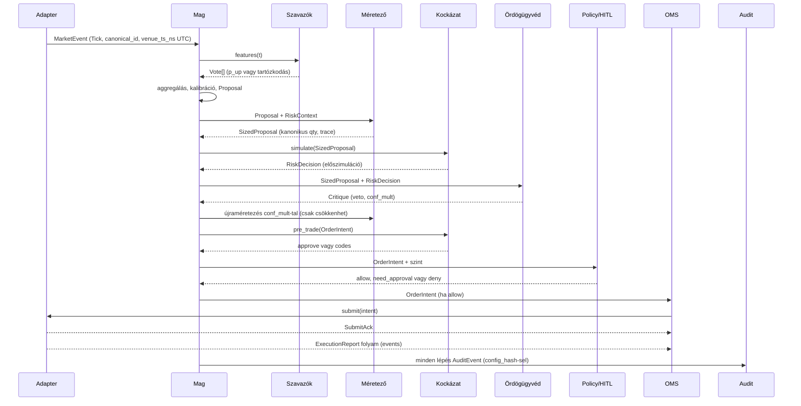
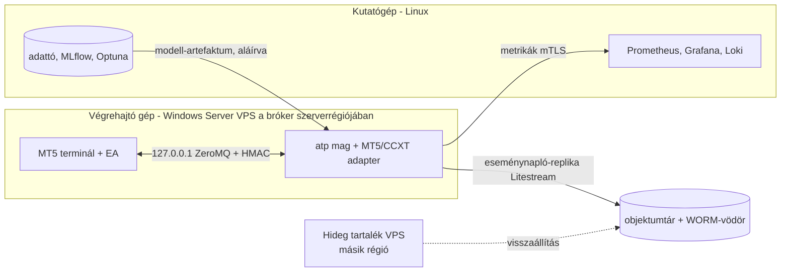
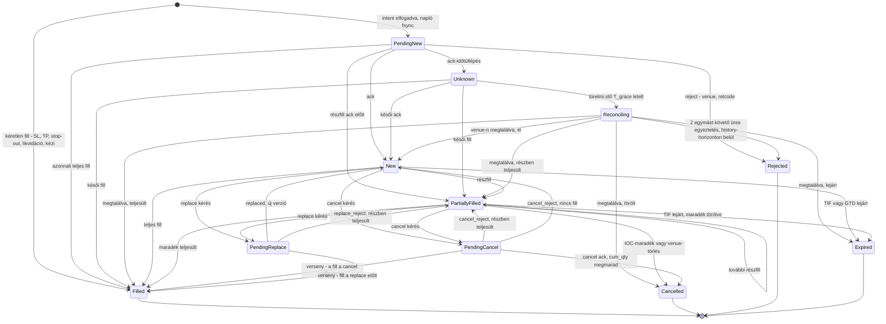
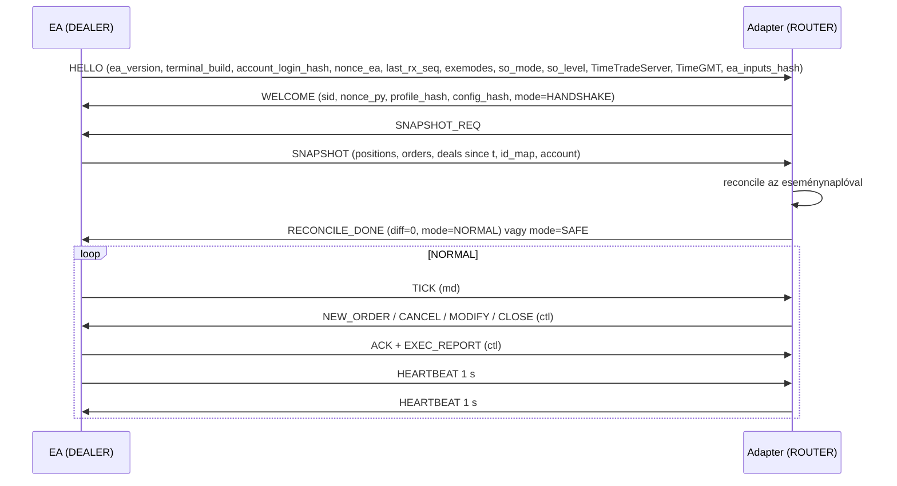
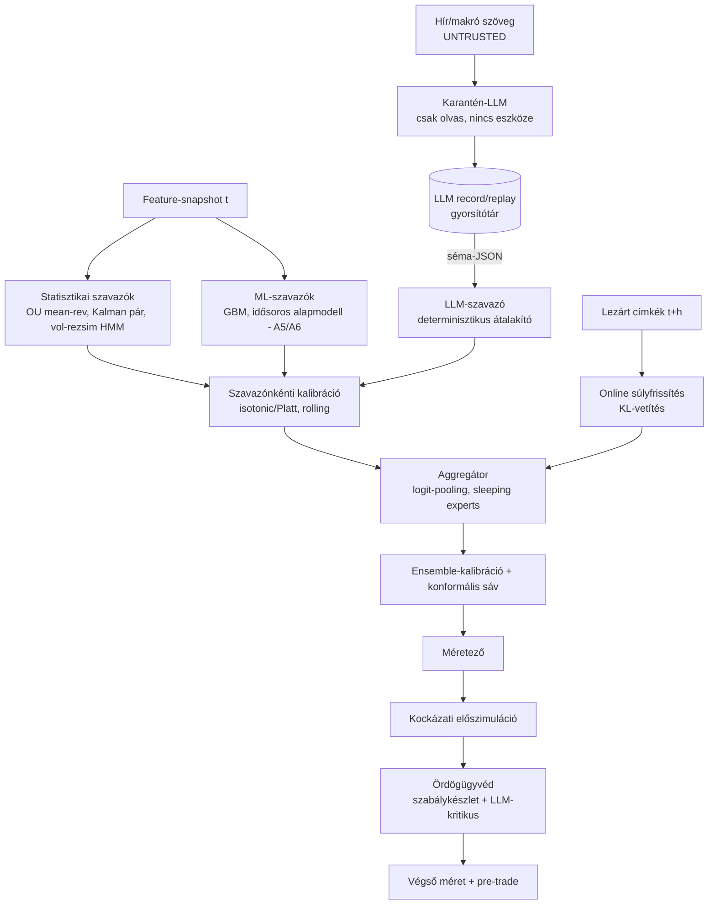
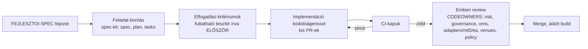
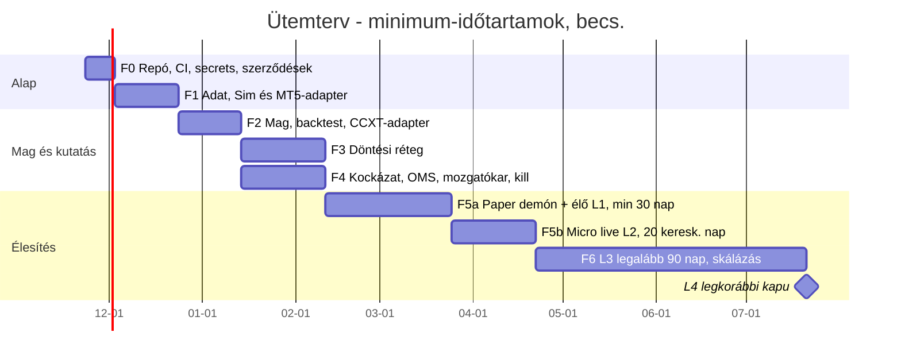

# A9 – Fejlesztői specifikáció: platform-architektúra, AI-fejlesztési folyamat, mozgatókar, paritásmátrix

> Kutatóágens: A9 · Dátum: 2026-11-15 (2. változat, az 1. átnézői kör javításaival) · Modulok: M9 (döntési réteg, mozgatókar), M12 (paritásmátrix), M14 (AI-jal fejlesztett szoftver)
> Katalógus: `research/a9_platform.jsonl` (118 tétel). A szövegben a `[tétel-id]` jelölés a katalógus `id` mezőjére mutat.
> Ismeretelméleti címkék: **(mért)** = az oldalon vagy API-n láttuk 2026-11-15-én; **(köv.)** = következtetett; **(becs.)** = becsült; **(n.e.)** = nem ellenőrzött; **ellenőrizendő** = API- vagy viselkedési részlet, amelyet a csapatnak az első használat előtt teszttel kell igazolnia.
> Árfolyam az EUR-átszámításhoz: ECB referencia 2026-11-13, 1 EUR = 1,1052 USD (mért).
> **Olvasási sorrend egy kódolóágensnek:** §0 → §2 (szerződések) → §12 (platformfüggetlenség, felülír mindent) → §10 (elfogadási kritériumok) → a feladathoz tartozó fejezet.

**Tartalom**

- §0 – [Cél, hatókör, alapelvek](#0-cél-hatókör-alapelvek)
- §1 – [Rendszerarchitektúra](#1-rendszerarchitektúra)
- §2 – [Kanonikus szerződések (`atp/contracts.py`)](#2-kanonikus-szerződések-atpcontractspy)
- §3 – [Végrehajtási réteg (venue-semleges)](#3-végrehajtási-réteg-venue-semleges)
- §4 – [Az első adapter: MT5 (`atp.adapters.mt5`)](#4-az-első-adapter-mt5-atpadaptersmt5)
- §5 – [Döntési réteg (M9) – mérnöki terv](#5-döntési-réteg-m9--mérnöki-terv)
- §6 – [Kockázati motor (pre-trade és post-trade)](#6-kockázati-motor-pre-trade-és-post-trade)
- §7 – [AI mozgatókar – governance](#7-ai-mozgatókar--governance)
- §8 – [Konfiguráció, kísérletek és validálási kapuk](#8-konfiguráció-kísérletek-és-validálási-kapuk)
- §9 – [AI-jal fejlesztett szoftver – folyamat](#9-ai-jal-fejlesztett-szoftver--folyamat)
- §10 – [Fázisos ütemterv és elfogadási kritériumok](#10-fázisos-ütemterv-és-elfogadási-kritériumok)
- §11 – [Paritásmátrix, nyitott kérdések, hiányok](#11-paritásmátrix-nyitott-kérdések-hiányok)
- §12 – [Platform- és brókerfüggetlenség (kötelező tervezési elv)](#12-platform--és-brókerfüggetlenség-kötelező-tervezési-elv)

---

## 0. Cél, hatókör, alapelvek

A dokumentum azt írja le, mit épít a fejlesztőcsapat (AI-kódolóágensekkel), milyen sorrendben, és mivel bizonyítja, hogy kész. Ahol a szöveg „kell”-t mond, az kötelező; ahol „ajánlott”-at, ott a csapat dönthet, de a döntést ADR-ben rögzíti (§1.6).

**Kiinduló helyzet.** Az ügyfélnél ma egy grid-stratégia fut bérelt szerveren, MetaTraderen (MT4 vagy MT5: nyitott kérdés, §11.2 Q1), Vantage-számlán, 1:500 tőkeáttétellel. A MetaTrader és a Vantage a **jelenlegi végrehajtási hely**, nem a platform része (§12). A spec az MT5-öt az **első** adapterként kezeli; MT4-számla esetén ugyanaz a hídprotokoll MQL4-es EA-val valósul meg.

**A célrendszer:**
1. **eseményvezérelt, determinisztikusan visszajátszható mag** (backtest és élő ugyanazon a kódúton);
2. **Python-oldali „agy”** és **venue-adapterek** egy közös `ExecutionAdapter`-szerződés mögött; az első adapter az MT5 (vékony EA), a második egy valódi, eltérő protokollú helyszín (CCXT testnet, F2–F4), a referencia a szimulátor-adapter;
3. **súlyozott, többmodelles döntési réteg** ördögügyvéd-ágenssel;
4. **kockázati motor és OMS**, amely minden döntés és a helyszín között áll;
5. **„AI mozgatókar”**: fokozatos autonómia, kill switch, limitek, aláírt jóváhagyás, WORM-horgonyzott auditnapló, promptinjekció elleni védelem;
6. **beállítás-könyvtár**: sémával, verziózással, kísérletkövetéssel és a keresés túlillesztése elleni kapukkal.

**Nem cél:** HFT/colocation szintű késleltetés, vagyonkezelési ügyfélriportok, magánpiaci modulok.

### 0.1 Tervezési alapelvek

- **Venue-semlegesség:** a stratégia, a döntési réteg, a méretező, a kockázati motor és a mag csak kanonikus típusokat lát (`canonical_id`, kanonikus mennyiség, egész tick-ár). Brókerspecifikus adat csak a `venues/` profilokban és az `atp.adapters.*` csomagokban lehet. Ezt import-linter-szerződés kényszeríti ki (§12.4).
- **Egy igazságforrás az állapotra:** az eseménynapló (event sourcing [fowler-event-sourcing]). Minden állapot (pozíció, megbízás, súly, mozgatókar-szint) eseményekből áll elő.
- **Egyszálú, determinisztikus mag:** ugyanaz az elv, mint az LMAX BLP-nél (egy szálon 6 millió megbízás/s, memóriában, event sourcinggal (mért) [fowler-lmax-architecture]) és a NautilusTradernél (egyszálú üzenetfeldolgozás, crash-only (mért) [nautilustrader-architecture]). Az LLM-hívások determinizmusát a record/replay gyorsítótár adja (§5.3).
- **Fail-closed nyitásra, fail-open zárásra:** ha bármely kapu (policy, kockázat, adatfrissesség, híd-heartbeat) nem válaszol, **új kitettség nem nyílik**. A kitettséget csökkentő (`reduce_only`) megbízás viszont soha nem akadhat el vétón vagy jóváhagyáson (§5.2).
- **Az LLM soha nem ad közvetlenül megbízást.** Csak sémához kötött szavazatot ad, amelyet determinisztikus kód ellenőriz.
- **Minden limit tőkearányos és profilvezérelt:** lot helyett kanonikus névérték és effektív tőkeáttétel; a stop-out, a margin-modell és a díjak a profilból jönnek.

### 0.2 Szójegyzék

| Fogalom | Jelentés |
|---|---|
| A1–A11 | a kutatási területek (ágensek), kimenetük a `forras/research/a*` fájlokban (a repóban `src/research/`): A1 piac és végrehajtás, A2 kripto, A3 predikció és sport, A4 makró/hírek/alt adat, A5 nyílt szoftver, A6 AI-kutatás és irodalom, A7 stratégiák/kockázat/ötletek, A8 infrastruktúra/adó/jog, A9 platform-architektúra, A10 bevált módszerek, A11 platform- és bróker-összehasonlítás |
| M1–M16 | a mesterprompt moduljai (M9 döntési réteg, M10 kockázat, M14 fejlesztési folyamat) |
| L0–L4 | a mozgatókar autonómiaszintjei (§7.1) |
| venue, helyszín | végrehajtási hely (bróker-számla, tőzsde, predikciós piac); azonosítója a `venue_id` |
| adapter | egy venue-protokoll megvalósítása az `ExecutionAdapter`-szerződés mögött |
| `canonical_id` | brókerfüggetlen instrumentum-azonosító, pl. `FX:EURUSD`, `PRED:POLY:<outcome_token_id>` (§2.2) |
| kanonikus mennyiség | `qty` az `Instrument.qty_unit` egységében (FX-nél bázisdeviza-egység: 0,01 lot = 1000 EUR) |
| névérték (notional) | `qty × ár` számladevizára váltva; minden méretezési és kockázati limit erre épül |
| L_eff | effektív tőkeáttétel = Σ\|névérték\| / equity (§6.2) |
| intent | `OrderIntent`: a mag által jóváhagyott, venue-semleges megbízási szándék |
| short gamma | olyan stratégia, amely sok kis nyereséget ritka nagy veszteségre cserél (grid, martingale, short vol, carry) |

---

## 1. Rendszerarchitektúra

### 1.1 Áttekintő ábra



### 1.2 Modulok és felelősségek

| Modul | Felelősség | Nyelv | Fő eszköz / tétel |
|---|---|---|---|
| `atp.contracts` | a kanonikus típusok és protokollok (§2), JSON Schema-export | Python | Pydantic v2, JSON Schema [json-schema] |
| `atp.venues` | `VenueProfile` és `Instrument` betöltése, validálása, hash-elése | Python | JSON Schema, PyYAML |
| `atp.data` | ingest, normalizálás, szerződés-validálás, snapshot | Python | Pandera [pandera], Iceberg [apache-iceberg] |
| `atp.features` | feature-definíciók, point-in-time join | Python | Feast [feast] |
| `atp.core` | eseményhurok, óra (sim/élő), eseménynapló | Python | NautilusTrader-minta [nautilustrader-architecture] |
| `atp.strategies` | jel- és strukturális stratégiák (`Strategy` protokoll) | Python | – |
| `atp.decision` | szavazók, aggregátor, kalibráció, ördögügyvéd, LLM-gyorsítótár | Python | River [river], MAPIE [mapie], scikit-learn [sklearn-calibration] |
| `atp.sizing` | méretezés kanonikus névértékben (§5.7) | Python | – |
| `atp.risk` | pre-trade és post-trade kontrollok, margin- és stresszmodell, farokkapu | Python | RTS 6 15. cikk minta [eu-rts6-2017-589] |
| `atp.oms` | megbízás-állapotgép, egyeztetés | Python | FIX-szemantika [fix-protocol] |
| `atp.adapters.sim` | referencia-adapter és protokoll-szimulátorok (MT5-híd, CCXT) | Python | – |
| `atp.adapters.mt5` | MT5-híd, EA-forrás (`ea/`), idempotencia, időzóna | Python + MQL5 | pyzmq [pyzmq], mql-zmq [mql-zmq] |
| `atp.adapters.ccxt` | második adapter (testnet) | Python | CCXT [ccxt] |
| `atp.execq` | végrehajtás-minőség mérése (§3.7) | Python | – |
| `atp.governance` | mozgatókar-szint, policy, HITL, kill switch | Python + Rego | OPA [opa], Telegram [telegram-bot-api] |
| `atp.audit` | hash-láncolt auditnapló, WORM-horgony | Python | S3 Object Lock (§1.6 ADR-05) |
| `atp.config` | séma, kompozíció, `config_hash` | Python | Hydra [hydra], pydantic-settings [pydantic-settings] |
| `atp.research` | backtest, keresés, validálási kapuk, trial-napló | Python | Optuna [optuna], MLflow [mlflow-registry], pypbo [pypbo] |
| `atp.obs` | metrikák, trace, LLM-trace | Python | Prometheus [prometheus], OTel [opentelemetry], Langfuse [langfuse] |
| `atp.tools` | fejlesztői parancsok: `export_schemas` (Pydantic → `schemas/generated/`, `--check` diff), profil-validálás, fixture-felvétel | Python | – |

> Csomagnév: `atp` (algotrading platform). Ne legyen `platform`, mert az ütközik a Python standard könyvtárával. (köv.)

### 1.3 Repó-szerkezet és a konfiguráció helye

**Egy hely szabály:** a venue-adat (bróker, tőzsde) **csak** a `venues/` alatt van; minden más beállítás a `conf/` alatt. Titok egyik helyen sem lehet (`secrets/*.enc.yaml`, SOPS).

```text
atp/                      # Python-csomag (contracts.py, core/, strategies/, decision/, sizing/, risk/, oms/,
                          #   adapters/{sim,mt5,ccxt}/, execq/, governance/, audit/, config/, research/, obs/)
atp/adapters/mt5/ea/      # MQL5 EA-forrás + include-ok (CODEOWNERS: kötelező review)
venues/<venue_id>/        # profile.yaml, instruments.yaml, sources/ (exportok, szerződés-hash)
conf/strategy/            # grid_atr.yaml, meanrev_ou.yaml ...
conf/risk/                # paper.yaml, micro_live.yaml, scale_t1.yaml
conf/execution/           # adapter-futtatási beállítás venue-adat nélkül: bridge_zmq.yaml, ccxt.yaml
conf/accounts/            # account_id -> venue_id, secret-hivatkozás
conf/ensemble/ conf/governance/ conf/search/ conf/experiment/ conf/feeds/
policy/                   # Rego + opa-tesztek
schemas/published/        # kézzel karbantartott, publikált séma (venue_profile, instrument; §12.1)
schemas/generated/        # a Pydantic-modellekből generált séma, commitolva; `export_schemas --check` diffeli
tools/versions.env        # a CLI-eszközök rögzített verziói (§9.5)
tests/                    # unit, property, golden, adapters/, redteam/, fixtures/
secrets/                  # *.enc.yaml (SOPS + age)
```

A tárolási útvonalakban a `canonical_id` `:` karaktere `~`-re cserélődik (a `~` a `canonical_id`-ben nem megengedett), pl. `raw/source=vantage_mt5_demo/instrument=FX~EURUSD/dt=2026-10-01/part-0.parquet`.

### 1.4 Adattó-rétegek



**Clean tick-séma (Pandera):** `venue_ts_ns` instrumentumonként szigorúan nő (azonos értéknél a `seq` dönt); `canonical_id` létezik a `venues/*/instruments.yaml`-ban; `0 < bid ≤ ask`, és `(ask − bid)/mid < 0,01` (FX; egyébként jelzés); `source` a `venues/` vagy a `conf/feeds/` regiszterében szerepel (nincs zárt enum); `seq`-rés → `gap` státusz; `ingest_id` = a raw-fájl sha256-ja.

Szabály: **minden backtest-futás rögzíti a `data_snapshot_id`, `config_hash`, `git_sha` és `llm_cache_snapshot` négyest.** E nélkül a modell nem regisztrálható (CI-kapu, F2.5).

### 1.5 Egy döntés útja (szekvencia, a javított sorrenddel)



A `reduce_only` kilépési szándék rövidebb úton megy: stratégia vagy kockázati motor → méretező (csak a pozícióig) → `pre_trade` (csak érvényesség és ráta) → OMS. Vétó, jóváhagyás és szintkorlát nem állítja meg (§5.2).

### 1.6 Architektúra-döntések (ADR)

Minden ADR a `docs/adr/NNNN-*.md` fájlba kerül; itt a döntés és az indok kötelező.

| ADR | Kérdés | Döntés | Indok (röviden) | Felülvizsgálat |
|---|---|---|---|---|
| 01 | ZeroMQ vagy natív TCP a hídon | **ZeroMQ DEALER/ROUTER** (libzmq DLL az EA-ban, mql-zmq [mql-zmq]); tartalék: natív `SocketCreate` TCP ugyanazzal az üzenetréteggel | újracsatlakozás, keretezés, CurveZMQ; a REQ/REP időtúllépés után beragad, a PUB csendben dob, ezért egyik sem | ha a DLL tiltott (pl. MetaQuotes VPS), a tartalék lép életbe |
| 02 | Iceberg vagy ArcticDB | **Apache Iceberg** (PyIceberg, SQL-katalógus SQLite-on), olvasás DuckDB-vel | nyílt formátum, a snapshot-ID közvetlenül `data_snapshot_id`; az ArcticDB BSL-licences (A5 licenccsapda) | ha a tick-lekérdezés p95 > 2 s 1 hónapnyi EURUSD-n |
| 03 | Redis vagy SQLite online store | **SQLite** (WAL) | egycsomópontos, egyszálú mag; nincs külön szerver; fájlszintű mentés | ha több folyamat ír online feature-t |
| 04 | LangGraph vagy Temporal a HITL-hez | **egyik sem a kereskedési úton**: a jóváhagyás saját, eseménynaplós állapotgép (TTL, nonce, aláírás); munkafolyamat-motor (Temporal) csak F6+ kutatási pipeline-hoz | determinisztikus, auditálható, nincs új infrastruktúra a kritikus úton | F6 |
| 05 | immudb vagy git tag az auditnapló horgonyához | **saját hash-lánc + óránkénti horgony WORM-tárba** (S3 Object Lock, compliance mód) | a git tag törölhető vagy újraírható; az immudb új szervert hoz; a WORM-tár külső, nem módosítható | ha a szabályozói megőrzés mást ír elő (Q10) |
| 06 | NATS eseménytár vagy transzport | **csak transzport** (telemetria és dashboard fan-out), v1-ben elhagyható; az **igazságforrás az append-only SQLite eseménynapló** (egy író, `fsync` commitonként) | egyszálú magban a külső eseménytár csak hibaforrás | ha a mag több folyamatra bomlik |
| 07 | Python és csomagkezelés | **CPython 3.12.16** (`.python-version`; `requires-python = ">=3.12,<3.13"`), **uv 0.13.6** (`[tool.uv] required-version`), `uv.lock` hash-ekkel; ruff, mypy (`--strict` a `contracts`, `risk`, `sizing`, `oms` csomagra), pytest, Hypothesis, import-linter | széles wheel-támogatás; a MetaTrader5 csomag 3.12-es Windows-wheele ellenőrizendő (csak a C úthoz kell) | évente |
| 08 | F0 biztonsági eszközök | **gitleaks**, **osv-scanner**, **pip-audit**, **sops + age**, semgrep, syft, cosign; mind rögzített verzióval a CI-image-ben | lásd §9.5 | negyedévente (Renovate) |
| 09 | Hosting-topológia | lásd §1.7 | – | F1 vége |
| 10 | Második valódi adapter | **CCXT, Binance USDⓈ-M Futures testnet** (tartalék: Bybit testnet), F2–F4 | eltérő protokoll (REST/WS), natív `reduce_only`, `post_only`, `clientOrderId`, perp-funding: a kanonikus modellt jobban terheli, mint egy második MT-bróker; KYC nélkül CI-ben is futtatható. A pontos ccxt sandbox/demo hívás ellenőrizendő | F4 vége: cTrader demo a harmadik (F6) |
| 11 | Bróker-időzóna | a profil `server_tz` mezője (`ny_plus`, `iana`, `utc`); átváltás csak az adapterben | §3.4 | – |

### 1.7 Hosting, időszinkron, katasztrófa-helyreállítás



- **Végrehajtó gép:** Windows Server 2022 VPS a bróker MT-szerverének régiójában (Vantage esetén London; az adatközpont mérendő, A8: LD4 nem megerősített), a ping alapján kiválasztva: **4 vCPU, 16 GB RAM, 100 GB NVMe**. Itt fut a terminál, az EA, a mag és az adapterek, így a híd csak `127.0.0.1`-en kommunikál. A MetaQuotes VPS **nem** használható: a DLL-hívás ott dokumentáltan tiltott (MT5 súgó, A8 mért), Python nem fut rajta. Tartalék változat: Linux + Wine (§4.1 E út), rögzített Wine- és terminálverzióval.
- **Kutatógép:** Linux, 16+ mag, 128 GB RAM, 2× NVMe (pl. a Hetzner AX102, A8: 159 €/hó, mért). Itt fut az adattó, a backtest, az MLflow és a megfigyelés.
- **Időszinkron:** Linuxon chrony; Windowson a w32time nagy pontosságú beállítása. Cél: **|eltérés| < 1 ms**; az eltérést minden fillnél naplózzuk (`Fill.clock_offset_us`). 5 ms felett riasztás, 50 ms felett a végrehajtás-minőségi mérés az adott időszakra érvénytelen. **Virtualizált Windows VPS-en az 1 ms alatti w32time-pontosság nem bizonyított**; ez F1-kapu (F1.12): 7 napos mérés a végrehajtó gépen (p99 |eltérés| < 1 ms) a Windows vs. Linux + Wine döntés előtt. Ha bukik, a végrehajtó gép a Linux + Wine változatra vált, ahol chrony fut.
- **Frissítési rend:** a terminál-buildet az EA a `HELLO`-ban jelenti; ha nincs a profil `mt.terminal_builds_allowed` listáján, az adapter `SAFE` módban marad, amíg a smoke-teszt le nem fut. OS- és terminálfrissítés csak hétvégén, piaczárás után.
- **Katasztrófa-helyreállítás:** RPO ≤ 5 s (az eseménynapló folyamatos replikája Litestreammel objektumtárba), RTO ≤ 30 perc (hideg tartalék VPS másik régióban, image és konfiguráció gitből). A helyreállított mag mindig `SAFE` módban indul: `HELLO → SNAPSHOT → reconcile`, és csak ember lépteti `NORMAL`-ba. Amíg a gép áll, a helyszínen maradó védelem: **minden ATP-pozíciónak szerveroldali SL-je van**, ahol a venue támogatja (`server_side_sl_tp`). Az EA-helyi kosár-stop az EA gépén fut, így a végrehajtó gép kiesésekor **nem** véd; ekkor csak a szerveroldali SL marad. Binance-en a countdown-törlés a védőstopokat is törölheti: ezt F4 testnet-teszt dönti el (§3.6), és amíg nem igazolt, ott a „szerveroldali SL marad” állítás nem érvényes.
- **Bróker-időzóna és DST:** a Vantage MT-szerverideje GMT+2/+3 (amerikai DST-vel; exec átnéző), ami `server_tz: {mode: ny_plus, ny_plus_hours: 7}`. A részletek: §3.4.

---

## 2. Kanonikus szerződések (`atp/contracts.py`)

### 2.1 Szabályok

- A szerződések **Pydantic v2** modellek (`frozen=True`, `extra="forbid"`) és **`typing.Protocol`** interfészek. Ez a fejezet **normatív**: a kód mezőnevei, típusai és validátorai ezzel egyeznek. A Pydantic-modellekből generált JSON Schema a `schemas/generated/` mappában commitolva van; az `atp.tools.export_schemas --check` újragenerálja egy ideiglenes mappába, és eltérés esetén nem nulla kóddal kilép (breaking change MAJOR verzióemelést kíván [semver]). A `VenueProfile` és az `Instrument` kézzel karbantartott, **publikált** sémája a `schemas/published/` alatt van (§12.1); ez a normatív szerződés a profilt író embereknek, a generált séma pedig a kódé; a CI ellenőrzi (`tests/contracts/test_schema_sync.py`), hogy a példákat mindkettő elfogadja, és hogy mezőnkénti mutációkra (hiány, `null`, rossz típus, rossz enum, negatív szám) ugyanazt döntik. A séma a szerkezetet írja le; a mezők közötti szabályokat (pl. `min_qty` a `lot_step` többszöröse, Polymarketen `canonical_id = PRED:POLY:<outcome_token_id>`) csak a Pydantic ellenőrzi. A séma-validátor a `jsonschema[format]` extrával fut (dátumformátum).
- **Betöltés:** a modellek `strict=True` módban vannak; a YAML-t előbb JSON-ná alakítjuk, majd `Model.model_validate_json(...)` validál (így `0` nem lesz `false`, és a dátum csak ISO-string lehet). A belső kód tuple-t ad át, nem listát.
- **Mennyiség:** `qty: Decimal` mindig kanonikus egységben (`Instrument.qty_unit`): `base` = bázisegység (FX: EUR az EURUSD-n; index-CFD: indexegység), `quote` = jegyzési deviza (inverse kontraktus), `shares` = bináris részvény (predikciós piac). A venue-lot csak az adapterben létezik: `venue_volume = qty / contract_size`.
- **Ár:** a megbízásban egész tick (`price_ticks × tick_size`), így az `intent_hash` nem függ lebegőpontos ábrázolástól. A riportokban és a fillekben `Decimal`.
- **Idő:** minden időbélyeg UTC nanoszekundum (`*_ns: int`). A szerveridőt az adapter váltja át (§3.4).
- **Hash:** kanonikus JSON (rendezett kulcsok, `Decimal` → normalizált tizedes string, nincs float a hash-elt mezőkben) → SHA-256. A `config_hash` minden `OrderIntent`, `Proposal`, `ReplaceRequest`, `AuditEvent`, jóváhagyás és MLflow-futás kötelező mezője.

### 2.2 A `canonical_id` nyelvtana

| Osztály | Minta | Példa | Megjegyzés |
|---|---|---|---|
| FX | `FX:<BASE><QUOTE>` | `FX:EURUSD` | a brókerszimbólum (`EURUSD.r`, `EURUSD+`) csak a profilban |
| CFD | `CFD:<UNDERLYING>` | `CFD:US500` | a kontraktusméret venue-adat (`Instrument.contract_size`) |
| Kripto | `CRYPTO:<BASE>-<QUOTE>[-PERP]` | `CRYPTO:BTC-USDT-PERP` | inverse: `CRYPTO:BTC-USD-PERP-INV` |
| Határidős | `FUT:<ROOT>:<YYYYMM>` | `FUT:ES:202612` | |
| Részvény | `EQ:<MIC>:<TICKER>` | `EQ:XNAS:AAPL` | |
| Predikciós | `PRED:POLY:<outcome_token_id>`, `PRED:KALSHI:<ticker>` | `PRED:KALSHI:KXCPI-26NOV-T3.0` | Polymarketen az **outcome token ID**, nem a `market_id` (egy piacnak két tokenje van). Kalshin a `PRED:KALSHI:<ticker>` mindig a **YES** szerződés: a „buy NO at p” az adapterben „sell YES at 1 − p” lesz, az ár centben (tick 0,01); a pozíció előjelét szerződéses teszt ellenőrzi a Kalshi demón (ellenőrizendő) |

### 2.3 A modul (normatív kód)

```python
# atp/contracts.py – a kanonikus, venue-semleges szerződések (normatív)
from datetime import date, datetime
from decimal import Decimal
from enum import Enum
from typing import Annotated, AsyncIterator, Literal, Protocol, Sequence, Union
from pydantic import BaseModel, ConfigDict, Field, model_validator
CANON_RE = r"^(FX|CFD|CRYPTO|FUT|EQ|PRED|SPORT):[A-Za-z0-9:._-]+$"
CanonicalId = Annotated[str, Field(pattern=CANON_RE)]
VenueId = Annotated[str, Field(pattern=r"^[a-z0-9_]{3,40}$")]
Hash64 = Annotated[str, Field(pattern=r"^[0-9a-f]{64}$")]
Ccy = Annotated[str, Field(pattern=r"^[A-Z0-9]{2,10}$")]   # kanonikus kód; pl. Polymarket "pUSD" -> "PUSD" alias
Pct = Annotated[Decimal, Field(ge=0)]
TsNs = Annotated[int, Field(ge=0)]            # UTC, nanoszekundum az epoch óta
Side = Literal["buy", "sell"]
TIF = Literal["GTC", "IOC", "FOK", "GTD", "DAY"]
OrderType = Literal["market", "limit", "stop", "stop_limit"]
Weekday = Literal["mon", "tue", "wed", "thu", "fri", "sat", "sun"]
Label = Literal["mért", "becsült", "köv.", "nem ellenőrzött"]

class Frozen(BaseModel):
    model_config = ConfigDict(frozen=True, extra="forbid", strict=True)   # YAML -> JSON -> model_validate_json

# ---------- Instrument (venue-szintű specifikáció egy kanonikus azonosítóhoz) ----------
class Instrument(Frozen):
    canonical_id: CanonicalId                 # pl. FX:EURUSD, PRED:POLY:<outcome_token_id>
    venue_id: VenueId
    venue_symbol: str = Field(min_length=1)   # pl. "EURUSD.r" – csak itt és a profilban
    asset_class: Literal["fx", "cfd_index", "cfd_commodity", "cfd_equity", "crypto_spot",
                         "crypto_perp", "future", "equity", "prediction", "sports"]
    payoff: Literal["linear", "inverse", "quanto", "binary"]
    qty_unit: Literal["base", "quote", "shares"]  # base: névérték = qty × ár; quote: inverse; shares: bináris
    base_ccy: Ccy
    quote_ccy: Ccy
    settle_ccy: Ccy
    contract_size: Decimal = Field(gt=0)      # kanonikus egység / 1 venue-lot (MT5: SYMBOL_TRADE_CONTRACT_SIZE)
    tick_size: Decimal = Field(gt=0)
    price_precision: int = Field(ge=0, le=12)
    min_qty: Decimal = Field(gt=0)            # kanonikus egységben
    lot_step: Decimal = Field(gt=0)           # kanonikus egységben
    max_qty: Decimal | None = Field(default=None, gt=0)
    min_notional: Decimal | None = None       # quote devizában
    expiry: datetime | None = None
    funding_interval_h: int | None = Field(default=None, ge=1, le=24)
    outcome_token_id: str | None = None       # Polymarket: az outcome token ID, nem a market_id
    leverage_class: str                       # kulcs a VenueProfile.margin_model.leverage_by_class-ba
    session_class: str = "default"            # kulcs a VenueProfile.sessions-be
    fee_category: str | None = None           # pl. Polymarket "crypto", "geopolitics" (CLOB market-info)
    fee_rate: Decimal | None = Field(default=None, ge=0)   # felülírja a CommissionRule.amount-ot
    peg_risk: bool = False                    # rögzített/menedzselt árfolyam vagy volt floor (pl. EURCHF)
    @model_validator(mode="after")
    def _check(self) -> "Instrument":
        if self.asset_class == "prediction":
            if self.payoff != "binary" or self.qty_unit != "shares":
                raise ValueError("prediction: payoff=binary, qty_unit=shares")
            if self.canonical_id.startswith("PRED:POLY:"):
                if not self.outcome_token_id or self.canonical_id != f"PRED:POLY:{self.outcome_token_id}":
                    raise ValueError("Polymarket: canonical_id = PRED:POLY:<outcome_token_id>")
        if self.asset_class == "crypto_perp" and self.funding_interval_h is None:
            raise ValueError("perp: funding_interval_h kötelező")
        if self.payoff == "inverse" and self.qty_unit != "quote":
            raise ValueError("inverse: qty_unit=quote")
        if (self.min_qty / self.lot_step) % 1 != 0:
            raise ValueError("min_qty a lot_step egész többszöröse")
        return self

# ---------- Capabilities ----------
class Capabilities(Frozen):
    order_types: tuple[OrderType, ...]
    tif: tuple[TIF, ...]
    post_only: bool
    reduce_only: Literal["native", "emulated", "none"]
    client_order_id: Literal["native", "order_hash", "comment", "none"]   # MT5: comment; order_hash: §3.3
    client_order_id_max_len: int = Field(ge=0)               # bróker-csonkítási teszt méri
    cancel_on_disconnect: bool
    dead_man: Literal["none", "venue_heartbeat", "venue_countdown", "ea_local"]
    dead_man_timeout_s: Decimal | None = None
    dead_man_scope: Literal["none", "account", "api_key", "symbol", "connection"]
    dead_man_guaranteed: bool                 # False = best effort (pl. Polymarket): K5 időzítése nem garantált
    partial_fills: bool
    replace: Literal["native", "cancel_replace", "none"]
    oco: bool
    server_side_sl_tp: bool
    trailing_server_side: bool
    streaming_quotes: bool
    l2_depth: bool
    batch_orders: bool
    # MT5 SYMBOL_TRADE_EXEMODE leképezve; CLOB-on "exchange". Kulcs: canonical_id vagy "*"
    execution_mode: dict[str, Literal["market", "instant", "request", "exchange"]]

# ---------- VenueProfile (adat, nem kód: venues/<venue_id>/profile.yaml) ----------
class Entity(Frozen):
    name: str                                 # "a számlaszerződésből" – a saját Client Agreement a forrás
    regulator: str
    license_id: str
    jurisdiction: str
    source: str
    checked: date

class MarginModel(Frozen):
    kind: Literal["fx_leverage", "cfd_leverage", "exchange_margin", "portfolio", "full_collateral"]
    leverage_by_class: dict[str, Annotated[int, Field(ge=1)]]   # leverage_class -> λ
    margin_call_pct: Pct
    stop_out_pct: Pct                         # 20 vs 50: ADAT, a kockázati motor ebből számol
    stop_out_mode: Literal["percent", "money"]   # MT5: ACCOUNT_MARGIN_SO_MODE
    stop_out_order: Literal["largest_loss_first", "all_positions", "venue_defined"]
    hedged_margin_pct: Pct = Decimal(100)

class ServerTz(Frozen):
    mode: Literal["utc", "iana", "ny_plus"]   # ny_plus: New York idő + N óra (US DST-t követ)
    iana: str | None = None
    ny_plus_hours: int | None = Field(default=None, ge=-12, le=14)
    @model_validator(mode="after")
    def _check(self) -> "ServerTz":
        if (self.mode == "iana") != (self.iana is not None):
            raise ValueError("iana mező csak és kötelezően mode=iana esetén")
        if (self.mode == "ny_plus") != (self.ny_plus_hours is not None):
            raise ValueError("ny_plus_hours csak és kötelezően mode=ny_plus esetén")
        return self

class SessionWindow(Frozen):
    days: tuple[Weekday, ...]
    open: str = Field(pattern=r"^\d{2}:\d{2}$")    # szerveridőben
    close: str = Field(pattern=r"^\d{2}:\d{2}$")

class CommissionRule(Frozen):
    applies_to: tuple[str, ...] = Field(min_length=1)   # canonical_id vagy glob, pl. "FX:*"
    kind: Literal["per_lot_side", "per_lot_round_turn", "bps_notional", "per_contract",
                  "prob_quadratic", "none"]          # prob_quadratic: amount × qty × p(1−p) (Polymarket, Kalshi)
    amount: Decimal                           # prob_quadratic: plafon, ha az Instrument.fee_rate hiányzik
    currency: Ccy
    rounding: Literal["none", "ceil", "half_up"] = "none"   # Kalshi: ceil 0,01-re (nem direkt tag)
    rounding_step: Decimal | None = Field(default=None, gt=0)
    @model_validator(mode="after")
    def _rounding(self) -> "CommissionRule":
        if (self.rounding == "none") != (self.rounding_step is None):
            raise ValueError("rounding != none <=> rounding_step kötelező")
        return self

class FeeTier(Frozen):
    tier: str
    min_30d_volume: Decimal
    maker_bps: Decimal
    taker_bps: Decimal

class SwapRule(Frozen):
    applies_to: tuple[str, ...] = Field(min_length=1)
    kind: Literal["points_per_lot", "pct_annual", "funding", "none"]
    long: Decimal
    short: Decimal
    triple_day: Weekday | None = None

class RateLimitBucket(Frozen):
    name: str
    scope: Literal["account", "connection", "ip", "signer", "endpoint"]   # ip: pl. Cloudflare; signer: aláíró kulcs
    capacity: int = Field(gt=0)               # token
    refill_per_s: Decimal = Field(gt=0)
    cost: dict[str, Annotated[int, Field(ge=0)]]   # művelet -> token, pl. {"submit": 10} (Kalshi)

class MtSettings(Frozen):                     # csak platform=mt4|mt5
    owned_magic_ranges: tuple[tuple[int, int], ...]
    foreign_magics: tuple[int, ...]           # az ügyfél meglévő EA-ja: csak olvasható
    manual_magic: int = 0
    comment_max_len: int = Field(ge=0)
    terminal_builds_allowed: tuple[int, ...]

class ServerLocation(Frozen):
    region: str
    datacenter: str | None = None
    verified: Label

class TosFlags(Frozen):
    ea_allowed: bool
    latency_arbitrage: Literal["forbidden", "allowed", "unknown"]
    carry_trade_abuse_clause: Literal["present", "absent", "check"]
    scalping_min_hold_s: int | None = None
    notes: str = ""

class FieldSource(Frozen):
    field: str
    source: str
    checked: date

class VenueProfile(Frozen):
    schema_version: Literal["1.0"]
    venue_id: VenueId
    platform: Literal["mt4", "mt5", "ctrader", "fix44", "ibkr", "ccxt", "polymarket_clob",
                      "kalshi", "betfair", "sim"]
    adapter: str = Field(pattern=r"^[a-z_][a-z0-9_.]*:[A-Za-z_][A-Za-z0-9_]*$")
    account_type: str
    account_currency: Ccy
    entity: Entity
    blocked_jurisdictions: tuple[Annotated[str, Field(pattern=r"^[A-Z]{2}$")], ...]   # ISO 3166-1, tiltott/blokkolt
    position_mode: Literal["hedging", "netting"]
    negative_balance_protection: Literal["yes", "no", "unknown"]
    margin_model: MarginModel
    server_tz: ServerTz
    sessions: dict[str, tuple[SessionWindow, ...]]
    rollover_server_time: str = Field(pattern=r"^\d{2}:\d{2}$")
    commissions: tuple[CommissionRule, ...]
    fee_tiers: tuple[FeeTier, ...] = ()
    swaps: tuple[SwapRule, ...]
    rate_limits: tuple[RateLimitBucket, ...]
    capabilities: Capabilities
    symbol_map: dict[CanonicalId, str]
    mt: MtSettings | None = None
    server_location: ServerLocation
    tos_flags: TosFlags
    sources: tuple[FieldSource, ...] = Field(min_length=1)
    @model_validator(mode="after")
    def _check(self) -> "VenueProfile":
        if (self.platform in ("mt4", "mt5")) != (self.mt is not None):
            raise ValueError("mt blokk csak és kötelezően mt4/mt5 platformon")
        if "default" not in self.sessions:
            raise ValueError("sessions.default kötelező")
        return self

# ---------- Piaci adat ----------
class Tick(Frozen):
    kind: Literal["tick"] = "tick"
    source: str                               # venue_id vagy referenciafeed-id (conf/feeds/)
    canonical_id: CanonicalId
    seq: int = Field(ge=0)                    # forrásonként monoton; rés = elavult adat
    bid: Decimal = Field(gt=0)
    ask: Decimal = Field(gt=0)
    bid_qty: Decimal | None = None
    ask_qty: Decimal | None = None
    last: Decimal | None = None
    venue_ts_ns: TsNs                         # UTC-re váltva az adapterben (server_tz)
    recv_ns: TsNs

class Bar(Frozen):
    kind: Literal["bar"] = "bar"
    source: str
    canonical_id: CanonicalId
    interval_s: int = Field(gt=0)
    start_ns: TsNs
    open: Decimal
    high: Decimal
    low: Decimal
    close: Decimal
    volume: Decimal | None = None
    tick_count: int | None = None

class MarketStatus(Frozen):
    kind: Literal["status"] = "status"
    source: str
    canonical_id: CanonicalId | None = None   # None = az egész forrás
    status: Literal["open", "closed", "halted", "stale", "gap"]
    reason: str
    ts_ns: TsNs

MarketEvent = Annotated[Union[Tick, Bar, MarketStatus], Field(discriminator="kind")]

# ---------- Megbízás, végrehajtás, számla ----------
class OrderState(str, Enum):
    PENDING_NEW = "PendingNew"
    NEW = "New"
    PARTIALLY_FILLED = "PartiallyFilled"
    FILLED = "Filled"
    PENDING_CANCEL = "PendingCancel"
    PENDING_REPLACE = "PendingReplace"
    CANCELLED = "Cancelled"
    REJECTED = "Rejected"
    EXPIRED = "Expired"
    UNKNOWN = "Unknown"
    RECONCILING = "Reconciling"

Origin = Literal["ensemble", "strategy", "user", "ai_agent", "risk_exit", "kill"]
FillOrigin = Literal["client", "venue_sl", "venue_tp", "stop_out", "liquidation", "manual", "foreign"]

class OrderIntent(Frozen):
    client_order_id: str = Field(pattern=r"^[0-9a-f-]{36}$")   # UUIDv7
    venue_id: VenueId
    account_id: str
    canonical_id: CanonicalId
    side: Side
    type: OrderType
    qty: Decimal = Field(gt=0)                # kanonikus egység, lot_step-re lefelé kerekítve
    price_ticks: int | None = None            # ár = price_ticks × tick_size (egész → stabil hash)
    stop_ticks: int | None = None
    sl_ticks: int | None = None
    tp_ticks: int | None = None
    tif: TIF
    expire_at_ns: TsNs | None = None
    post_only: bool = False
    reduce_only: bool = False
    position_id: str | None = None            # hedging számlán: a zárandó pozíció (close-by-ticket)
    strategy_id: str
    origin: Origin
    autonomy_level: int = Field(ge=0, le=4)
    config_hash: Hash64
    proposal_id: str | None = None
    created_ns: TsNs                          # = arrival (döntési idő)
    @model_validator(mode="after")
    def _check(self) -> "OrderIntent":
        if self.type in ("limit", "stop_limit") and self.price_ticks is None:
            raise ValueError("limit: price_ticks kötelező")
        if self.type in ("stop", "stop_limit") and self.stop_ticks is None:
            raise ValueError("stop: stop_ticks kötelező")
        if self.post_only and self.type != "limit":
            raise ValueError("post_only csak limit")
        if (self.tif == "GTD") != (self.expire_at_ns is not None):
            raise ValueError("GTD <=> expire_at_ns")
        if self.position_id is not None and not self.reduce_only:
            raise ValueError("position_id csak reduce_only zárásnál")
        return self

class SubmitAck(Frozen):
    client_order_id: str
    accepted: bool                             # a kérés átvéve (transzport/venue), NEM fill
    state: Literal[OrderState.PENDING_NEW, OrderState.NEW, OrderState.REJECTED, OrderState.UNKNOWN]
    venue_order_id: str | None = None
    reason_code: str | None = None
    recv_ns: TsNs

class ReplaceRequest(Frozen):
    qty: Decimal | None = None
    price_ticks: int | None = None
    sl_ticks: int | None = None
    tp_ticks: int | None = None
    config_hash: Hash64

class Fill(Frozen):
    fill_id: str
    client_order_id: str | None               # None: kéretlen (SL/TP/stop-out/kézi)
    venue_order_id: str
    venue_id: VenueId
    account_id: str
    canonical_id: CanonicalId
    side: Side
    qty: Decimal = Field(gt=0)
    price: Decimal = Field(gt=0)
    fee: Decimal
    fee_ccy: Ccy
    liquidity: Literal["maker", "taker", "unknown"]
    origin: FillOrigin
    fill_ns: TsNs                             # venue-időbélyeg UTC-ben
    recv_ns: TsNs
    clock_offset_us: int                      # chrony/w32time mért eltérés a fill pillanatában
    # TCA-mezők: csak origin == "client" esetén kötelezők, kéretlen fillnél None
    arrival_ns: TsNs | None = None            # döntés ideje (OrderIntent.created_ns)
    send_ns: TsNs | None = None               # elküldés a venue felé
    ack_ns: TsNs | None = None
    bid_at_send: Decimal | None = None
    ask_at_send: Decimal | None = None
    ref_mid_at_send: Decimal | None = None    # független referenciafeed midje
    ref_source: str | None = None
    @model_validator(mode="after")
    def _tca_fields(self) -> "Fill":
        tca = (self.arrival_ns, self.send_ns, self.bid_at_send, self.ask_at_send)
        if self.origin == "client":
            if self.client_order_id is None or any(v is None for v in tca):
                raise ValueError("kliens fill: client_order_id, arrival_ns, send_ns, bid/ask_at_send kötelező")
        elif any(v is not None for v in tca + (self.ack_ns, self.ref_mid_at_send)):
            raise ValueError("kéretlen fill (SL/TP/stop-out/likvidáció/kézi): a TCA-mezők None-ok")
        return self

class ExecutionReport(Frozen):
    report_id: str
    seq: int = Field(ge=0)                    # adapter-folyamonként monoton
    venue_id: VenueId
    account_id: str
    client_order_id: str | None
    venue_order_id: str | None
    canonical_id: CanonicalId
    kind: Literal["ack", "reject", "partial_fill", "fill", "cancelled", "cancel_reject", "replaced",
                  "replace_reject", "expired", "status", "unsolicited_fill"]
    state: OrderState
    cum_qty: Decimal = Field(ge=0)
    leaves_qty: Decimal = Field(ge=0)
    last_fill: Fill | None = None
    reason_code: str | None = None            # kanonikus ok, pl. "INSUFFICIENT_MARGIN"
    venue_code: str | None = None             # nyers kód, pl. MT5 retcode "10019"
    venue_ts_ns: TsNs
    recv_ns: TsNs

class Position(Frozen):
    venue_id: VenueId
    account_id: str
    canonical_id: CanonicalId
    position_id: str | None                   # hedging számlán ticket; netting: None
    qty: Decimal                              # előjeles, kanonikus egység
    avg_price: Decimal
    unrealized_pnl_acct: Decimal
    owner: Literal["atp", "foreign", "manual"]
    strategy_id: str | None
    sl_price: Decimal | None = None
    opened_ns: TsNs

class AccountState(Frozen):
    venue_id: VenueId
    account_id: str
    currency: Ccy
    balance: Decimal
    equity: Decimal
    margin_used: Decimal
    margin_free: Decimal
    margin_level_pct: Decimal | None          # None, ha nincs nyitott margin
    stop_out_pct_reported: Decimal | None     # MT5: ACCOUNT_MARGIN_SO_SO – profillal egyeztetve
    ts_ns: TsNs

class AdapterStatus(Frozen):
    venue_id: VenueId
    state: Literal["connecting", "handshake", "reconciling", "normal", "safe", "down"]
    reason: str
    ts_ns: TsNs

# ---------- Döntési lánc ----------
class Vote(Frozen):
    voter_id: str                             # pl. "stat.ou_meanrev.v3"
    voter_kind: Literal["stat", "ml", "llm", "rule"]
    canonical_id: CanonicalId
    horizon_s: int = Field(gt=0)
    p_up: float | None = Field(default=None, ge=0, le=1)   # None = tartózkodik (sleeping expert)
    confidence: float = Field(ge=0, le=1)
    exp_ret_bps: float | None = None
    interval_bps: tuple[float, float] | None = None
    features_ref: str
    model_version: str
    llm_cache_key: Hash64 | None = None       # LLM-szavazónál kötelező (record/replay)
    rationale: str | None = None              # csak napló; döntés nem épülhet rá
    taint: Literal["trusted", "untrusted_text"] = "trusted"
    ts_ns: TsNs

class Proposal(Frozen):
    proposal_id: str
    origin: Origin
    strategy_id: str
    canonical_id: CanonicalId
    side: Side
    intent_kind: Literal["open", "reduce", "close"]
    p_ens: float | None = Field(default=None, ge=0, le=1)  # strukturális (grid) javaslatnál None
    disagreement: float | None = Field(default=None, ge=0)
    payoff_b: Decimal | None = Field(default=None, gt=0)   # nettó nyereség/veszteség arány
    sl_ticks: int | None = None
    tp_ticks: int | None = None
    votes: tuple[Vote, ...] = ()
    config_hash: Hash64
    ts_ns: TsNs

class Critique(Frozen):
    proposal_id: str
    veto: bool
    veto_codes: tuple[str, ...]
    counter_args: tuple[str, ...]
    conf_mult: float = Field(ge=0.5, le=1)    # = 1 − 0,5·severity

class SizingTrace(Frozen):
    equity_acct: Decimal
    n_base_acct: Decimal                      # vol-target névérték számladevizában
    multipliers: dict[str, float]             # c_edge, c_calib, c_dis, c_crit, c_aut – mind [0,1]
    caps_acct: dict[str, Decimal]             # leverage, stress, risk, policy
    binding: str                              # melyik korlát kötött
    qty_raw: Decimal
    qty_rounded: Decimal

class SizedProposal(Frozen):
    proposal: Proposal
    qty: Decimal = Field(ge=0)                # 0 = nincs kötés (MIN_QTY / MIN_NOTIONAL)
    notional_acct: Decimal = Field(ge=0)
    trace: SizingTrace

class RiskLimits(Frozen):
    max_eff_leverage: Decimal = Decimal(10)
    max_eff_leverage_peg: Decimal = Decimal(5)
    max_stress_loss_pct: Decimal = Decimal(25)
    daily_loss_pct: Decimal = Decimal(2)
    weekly_dd_pct: Decimal = Decimal(5)
    risk_per_trade_pct: Decimal = Decimal(1)
    max_orders_per_min: int = 10
    max_grid_levels: int = 6

class StressScenario(Frozen):
    scenario_id: str                          # pl. "2015-01-15_CHF"
    moves: dict[CanonicalId, Decimal]         # relatív árváltozás, pl. FX:EURCHF -> -0.144

class RiskContext(Frozen):
    account: AccountState
    positions: tuple[Position, ...]           # az idegen (foreign/manual) pozíciók is
    open_orders: tuple[OrderIntent, ...]
    instrument: Instrument                    # a javaslat instrumentuma
    instruments: dict[CanonicalId, Instrument]   # minden nyitott pozíció instrumentuma (stressz, áttétel)
    profile_hash: Hash64
    stop_out_pct: Decimal                     # a profilból; a riportolt értékkel egyeztetve
    leverage: int                             # λ a profil leverage_by_class-ából
    quotes: dict[CanonicalId, Tick]
    fx_to_acct: dict[Ccy, Decimal]            # deviza -> számladeviza árfolyam
    vol_ann: dict[CanonicalId, Decimal]       # EWMA évesített volatilitás
    equity_sod_acct: Decimal                  # napnyitó equity (UTC 00:00)
    daily_pnl_acct: Decimal
    limits: RiskLimits
    scenarios: tuple[StressScenario, ...]
    autonomy_level: int = Field(ge=0, le=4)
    kill_active: bool
    safe_mode: bool
    data_age_ms: dict[CanonicalId, int]
    now_ns: TsNs

class RiskDecision(Frozen):
    approve: bool
    codes: tuple[str, ...]                    # pl. ("LEVERAGE_CAP", "STRESS_LOSS")
    post_trade_eff_leverage: Decimal
    post_trade_margin_level_pct: Decimal | None
    stress_loss_pct: Decimal                  # a legrosszabb forgatókönyv, nyitható grid-szintekkel
    worst_case_loss_acct: Decimal
    max_qty_allowed: Decimal

# ---------- Audit ----------
class AuditEvent(Frozen):
    seq: int = Field(ge=0)
    ts_ns: TsNs
    actor: str = Field(pattern=r"^(system|voter:[\w.-]+|devil|risk|policy|human:[\w.-]+|adapter:[\w.-]+|ea)$")
    type: Literal["VOTE", "PROPOSAL", "CRITIQUE", "RISK", "POLICY", "APPROVAL", "ORDER", "EXEC",
                  "KILL", "LEVEL_CHANGE", "CONFIG_CHANGE", "RECONCILE", "ANCHOR"]
    correlation_id: str
    config_hash: Hash64
    payload: dict
    prev_hash: Hash64
    hash: Hash64                              # sha256(canonical_json(az esemény a hash mező nélkül))

# ---------- Protokollok ----------
class KillScope(Frozen):
    level: Literal["strategy", "instrument", "venue", "global"]
    target: str | None = None
    flatten: bool

class Strategy(Protocol):
    strategy_id: str
    config_hash: str
    short_gamma: bool                         # grid/martingale/short vol: csőd-kapu kötelező
    def instruments(self) -> Sequence[str]: ...
    def required_capabilities(self) -> set[str]: ...
    def on_event(self, ev: MarketEvent, positions: Sequence[Position]) -> Sequence[Proposal]: ...

class Voter(Protocol):
    voter_id: str
    def vote(self, canonical_id: str, t_ns: int, features: dict) -> Vote: ...

class Aggregator(Protocol):
    def combine(self, votes: Sequence[Vote]) -> Proposal | None: ...
    def update(self, decision_id: str, losses: dict[str, float]) -> None: ...

class Sizer(Protocol):
    def size(self, p: Proposal, ctx: RiskContext, conf_mult: float = 1.0) -> SizedProposal: ...

class RiskEngine(Protocol):
    def simulate(self, s: SizedProposal, ctx: RiskContext) -> RiskDecision: ...
    def pre_trade(self, intent: OrderIntent, ctx: RiskContext) -> RiskDecision: ...
    def on_report(self, r: ExecutionReport) -> None: ...

class DevilsAdvocate(Protocol):
    def critique(self, s: SizedProposal, presim: RiskDecision, ctx: RiskContext) -> Critique: ...

class PolicyEngine(Protocol):
    async def evaluate(self, intent: OrderIntent, ctx: RiskContext) -> Literal["allow", "need_approval", "deny"]: ...

class ExecutionAdapter(Protocol):
    venue_id: str
    async def connect(self) -> AdapterStatus: ...
    async def capabilities(self) -> Capabilities: ...
    async def instruments(self) -> Sequence[Instrument]: ...
    async def submit(self, intent: OrderIntent) -> SubmitAck: ...
    async def cancel(self, client_order_id: str) -> SubmitAck: ...
    async def replace(self, client_order_id: str, req: ReplaceRequest) -> SubmitAck: ...
    async def order_status(self, client_order_id: str) -> ExecutionReport | None: ...
    async def open_orders(self) -> Sequence[ExecutionReport]: ...
    async def account(self) -> AccountState: ...
    async def positions(self) -> Sequence[Position]: ...
    async def fills(self, since_ns: int) -> Sequence[Fill]: ...
    def events(self) -> AsyncIterator[Union[ExecutionReport, Tick, Bar, MarketStatus, AdapterStatus]]: ...
    async def arm_dead_man(self, scope: KillScope | None, timeout_s: float) -> bool: ...   # None = venue-alapértelmezés
    async def heartbeat(self) -> None: ...
    async def cancel_all(self, scope: KillScope) -> int: ...
    async def close(self) -> None: ...

class AuditLog(Protocol):
    def append(self, event: AuditEvent) -> str: ...
    def verify(self, from_seq: int = 0) -> int | None: ...   # None = ép; különben az első hibás seq
```

```python
# atp/hashing.py – kanonikus JSON és hash (intent_hash, config_hash, audit-hash)
import hashlib
import json
from datetime import date, datetime
from decimal import Decimal
from enum import Enum

from pydantic import BaseModel


def _default(o: object) -> object:
    if isinstance(o, Decimal):
        return format(o.normalize(), "f")       # 1E+2 -> "100"; nincs float a hash-ben
    if isinstance(o, (datetime, date)):
        return o.isoformat()
    if isinstance(o, Enum):
        return o.value
    raise TypeError(f"nem kanonizálható: {type(o)!r}")


def canonical_json(obj: object, exclude: set[str] | None = None) -> bytes:
    if isinstance(obj, BaseModel):
        obj = obj.model_dump(mode="python", exclude=exclude)
    return json.dumps(obj, sort_keys=True, separators=(",", ":"), ensure_ascii=False,
                      allow_nan=False, default=_default).encode("utf-8")


def sha256_hex(b: bytes) -> str:
    return hashlib.sha256(b).hexdigest()


def intent_hash(intent: BaseModel) -> str:
    return sha256_hex(canonical_json(intent))


DEDUP_EXCLUDE = {"client_order_id", "created_ns", "proposal_id"}


def dedup_key(intent: BaseModel) -> str:
    """Duplikátum-szűrés kulcsa (60 s ablak): a tartalmi mezők; az intent_hash-t NEM váltja ki."""
    return sha256_hex(canonical_json(intent, exclude=DEDUP_EXCLUDE))


def config_hash(resolved_config: dict) -> str:
    return sha256_hex(canonical_json(resolved_config))


def audit_hash(event: BaseModel) -> str:
    return sha256_hex(canonical_json(event, exclude={"hash"}))   # actor, type, seq, ts, prev_hash is
```

### 2.4 Stratégia, ensemble és grid viszonya

- **Jelstratégia:** a `Strategy` belül `Voter`-eket és egy `Aggregator`-t használ, a kimenete `Proposal` `p_ens`-sel és `disagreement`-tel.
- **Strukturális stratégia** (grid, market making): közvetlenül `Proposal`-t ad szintenként (`p_ens=None`), a méret a konfigurációból jön (§8.1, `level_notional_pct`). Ugyanazon a láncon megy át: méretező → előszimuláció → ördögügyvéd (pl. `REGIME_MISMATCH`, `EVENT_WINDOW`) → pre-trade → policy. Az ensemble itt rezsimszűrőként és méretszorzóként hat, irányt nem ad.
- **Kilépés:** `intent_kind ∈ {reduce, close}` → `reduce_only=True` intent, a rövid úton (§5.2).
- `Strategy.short_gamma = True` minden gridre, martingale-re, short vol- és carry-stratégiára; ezekre a farokkapu (§6.6) és a flatten-alapértelmezés (§6.4) kötelező.

---

## 3. Végrehajtási réteg (venue-semleges)

### 3.1 Az `ExecutionAdapter` szemantikája

| Metódus | Szemantika | Időkorlát (alap) | Hiba esetén |
|---|---|---|---|
| `connect()` | kapcsolat + kézfogás; `AdapterStatus.normal` csak sikeres egyeztetés után | 30 s | `down`; új nyitás tiltva |
| `capabilities()` | a profil `capabilities` blokkja, a venue-ről ellenőrizve (pl. MT5 `SYMBOL_TRADE_EXEMODE`) | – | eltérés → riasztás, a szigorúbb érték él |
| `instruments()` | a venue-ről exportált `Instrument`-lista; a `venues/<id>/instruments.yaml`-lal diffelve | 60 s | eltérés → az érintett instrumentum letiltva |
| `submit(intent)` | elküldés, **`SubmitAck` = átvétel, nem fill**. Előtte az OMS `PendingNew`-t ír a naplóba `fsync`-kel | 2 s (ack) | időtúllépés → `Unknown` (§3.3), **újraküldés tilos** |
| `cancel(coid)` / `replace(coid, req)` | kérés; az eredmény az `events()` folyamon jön (`cancelled`, `cancel_reject`, `replaced`, `replace_reject`) | 2 s | `cancel_reject` → az előző állapot marad |
| `order_status(coid)` | egy megbízás venue-oldali állapota (egyeztetéshez) | 5 s | `None` = nem található (még) |
| `open_orders()`, `positions()`, `account()` | pillanatkép; a `positions()` az idegen és kézi pozíciókat is visszaadja `owner`-rel | 5 s | egyeztetés elhalasztva, riasztás |
| `fills(since_ns)` | fill-történet (egyeztetés, TCA) | 10 s | – |
| `events()` | aszinkron folyam: `ExecutionReport`, `Tick`, `Bar`, `MarketStatus`, `AdapterStatus`; adapterenként monoton `seq` | – | folyam-rés → `stale`, egyeztetés |
| `arm_dead_man(scope, timeout_s)` | a venue-natív dead-man switch élesítése a `scope`-ra (`None` = a venue alapértelmezése: MT5 EA-helyi, Polymarket API-kulcs, Binance szimbólum) | – | `False` → a policy L3+ szintet tilt ezen a venue-n |
| `heartbeat()` | a dead-man és a kapcsolat életben tartása (alap: 1 s) | – | 3 kimaradás → `safe` |
| `cancel_all(scope)` | kill-útvonal; visszaadja a törölt megbízások számát | 2 s | ismétlés 3×, utána riasztás + K6 (§6.5) |

Minden adapter ugyanazt a **szerződéses tesztkészletet** futtatja (`tests/adapters/test_contract.py --adapter <név>`, §10).

### 3.2 OMS-állapotgép



Kötelező szabályok:
- **Terminális állapot:** `Filled`, `Cancelled`, `Rejected`, `Expired`. Terminális állapot után érkező fill (késői vagy a `Rejected` utáni „árva”) **nem dobható el**: `unsolicited_fill`-ként a pozícióba kerül, riasztás és `RECONCILE` auditesemény kíséri.
- **`Unknown` soha nem megy közvetlenül `Rejected`-be.** A `T_grace` (alap 10 s, a profilban felülírható) alatt a késői ack vagy fill még érvényes. Utána `Reconciling`: `order_status`, `open_orders`, `fills(since)` és a venue history. `Rejected` csak két, egymástól ≥ `T_grace` távolságú üres egyeztetés után, és csak ha a venue history-ja az adott időpontot már lefedi.
- **Kéretlen fill** (szerveroldali SL/TP, stop-out, likvidáció, kézi vagy idegen EA): új, `origin`-nel jelölt rekord. A saját (`owner=atp`) pozíciót módosítja; az idegen csak a számlaszintű kockázatba számít (§3.5).
- **Részfill utáni törlés:** a `cum_qty` megmarad, a `leaves_qty` nullázódik; a stratégia a tényleges `cum_qty`-t kapja vissza.
- Az állapotgépet Hypothesis stateful teszt ellenőrzi (F2.3): illegális átmenet nincs, és minden sorrendben (fill a cancel előtt vagy után, ack fill után) a végső pozíció azonos a venue-szimulátoréval.

### 3.3 Idempotencia és egyeztetés (általános)

1. A `client_order_id` UUIDv7, a mag generálja. A `PendingNew` eseményt **`fsync`-kel** írjuk az eseménynaplóba, mielőtt az adapter bármit küldene.
2. Ha a venue natív kliens-azonosítót ad (`capabilities.client_order_id = native`), az adapter azt használja, a venue pedig elutasítja a duplikátumot. Ha `order_hash`, az adapter a venue-oldali azonosítót **beküldés előtt** determinisztikusan kiszámolja (Polymarket: az aláírt EIP-712 megbízás hash-e), `fsync`-kel naplózza, és egyeztetéskor erre keres; ez idempotencia szempontjából `native`-nak számít, GTC limit és L3+ engedett. Ha `comment` (MT5), a §4.4 szerinti rövid ID és ID→ticket térkép kell. Ha `none`, csak `post_only=False` piaci megbízás és szigorú egyeztetés engedélyezett, GTC limit és L3+ tilos.
   - **Polymarket (ellenőrizendő, F6.4):** a profil addig `client_order_id: none`, amíg a próba nem igazolja, hogy a beküldés előtt számolt order hash megegyezik a CLOB által visszaadott order ID-val; utána `order_hash`.
3. **Indulási egyeztetés** (minden `connect()` után): az eseménynaplóból felépített állapotot összevetjük a venue pillanatképével. Eltérés esetén a venue az igazság a pozícióra, a napló a szándékra. Minden eltérés `RECONCILE` auditesemény, és amíg a diff nem 0, az adapter `reconciling` állapotban marad (új nyitás tiltva, zárás engedett).
4. **Folyamatos egyeztetés:** 1–5 s-onként `positions()` és `open_orders()`; a diff a `recon_diff` metrika.

### 3.4 Szerveridő → UTC

- A profil `server_tz` mezője: `utc`, `iana` (pl. `Europe/London`) vagy `ny_plus` (New York-i idő + N óra; a Vantage-féle GMT+2/+3 szerver `ny_plus_hours: 7`, mert az amerikai DST-t követi).
- Átváltás: `ts_utc = to_utc(localize(ts_srv − N óra, "America/New_York"))` a `zoneinfo` csomaggal; a DST-váltás körüli kétértelmű órát a `fold` dönti el, amelyet az EA által küldött `TimeGMT()` értékből számolt eltolás választ ki.
- Az EA minden `HELLO`-ban és `HEARTBEAT`-ben küldi a `TimeTradeServer()` és a `TimeGMT()` értékét. Ha a mért eltolás 60 s-nál jobban eltér a profilból számolttól, riasztás megy, és a mért eltolás él, amíg ember nem javítja a profilt.
- Teszt: a 2026-os márciusi és novemberi US-, valamint az EU-DST-váltás körüli órák (F1.9).

### 3.5 Együttélés az ügyfél meglévő EA-jával és a kézi kötésekkel

- Az ATP csak a profil `mt.owned_magic_ranges` tartományában nyit és módosít. A `foreign_magics` (az ügyfél futó grid EA-ja) és a `manual_magic` (kézi kötés, 0) pozícióit **soha nem módosítja és nem zárja**, kivéve a `K4`/`K6` kill-t, ha ember kifejezetten `scope=account`-ot és `flatten=true`-t választ.
- Az idegen és kézi pozíciók **beszámítanak** a számlaszintű effektív tőkeáttételbe, a stresszveszteségbe és a margin-szimulációba, mert a margin közös. Ha az idegen kitettség miatt a számla már a limit fölött van, az ATP nem nyit, csak zár.
- Nem-MT venue-n ugyanez az `owner` mezővel és a venue-n külön (al)számlával valósul meg.
- **Az élő grid átállítása** (ügyfél-döntés, Q2): (1) **árnyék:** a meglévő grid paramétereit `GridATRConfig`-ba írjuk, és demón futtatjuk; a megbízás-sorozatot összevetjük az élő EA naplójával; (2) a farokkapu (§6.6) lefut a valódi paraméterekre; (3) csere vagy párhuzamos futás csak a kapu után, külön számlán ajánlott. Ha a kapu bukik, a meglévő EA-t a spec nem veszi át, és ezt az ügyfélnek írásban jelezni kell.

### 3.6 Dead-man switch és kill-útvonal adapterenként

| Adapter | Venue-natív védelem | Ha a mag kiesik | Ellenőrzés |
|---|---|---|---|
| Sim | emulált időzítő | a szimulátor törli a függő megbízásokat | F4.2 |
| MT5 | nincs venue-oldali; EA-helyi heartbeat (`dead_man: ea_local`, 5 s) | az EA `SAFE` módba lép: függők törlése, short-gamma pozíciók zárása a türelmi idő után (§6.4) | F1.6, F4.2 |
| CCXT – Binance USDⓈ-M testnet | `countdownCancelAll` **szimbólumonként** (a `symbol` kötelező, `countdownTime = 0` leállítja): minden nyitott instrumentumra külön élesíteni és megújítani; a hívássúly a profil `rate_limits` vödrébe kerül (`cost.arm_dead_man`, `cost.heartbeat`; a súly értéke ellenőrizendő). `dead_man_guaranteed` ellenőrizendő | a venue a visszaszámlálás végén törli az adott szimbólum megbízásait | F4.2; **testnet-teszt: törli-e a `countdownCancelAll` a `reduce_only` védőstopokat** (ha igen, §1.7 szerint ott nincs megmaradó SL) |
| Polymarket CLOB (F6+, HU-ban blokkolt) | order heartbeat az A3 `polymarket-order-heartbeat` szerint: 5 s-onként küldendő, **az API-kulcs összes** nyitott megbízására vonatkozik; 10 s heartbeat nélkül a szerver legfeljebb 5 s-os vizsgálati ciklusban cancel-all-t állít sorba, **best effort**. Profil: `dead_man_timeout_s: 15`, `dead_man_scope: api_key`, `dead_man_guaranteed: false` | a venue (nem garantáltan) törli a nyitott megbízásokat | F6 |
| Kalshi (F6+) | ellenőrizendő; ha nincs, külső watchdog-folyamat törli a megbízásokat | watchdog | F6 |

A policy L3+ szintet csak olyan venue-n enged, ahol `arm_dead_man()` igazzal tért vissza. Best-effort helyszínen (`dead_man_guaranteed: false`) a K5 időkorlátja (§6.5) **nem garantált**: a gyakorlat méri és riportolja, de a kapu ott csak a megbízás-törlés megtörténtét kéri, az időt nem.

### 3.7 Végrehajtás-minőség mérése (`atp.execq`)

**Csak kliens fill (`origin = client`) számít a TCA-ba**; a kéretlen fill (SL, TP, stop-out, likvidáció, kézi) TCA-mezői `None`-ok (a `Fill` validátora kikényszeríti). **Adat kliens fillenként:** `arrival_ns`, `send_ns`, `ack_ns`, `fill_ns`, `bid_at_send`, `ask_at_send`, `ref_mid_at_send` (független referenciafeed, pl. Dukascopy), `clock_offset_us`. Az elutasított és requote-olt kéréseket is naplózzuk (`ExecutionReport.kind = reject`, `venue_code`).

**Mérőszámok** (s = oldal: vételnél +1, eladásnál −1):
- csúszás: `slip_ticks = s × (fill − ár_küldéskor) / tick_size`, ahol `ár_küldéskor` vételnél az ask, eladásnál a bid; pozitív = kedvezőtlen;
- implementation shortfall az arrival midhez és a referencia-midhez;
- **markout** τ = 1, 5 és 60 s-ra: `m_τ = s × (ref_mid(fill_ns + τ) − fill) / fill` bps-ben; tartósan negatív 1 s-os markout = késleltetési arbitrázs elszenvedése vagy aszimmetrikus végrehajtás;
- tartási idő: `ack_ns − send_ns` eloszlása, a fill- és a reject-ágon külön.

**Feltételes szimmetria-teszt.** A küldés és a fill közötti ármozgás `Δm = s × (mid(fill_ns) − mid(send_ns))`. Tisztességes végrehajtásnál a kedvező és a kedvezőtlen mozgás ugyanúgy átmegy a fill-árba:
`slip = β₊·Δm·1[Δm > 0] + β₋·Δm·1[Δm < 0] + ε`, H₀: β₊ = β₋ (Wald-teszt, HAC-szórással). Kiegészítő próba: a nem nulla csúszású fillek között a kedvezőtlenek aránya `Binomial(n, 0,5)` (egyoldalú). A tesztet `|Δm|`-vödrönként és munkamenetenként (Ázsia, London, NY, rollover ±1 óra) is lefuttatjuk. **Többszörös tesztelés:** a vödrök (ármozgás × munkamenet × helyszín × instrumentum) p-értékeit Benjamini–Hochberg (q = 0,10, felderítő riport) vagy Holm (α = 0,05, ha a riport döntést indokol, pl. bróker-váltást) szerint korrigáljuk; a riport q-értékeket ad, nem nyers p-t.

**Referenciafeed-késés:** az 1 s-os markout előtt a referenciafeed és a venue-feed közötti késést lead-lag keresztkorrelációval becsüljük (a mid-hozamok keresztkorrelációjának maximuma ±2 s eltolásban, 10 ms-os rácson, naponta); a becsült késéssel eltolt referencia-mid adja a `ref_mid` értékét. Ha a késés bizonytalansága nagyobb, mint 100 ms, az 1 s-os markout arra a napra „nem értékelhető”.

**Last-look szignatúra** (mindhárom együtt erős jel): (1) a reject/requote valószínűsége nő a kliensnek kedvező `Δm`-mel (logisztikus regresszió, a meredekség > 0, p < 0,01); (2) a tartási idő hosszabb a kliensnek kedvező mozgás után; (3) a kedvező mozgás után teljesült fillek aránya kisebb, mint a kedvezőtlen után.

**Minimális mintaméret** (egyoldalú binomiális próba, α = 0,05, erő 0,8): 55%-os kedvezőtlen aránynál **617**, 60%-osnál **153** nem nulla csúszású fill venue × instrumentum vödrönként. Ennél kisebb mintán a riport „nem eldönthető”, nem „rendben”.

**Korlát.** Hibrid A/B-könyvű brókernél (a forgalom egy részét internalizálja, a toxikusat fedezi) a saját fill-adatból **nem különíthető el**, hogy a végrehajtás B-book-e. Ehhez az ÁSZF, a bróker nyilatkozata és a kifizetési viselkedés ad jelet. A riport ezt a mondatot minden kimenetben tartalmazza.

### 3.8 A második valódi adapter: CCXT testnet (F2–F4)

- **Cél:** a kanonikus modell valódi próbája egy egészen más protokollon: perp (funding, `crypto_perp`), natív `clientOrderId`, `reduce_only`, `post_only`, `GTC/IOC/FOK`, rate-limit súlyok, venue-oldali countdown-törlés.
- **Megvalósítás:** a `ccxt.async_support` aszinkron osztályai; a WS-folyam a ccxt `watch_*` metódusaival (a pontos hívásnevek és a sandbox/demo mód a rögzített ccxt-verzión ellenőrizendők). A profil: `venues/binance_usdm_testnet/profile.yaml`, `platform: ccxt`, `mt: null`.
- **Ütem:** F2 – submit/cancel/replace, események, felvett visszajátszás (`tests/fixtures/replay/ccxt/*.jsonl`); F3 – szerződéses tesztkészlet zöld; F4 – kill-gyakorlat és dead-man.
- **Jogi megjegyzés:** a testnet nem kereskedés; élő kriptoadapterhez külön jogi és adóellenőrzés kell (A2, A8).

### 3.9 Paritás: protokoll-szimulátorok és visszajátszás (nem élő-élő)

Két élő helyszín soha nem ad azonos fillt, ezért a paritást így mérjük:
1. **Referencia:** `atp.adapters.sim` (determinisztikus fill-modell: spread, latencia, részfill, reject-arány a profilból).
2. **Protokoll-szimulátorok:** `mt5_bridge_sim` (Pythonban írt EA-oldal: ugyanaz a hídprotokoll, MT5-szemantika – végrehajtási módok, retcode-ok, comment-csonkítás, EA-újraindulás) és `ccxt_sim` (ccxt-válaszalakok, rate-limit hibák).
3. **Felvett visszajátszás:** demo/testnet munkamenetek nyers üzenetei (`tests/fixtures/replay/<venue_id>/*.jsonl`), amelyeket az adapter újra feldolgoz.

**Tűrések:** ugyanarra a megbízás-szkriptre az OMS-állapotsorozat azonos (az időbélyegek nem, csak a sorrend); a pozíció-mennyiség pontosan azonos (lot_step-re kerekítve); az átlagár a szimulátoron 0 tick, visszajátszáson ≤ 1 tick; a díj ≤ 0,01 számladeviza-egység; a swap/funding napi összege ≤ 1%-kal tér el a felvett értéktől.

---

## 4. Az első adapter: MT5 (`atp.adapters.mt5`)

Minden, ami ebben a fejezetben MT5-specifikus, **csak** az `atp/adapters/mt5/` alatt és a `venues/<mt5-venue>/` profilban jelenhet meg.

### 4.1 Integrációs utak

| Út | Leírás | Előny | Hátrány | Ítélet |
|---|---|---|---|---|
| A. Tiszta EA | minden logika MQL5-ben | legkisebb késleltetés | ML/LLM, adattó és tesztelés nehéz; az AI-generált MQL5 hibaérzékeny | csak a vészhelyzeti védőlogika marad itt (§4.6) |
| **B. Vékony EA + Python-agy (ZeroMQ, ADR-01)** | az EA I/O: tick-küldés, parancs-végrehajtás, helyi védőkorlátok | teljes Python-ökoszisztéma; az EA kicsi és tesztelhető | extra hop (ms-nagyságrend, becs.); a híd hibakezelése kritikus | **ajánlott**, saját Windows VPS-en (§1.7) |
| C. MetaTrader5 Python csomag | IPC a futó terminálhoz [mt5-python-package] | hivatalos; `order_check`, `order_send`, `order_calc_margin` elérhető (mért) | csak `win_amd64` wheel (mért); Linuxon Wine-Python vagy RPyC [mt5linux]; polling-alapú | kiegészítő: történeti letöltés, egyeztetés, margin-referencia (F2.4) |
| D. Manager/Gateway/Server API | brókeroldali API-k [mt5-broker-apis], [mt5manager-pypi] | szerveroldali hozzáférés | **retail ügyfélnek nem elérhető** (köv.) | nem releváns |
| E. Linux/Wine üzem | hivatalos `mt5linux.sh` szkript (mért) [mt5-linux-wine], Docker-image [mt5-docker-gmag11] | chrony natívan fut | Wine-frissítés törhet; headless kijelzőhöz Xvfb kell | tartalék (§1.7); a Wine- és terminálverzió rögzítve |

### 4.2 Hídprotokoll (B út)

**Topológia.** Az MQL5 natív socketje csak kliens lehet, és a cél címét fel kell venni a terminál engedélyezett címlistájára (Eszközök → Beállítások → Expert Advisors). Ezért **mindkét transzportnál** a Python oldal a szerver: ZeroMQ **ROUTER** bindol a `127.0.0.1:5555`-re, az EA **DEALER**-ként csatlakozik (ADR-01). A natív TCP-tartalék ugyanezt a keretezést használja hosszelőtaggal.

**Két logikai csatorna, külön sorszámmal:**
- `ctl` (megbízható): parancsok, riportok, pillanatképek, heartbeat. **Irányonként** monoton `seq` munkamenetenként (`sid`). A vevő minden keretet **`ACK{ack_seq}`**-kel nyugtáz, miután a saját naplójába írta. A transzport-ACK **nem** üzleti visszaigazolás: a megbízás venue-oldali átvételét az `EXEC_REPORT{kind: ack}` jelzi. Nyugtázatlan keret 500 ms után ugyanazzal a `seq`-kel újraküldődik; a vevő a `seq ≤ last_rx_seq` kereteket újranyugtázza és eldobja; rés esetén `RESEND{from_seq}`-et küld.
- `md` (best effort): `TICK`, szimbólumonként saját `md_seq`. Ticket nem küldünk újra. **Tick-rés** (`md_seq` ugrás) vagy a `stale_ms` (alap 2000) feletti csend az adott instrumentumra `MarketStatus(stale)`-et ad; új nyitás tiltva, amíg friss tick és quote-pillanatkép nem jön.

**Keret:** `{"v":1,"sid":…,"ch":"ctl|md","dir":"py2ea|ea2py","seq":…,"type":…,"ts_ns":…,"body":{…},"mac":…}`, UTF-8 JSON (az MQL5-oldalon nincs protobuf).

**Kézfogás és állapotok:**



`HANDSHAKE` alatt csak `reduce_only` parancs fogadható el. Bármely újracsatlakozás (mindkét oldal újraindulása, hálózati hiba) újra a teljes kézfogást futtatja.

| Üzenet | Irány | Mezők (a `body`-ban) |
|---|---|---|
| `HELLO` | EA→Py | `ea_version`, `terminal_build`, `account_login_hash`, `server`, `nonce_ea`, `last_rx_seq`, `exemodes{sym: mode}`, `so_mode`, `so_level`, `margin_call`, `time_trade_server`, `time_gmt`, `ea_inputs_hash` |
| `WELCOME` | Py→EA | `sid`, `nonce_py`, `profile_hash`, `config_hash`, `mode` |
| `SNAPSHOT_REQ` / `SNAPSHOT` | Py→EA / EA→Py | `positions[]`, `orders[]`, `deals[]` (since), `id_map[]` (`coid_short → ticket`), `account` |
| `RECONCILE_DONE` | Py→EA | `diff_count`, `mode` (`NORMAL`/`SAFE`) |
| `TICK` | EA→Py (md) | `md_seq`, `sym`, `bid`, `ask`, `last`, `vol`, `time_msc` (szerver), `local_ms` |
| `HEARTBEAT` | kétirányú | `mode`, `last_rx_seq`, `time_trade_server`, `time_gmt` |
| `ACK` / `RESEND` | kétirányú | `ack_seq` / `from_seq` |
| `NEW_ORDER` | Py→EA | `coid`, `coid_short`, `sym`, `side`, `type`, `volume` (lot), `price`, `sl`, `tp`, `deviation_pts`, `filling`, `type_time`, `expiration`, `magic`, `position` (hedging zárásnál kötelező: az `OrderIntent.position_id` tickete), `expires_ns`, `intent_hash`, `max_slip_pts` |
| `CANCEL` / `MODIFY` / `CLOSE` | Py→EA | `coid` vagy `ticket`, új `price`/`sl`/`tp`, `intent_hash` |
| `EXEC_REPORT` | EA→Py | `coid`, `kind`, `retcode`, `retcode_external`, `request_id`, `order`, `deal`, `position`, `price`, `volume`, `deal_reason`, `comment_seen`, `time_msc` |
| `KILL` | Py→EA | `scope` (`ALL`/`SYMBOL`/`MAGIC`/`ACCOUNT`), `flatten` (bool), `reason` |
| `MODE` | EA→Py | `mode` (`NORMAL`/`SAFE`), `reason` |

A szerveroldali SL/TP, a stop-out és a kézi kötés az `OnTradeTransaction` `TRADE_TRANSACTION_DEAL_ADD` eseményéből jön, a `DEAL_REASON_SL`, `DEAL_REASON_TP`, `DEAL_REASON_SO`, `DEAL_REASON_CLIENT` stb. okkóddal; az adapter ezt `unsolicited_fill`-re és a `FillOrigin` értékre képezi le.

### 4.3 Hitelesítés

- **Alap:** csak `127.0.0.1` bind, és minden `ctl` keret **HMAC-SHA256**-tal aláírva: `mac = HMAC(k_sess, sid ‖ ch ‖ dir ‖ seq ‖ type ‖ canonical(body))`, ahol `k_sess = HMAC(k_static, "atp-bridge-v1" ‖ nonce_ea ‖ nonce_py)`. A `k_static` a SOPS-ból jön, az EA-hoz a terminál `MQL5/Files` mappáján kívüli, csak a szolgáltatásfiók által olvasható fájlból. Hibás MAC → a keret eldobva, `SAFE`, riasztás. A `seq` és a munkamenet-nonce a visszajátszás ellen véd.
- **Ha a mag és a terminál külön gépen van:** CurveZMQ (a libzmq CURVE mechanizmusa) a HMAC mellett.
- MQL5-ben nincs beépített HMAC: a `CryptEncode(CRYPT_HASH_SHA256, …)` fölé kell megírni, és az RFC 4231 tesztvektoraival tesztelni (ellenőrizendő a célterminálon).

### 4.4 Idempotencia MT5-ön (nincs natív kliens-azonosító)

1. Az MT5 kérésben csak a `magic` és a `comment` hordozhat azonosítót. A **rövid ID** `coid_short = base32(sha256(coid))[:12]`, a `comment` értéke `a:<coid_short>` (14 karakter).
2. **Csonkítási teszt brókerenként** (F1.8): a bekötéskor demón 31 karakteres commentet küldünk, és a history-ból kiolvassuk, mi maradt meg. Az eredmény a profil `capabilities.client_order_id_max_len` és `mt.comment_max_len` mezőjébe kerül. Ha < 14, vagy a bróker felülírja a commentet, a venue `client_order_id: none` lesz (L3+ tilos, §3.3).
3. **ID→ticket térkép:** az adapter a `PendingNew` eseményt `fsync`-kel írja; az EA a `coid_short → {coid, state: SENDING, ts}` sort az `OrderSend` **előtt** a saját journal-fájljába írja és `FileFlush`-sal üríti (hogy ez Windows alatt valódi lemezre írást jelent-e, ellenőrizendő; a Python-oldali napló ezért az elsődleges). A visszatérés után a sor `ticket`-et kap.
4. Az EA induláskor betölti a journalt, és a már szereplő `coid`-ot `DUPLICATE` retcode-dal elutasítja. Így az újraindulás után sem köt kétszer (F1.7: EA-újraindulás két azonos megbízás között).
5. `Unknown` esetén a türelmi idő után az egyeztetés a `HistorySelect` időablakában a `comment` és a `magic` alapján keres (§3.2).

### 4.5 Végrehajtási módok

- Az EA a `HELLO`-ban szimbólumonként jelenti a `SYMBOL_TRADE_EXEMODE` értékét (`REQUEST`, `INSTANT`, `MARKET`, `EXCHANGE`); ez a `capabilities.execution_mode`-ba kerül.
- **Market Execution módban a `deviation` hatástalan**, requote csak Instant/Request módban van. Ezért a csúszásvédelem **fill utáni őr**: ha `|fill − ár_küldéskor| > max_slip_pts`, az adapter `SLIPPAGE_BREACH` eseményt ad. 3 eset / 15 perc után az instrumentumon `SPREAD_WIDE`-vétó él 15 percig, és a policy L2-re lép vissza.
- Limit- és stop-megbízásnál a filling mód a `SYMBOL_FILLING_MODE` szerint választandó; IOC-limit a venue-n ellenőrizendő.
- Az EA **`OrderSendAsync`**-ot használ; a `request_id → coid` párosítás a journalban van, az eredmény az `OnTradeTransaction` (`TRADE_TRANSACTION_REQUEST`, majd `DEAL_ADD`, `ORDER_UPDATE`) eseményekből áll össze. A szinkron `OrderSend` csak a `KILL`-útvonalon engedett.
- Minden küldés előtt `OrderCheck()` fut (margin és paraméterek).

### 4.6 Az EA helyi védőkorlátai (a Pythontól függetlenül)

Az EA inputjai a profilból és a `conf/risk/*` fájlból generálódnak; a hash-ük (`ea_inputs_hash`) a `HELLO`-ban megy, és egyeznie kell a mag által várttal.
- `MaxEffLeverage` (alap 10; `peg_risk` instrumentumon 5): az EA a saját és az idegen pozíciók névértékéből, számladevizára váltva számol, és a korlátot sértő nyitást elutasítja. Ez ugyanaz a limit, mint az OPA-ban (§7.2).
- `MaxOrdersPerMinute` (10), `MaxSpreadPts`, `MaxLotPerOrder` (a névérték-limitből lotra számolva, csak tartalék).
- **Kosár-stop:** short-gamma magic-tartományokra a kosár lebegő vesztesége ≥ `BasketStopPct` (equity %-ában) → a kosár zárása. Ez a Pythontól független, és `SAFE` módban is aktív. Újraindítás csak emberi jóváhagyással (A7: az automatikus újraindulás −10,3%/év helyett kb. −22,9%/évet ad, 1,81 kosár-stop pályánként).
- **`SAFE` mód** (heartbeat-kiesés 5 s, hibás MAC, ismeretlen terminál-build, `ACCOUNT_MARGIN_SO_SO` ≠ profil): új megbízás nincs; a függő megbízások törlése; a short-gamma pozíciók zárása `SafeFlattenGraceS` (alap 30 s) után, ha a heartbeat nem tér vissza; egyéb pozíciók a szerveroldali SL-lel maradnak.
- `expires_ns` lejárt parancs nem hajtható végre; duplikátum-szűrés a journal alapján (§4.4).

### 4.7 MQL5 kódgenerálási buktatók (AI-ágenseknek kötelező ellenőrzőlista)

1. `OrderSend`/`OrderSendAsync` visszatérési értéke mellett **mindig** a `MqlTradeResult.retcode`-ot kell vizsgálni [mql5-trade-return-codes]. A requote és az árváltozás korlátos számú újrapróbálást kap, de csak új `coid` nélkül, ugyanarra a journal-sorra.
2. A filling mode szimbólumonként eltér: `SYMBOL_FILLING_MODE` alapján, nem fixen FOK [mql5-ordercheck].
3. `OrderCheck()` minden küldés előtt.
4. Netting és hedging számla eltérő pozíciókezelést kíván (`ACCOUNT_MARGIN_MODE`). Hedging számlán a zárás **csak** a `position` ticketre szólhat (close-by-ticket, ez a `reduce_only` emulációja); ticket nélküli ellentétes megbízás hedging számlán új, ellentétes pozíciót nyitna, ezért az EA ezt `reduce_only` esetén elutasítja.
5. Térfogat-normalizálás: `SYMBOL_VOLUME_MIN`, `SYMBOL_VOLUME_STEP`, `SYMBOL_VOLUME_MAX` – **csak az adapterben és az EA-ban**; a mag kanonikus `qty`-t küld, amelyet már a `lot_step`-re kerekített. Ár: `SYMBOL_DIGITS`, `SYMBOL_TRADE_TICK_SIZE`; stop-szint: `SYMBOL_TRADE_STOPS_LEVEL`, `SYMBOL_TRADE_FREEZE_LEVEL`.
6. Idő: `TimeTradeServer()` a szerveridő, `TimeGMT()` az UTC; minden `HELLO`/`HEARTBEAT` mindkettőt küldi (§3.4).
7. A globális és statikus állapot újrainicializálódik időkeret-váltáskor és újrafordításkor; az `OnInit`/`OnDeinit` reason kódjait kezelni kell (https://www.mql5.com/en/docs/runtime/running). Az állapot ezért a journal-fájlban él, nem memóriában.
8. A DLL-import (libzmq) a terminálban engedélyezendő („Allow DLL imports”). **A MetaQuotes VPS-en a DLL-hívás dokumentáltan tiltott** (MT5 súgó; A8 mért), ezért a B út saját VPS-en fut. DLL nélküli tartalék: natív `SocketCreate` (csak kliens; a cím a terminál engedélyezett listáján).
9. Az AI hajlamos nem létező MQL5-függvényeket vagy MQL4-szintaxist generálni. A CI-ben a MetaEditor parancssori fordítója fut Wine alatt (`/compile`, `/log`), figyelmeztetés = hiba; a kapcsolók Wine alatti viselkedése ellenőrizendő.
10. A Strategy Testerben a hálózati függvények korlátozottak (n.e.); az EA `BacktestStub` módban egy előre generált jelfájlból dolgozik.

### 4.8 EA-csonk a CI-hez

A `atp.adapters.sim.mt5_bridge_sim` a hídprotokoll EA-oldalának Python-megvalósítása: `HELLO`, `SNAPSHOT`, seq/ACK/RESEND, HMAC, végrehajtási módok, retcode-ok (`10009`, `10004`, `10006`, `10019` stb.), comment-csonkítás (paraméter), részfill, `SAFE` mód, journal és újraindulás. Az adapter minden tesztje (F1, F2.3, F4.2) ezen fut Windows és bróker nélkül; a valódi EA ugyanazokat a teszteket a `--adapter mt5_demo --demo` kapcsolóval futtatja egy demo-terminálon.

---

## 5. Döntési réteg (M9) – mérnöki terv

### 5.1 Komponensek



### 5.2 A szakaszok sorrendje és a kilépési út

**Nyitás (`intent_kind = open`):**
1. szavazás → aggregálás → kalibráció → `Proposal`;
2. **méretező** (§5.7, `conf_mult = 1`) → `SizedProposal`;
3. **kockázati előszimuláció** `RiskEngine.simulate()` → `RiskDecision` (effektív áttétel, stresszveszteség, margin a kötés után, worst case);
4. **ördögügyvéd** a méretezett javaslatra és az előszimulációra; a `RISK_LIMIT` vétó az előszimulációból jön;
5. újraméretezés `conf_mult`-tal (a méret csak csökkenhet, ezért a kockázati limit nem sérülhet újra; a `pre_trade` ennek ellenére lefut);
6. `pre_trade(OrderIntent)` → policy (OPA) → szükség esetén jóváhagyás → OMS.

**Kilépés (`intent_kind ∈ {reduce, close}`, `reduce_only = True`):**
- a megbízás **a pozícióval ellentétes oldalú**, és a méretező csak a meglévő saját pozícióig enged (`qty ≤ |pozíció|`, az irány nem fordulhat); hedging számlán kötelező a `position_id` (close-by-ticket), különben a venue új, ellentétes pozíciót nyitna;
- **nem** fut rá szavazás, ördögügyvéd, vétó, jóváhagyás és szintkorlát; a `DATA_STALE` sem blokkolja (ilyenkor piaci vagy széles limitű megbízás megy);
- a `pre_trade` csak az érvényességet (`reduce_only` valóban csökkent), a külön zárási rátakeretet (alap 30/perc) és a minimális mennyiséget nézi;
- L0-n, kill alatt és `SAFE` módban is engedett. A policy ezt külön szabállyal engedi (§7.2).

### 5.3 Szavazók

- **Statisztikai:** paraméteres modellek explicit feltételezésekkel; `p_up`-ot adnak a horizontra (pl. z-score → logisztikus leképezés, majd kalibráció).
- **ML:** az MLflow-regiszterből `@champion` aliasszal [mlflow-registry]. A `@challenger` árnyékban fut, súlyt nem kap, csak pontozzuk.
- **LLM:** a Dual LLM minta szerint [dual-llm-pattern]. A karanténba zárt LLM a szöveget fix JSON-sémába alakítja (`event_type`, `direction`, `certainty`, `source_ids[]`, `published_ts`). A szavazatot **determinisztikus** kód képzi ebből; a `rationale` csak napló; a szavazat `taint = "untrusted_text"`.
- **Tartózkodás:** a szavazó `p_up = None`-t ad, ha nincs mondanivalója (nincs hír, rezsimen kívül van). Ilyenkor „alszik” (§5.5), súlya nem változik.
- **LLM record/replay gyorsítótár:** kulcs = `sha256(model_id ‖ model_version ‖ prompt_template_hash ‖ input_doc_hashes ‖ decoding_params)`; érték = a nyers válasz és a sémára alakított JSON. Élő módban írunk (append-only, a `data_snapshot` része); backtestben és replayben **csak olvasunk**, és a cache-miss hiba (`LLMCacheMiss`), nem új hívás. Így az F2.1 bit-azonos marad. A szavazat `llm_cache_key` mezője kötelező.
- **Knowledge cutoff:** minden LLM-modell regiszter-bejegyzése tartalmazza a `knowledge_cutoff` dátumot. Az LLM-szavazó **csak a cutoff + 1 hónap utáni adaton** értékelhető és súlyozható. Korábbi ablakon a mérés a tanítóadat-szivárgás miatt érvénytelen.

### 5.4 Aggregálás

Logit-pooling az **ébren lévő** (nem tartózkodó) szavazók normalizált súlyaival (`A` = ébren lévők halmaza, `ŵ_i = w_i / Σ_{j∈A} w_j`):

`ℓ_ens = Σ_{i∈A} ŵ_i · logit(p_i)`; `p_ens = σ(ℓ_ens)`; `D = sqrt(Σ_{i∈A} ŵ_i (logit p_i − ℓ_ens)²)` (egyet nem értés, logit-egységben).

Ha `|A| < n_awake_min` (alap 2), nincs javaslat: `NO_QUORUM` auditesemény, az ördögügyvéd nem fut. Egy aggregátor egy horizont-vödörhöz tartozik; eltérő horizontú szavazó külön aggregátorba kerül (v1-ben nincs horizont-átskálázás). Alternatíva a stacking meta-learner (purged CV-vel tanítva); a két változatot a validálási kapu dönti el (§8.4). (köv.)

### 5.5 Online súlyfrissítés: sleeping experts + fixed share + KL-vetítés a korlátos szimplexre

Késleltetett visszajelzés: az `i` szavazó `t`-kori szavazatának vesztesége a `t+h` lezárultakor számolható; a frissítés a címkék lezárásának sorrendjében, döntésenként egyszer fut.

1. Veszteség: `L_i = −[y log p_i + (1−y) log(1−p_i)]` (log-loss, kalibrált `p`-n).
2. **Sleeping experts:** csak az ébren lévők frissülnek, a keverékveszteséghez mérve: `w̃_i = w_i · exp(−η (L_i − L̄_A))`, ahol `L̄_A = Σ_{A} w_i L_i / Σ_{A} w_i`; utána az ébren lévők össztömegét visszaskálázzuk az eredetire. Az alvók súlya nem változik. NaN vagy végtelen veszteség = alvás + riasztás.
3. **Fixed share** (rezsimváltáshoz): `w ← (1−α)·w + α/N`.
4. **KL-vetítés** a `C = {Σw = 1, w_min ≤ w_i ≤ w_max}` halmazra: `w_i = clip(c·w_i, w_min, w_max)`, a `c` skalárt bisekcióval keressük. **Megengedett csak akkor, ha `N·w_min ≤ 1 ≤ N·w_max`**; különben a konstruktor hibát dob.
5. **Csoportplafon:** az LLM-szavazók összsúlya ≤ `w_llm_max` (alap 0,25). Sértés esetén a két csoportot külön vetítjük `w_llm_max`, illetve `1 − w_llm_max` összegre (megengedett, ha `|G|·w_min ≤ w_llm_max ≤ |G|·w_max` és ugyanez a maradékra).
6. Hiperparaméterek: `η ∈ [0,05; 1]`, `α ∈ [0; 0,05]`, `w_min = 0,02`, `w_max = 0,35`; csak a kutatási hangolásban, a trial-könyvelés alatt (§8.4).
7. Hideg indítás: az új szavazó `w_min`-nel indul, és legalább `n_min = 200` lezárt címke után kap súlyfrissítést (addig alszik).
8. **Megvalósíthatóság a konstruktorban:** a `CappedHedge` létrehozásakor `check_feasible` fut (`N·w_min ≤ 1 ≤ N·w_max`, `|G|·w_min ≤ w_llm_max`, `|rest|·w_min ≤ 1 − w_llm_max ≤ |rest|·w_max`); megvalósíthatatlan konfiguráció azonnal `ValueError`, nem az `update()` közben. Új szavazó = új példány, újra ellenőrizve.

```python
# atp/decision/weights.py
import math


def project_capped_simplex(w: dict[str, float], lo: float, hi: float, total: float = 1.0) -> dict[str, float]:
    """KL-vetítés {Σw = total, lo ≤ w_i ≤ hi}-re: w_i = clip(c·w̃_i, lo, hi), c bisekcióval."""
    n = len(w)
    if not (n * lo <= total + 1e-12 and total <= n * hi + 1e-12):
        raise ValueError(f"nem megengedett: N·w_min ≤ {total} ≤ N·w_max sérül (N={n})")
    base = {k: max(v, 1e-300) for k, v in w.items()}
    s = lambda c: sum(min(hi, max(lo, c * v)) for v in base.values())
    c_lo, c_hi = 0.0, 1.0
    while s(c_hi) < total:
        c_hi *= 2.0
    for _ in range(200):
        mid = 0.5 * (c_lo + c_hi)
        c_lo, c_hi = (mid, c_hi) if s(mid) < total else (c_lo, mid)
    out = {k: min(hi, max(lo, c_hi * v)) for k, v in base.items()}
    err = total - sum(out.values())                      # kerekítési maradék a nem kötött elemekre
    free = [k for k, v in out.items() if lo < v < hi]
    for k in free:
        out[k] += err / len(free)
    return out


def check_feasible(groups: dict[str, str], lo: float, hi: float, group_cap: dict[str, float]) -> None:
    """A konstruktor hívja: megvalósíthatatlan konfiguráció azonnal ValueError, nem update() közben."""
    n = len(groups)
    if not (n * lo <= 1.0 <= n * hi):
        raise ValueError(f"N·w_min ≤ 1 ≤ N·w_max sérül (N={n}, w_min={lo}, w_max={hi})")
    for g, cap in group_cap.items():
        m = sum(1 for v in groups.values() if v == g)
        r = n - m
        if m == 0:
            continue
        if not (m * lo <= cap and r * lo <= 1.0 - cap <= r * hi):
            raise ValueError(f"csoportplafon {g}={cap}: |G|·w_min ≤ cap és |rest|·w_min ≤ 1−cap ≤ |rest|·w_max kell "
                             f"(|G|={m}, |rest|={r})")


def update(w: dict[str, float], losses: dict[str, float], eta: float, alpha: float,
           lo: float, hi: float, groups: dict[str, str], group_cap: dict[str, float]) -> dict[str, float]:
    """losses: csak az ébren lévő (nem tartózkodó, nem NaN) szavazók; a többi alszik."""
    awake = {k: v for k, v in losses.items() if k in w and math.isfinite(v)}
    new = dict(w)
    if awake:
        mass = sum(w[k] for k in awake)
        mix_loss = sum(w[k] * awake[k] for k in awake) / mass         # az ébren lévők keverékvesztesége
        raw = {k: w[k] * math.exp(-eta * (awake[k] - mix_loss)) for k in awake}
        z = sum(raw.values())
        for k in awake:                                               # az ébren lévők össztömege megmarad
            new[k] = raw[k] * mass / z
    n = len(new)
    new = {k: (1 - alpha) * v + alpha / n for k, v in new.items()}     # fixed share
    return _project(new, lo, hi, groups, group_cap)


def _project(w: dict[str, float], lo: float, hi: float, groups: dict[str, str],
             group_cap: dict[str, float]) -> dict[str, float]:
    new = project_capped_simplex(w, lo, hi)
    for g, cap in group_cap.items():                                  # pl. {"llm": 0.25}
        members = [k for k in new if groups.get(k) == g]
        if members and sum(new[k] for k in members) > cap + 1e-12:
            rest = [k for k in new if k not in members]
            a = project_capped_simplex({k: new[k] for k in members}, lo, hi, cap)
            b = project_capped_simplex({k: new[k] for k in rest}, lo, hi, 1.0 - cap)
            new = a | b
    return new


class CappedHedge:
    def __init__(self, groups: dict[str, str], eta: float, alpha: float, w_min: float = 0.02,
                 w_max: float = 0.35, group_cap: dict[str, float] | None = None) -> None:
        self.groups, self.eta, self.alpha = dict(groups), eta, alpha
        self.lo, self.hi, self.group_cap = w_min, w_max, dict(group_cap or {"llm": 0.25})
        check_feasible(self.groups, self.lo, self.hi, self.group_cap)   # új szavazó = új példány
        self.w = _project({k: 1.0 for k in self.groups}, self.lo, self.hi, self.groups, self.group_cap)

    def update(self, losses: dict[str, float]) -> dict[str, float]:
        self.w = update(self.w, losses, self.eta, self.alpha, self.lo, self.hi, self.groups, self.group_cap)
        return self.w
```

Elméleti háttér: Hedge/multiplicative weights, fixed share (Herbster–Warmuth), sleeping experts (Freund–Schapire–Singer–Warmuth, 1997); a forrásokat az A6 gyűjti [river].

**Tulajdonság-tesztek (Hypothesis) [hypothesis], F3.1:**
1. `|Σw − 1| ≤ 1e-9` és minden `w_i ∈ [w_min, w_max]` minden megengedett bemenetre. A Hypothesis-stratégia csak megvalósítható `(N, csoportok, w_min, w_max, w_llm_max)` konfigurációt generál; külön teszt ellenőrzi, hogy a megvalósíthatatlan (pl. 1 LLM + 2 egyéb szavazó, `w_max = 0,35`, `w_llm_max = 0,25`: a maradék legfeljebb 0,70 < 0,75) a konstruktorban `ValueError`.
2. Az LLM-csoport összsúlya ≤ `w_llm_max`.
3. **α = 0 és azonos veszteség minden ébren lévőre → a súlyok változatlanok** (megengedett kiinduló súlyokból). α > 0 mellett a súlyok az egyenletes felé mozdulnak: `KL(w′ ‖ u) ≤ KL(w ‖ u)`.
4. Az alvó szavazók súlya a multiplikatív lépésben nem változik.
5. Monotonitás: két ébren lévő, azonos kiinduló súlyú szavazó közül a kisebb veszteségűé nem lesz kisebb.
6. NaN-veszteség → a szavazó alszik, riasztás megy, a többi invariáns teljesül.
7. A vetítés idempotens: `proj(proj(w)) = proj(w)`.

### 5.6 Kalibráció és bizonytalanság

- A szavazónkénti kalibráció rolling ablakon fut, időben a tanító után (purged). Kis mintán Platt, `n > 1000` felett isotonic [sklearn-calibration].
- Ensemble-szinten újrakalibrálunk, és figyeljük a Brier-pontot és az ECE-t. **Két mező:** `ece` = pontbecslés, **csak riportra**; `ece_ub` = bootstrap felső korlát, **minden döntés** (c_calib, `CALIB_DEGRADED`, L2 → L1, F5.3) ezt használja. **ECE-becslés:** 10 egyenlő tömegű (kvantilis) bin, és a döntésekhez a **bootstrap 95%-os felső korlát** (B = 1000, a lezárt címkéken blokk-bootstrap a horizont hosszával). **Hiszterézis:** a vétó és az L2 → L1 visszaesés akkor kapcsol, ha a felső korlát > 0,05; visszakapcsolás csak 3 egymást követő, nem átfedő ablak után, amelyekben a felső korlát ≤ 0,03. Így a 200 címkés ablak zaja nem csapkodja a szintet.
- A konformális sáv adaptív idősoros változat (például ACI) [mapie]. Ha a hozam-intervallum a költségek után tartalmazza a 0-t, nincs nyitás.

### 5.7 Méretező: egy alap, korlátos szorzók

**Egy méretezési alap:** kanonikus névérték számladevizában. Lot és Kelly-hányad nem szorzódik össze.

`N_base = E · σ_target / σ̂_ann` (vol-target), `N = min(N_base · c, cap_lev, cap_stress, cap_risk, cap_policy)`, `qty = floor_lot_step(N / (ár × Árf(quote → számla)))`.

| Paraméter | Definíció | Alap |
|---|---|---|
| `E` | aktuális equity számladevizában (`AccountState.equity`) | – |
| `σ_target` | stratégiánkénti évesített volatilitás-cél (`conf/strategy`) | 0,10 |
| `σ̂_ann` | az instrumentum EWMA-volatilitása (λ = 0,94, napi hozamból évesítve) | – |
| `c = c_edge · c_calib · c_dis · c_crit · c_aut` | **korlátos bizalmi szorzó**, minden tényező ∈ [0, 1], tehát c ∈ [0, 1] | – |
| `c_edge` | `min(1, kelly(p_ens, payoff_b) / k_ref)`, `kelly(p, b) = max(0, p − (1−p)/b)`; strukturális javaslatnál 1 | `k_ref` = 0,10 |
| `payoff_b` | nettó nyereség/veszteség arány: `(TP-táv − költség)/(SL-táv + költség)` a stratégia barrier-konfigurációjából; TP nélküli stratégiánál az OOS-kötésekből becsült érték az MLflow-ban | – |
| `c_calib` | 1, ha `ece_ub` ≤ 0,02; lineárisan 0-ig 0,05-nél (`ece_ub` = az ECE bootstrap felső korlátja, §5.6) | – |
| `c_dis` | `1 − min(1, D / D_max)` | `D_max` = 1,0 logit (= a `DISAGREEMENT` vétó küszöbe) |
| `c_crit` | `Critique.conf_mult = 1 − 0,5·severity` ∈ [0,5; 1] | – |
| `c_aut` | L2: 1; L3 az első 30 napban: 0,5; utána 1 | – |
| `cap_lev` | `L_max · E − Σ|N_nyitott|` (saját + idegen); `L_max` = 10, `peg_risk`-en 5 | §6.2 |
| `cap_stress` | a legnagyobb `N`, amelynél minden forgatókönyv stresszvesztesége ≤ 25% E (§6.2) | – |
| `cap_risk` | `E · risk_per_trade / d_SL`, ahol `d_SL` = SL-táv relatívan | `risk_per_trade` = 1% |
| `cap_policy` | az aktuális autonómiaszint névérték-sávja (`data.limits`, §7.2) | – |

Ha `qty < min_qty` vagy `qty × ár < min_notional`, **nincs kötés** (`MIN_QTY`), felfelé kerekítés tilos. Minden szorzó és korlát a `SizingTrace`-be kerül.

Viszonyítás az A7-hez: Sharpe 1 és 10% vol mellett f* = 10× effektív áttétel; a `σ_target/σ̂` ≈ 1,5× (EURUSD) tehát kb. 0,15-ös Kelly-hányad, és a 10×-es plafon a teljes Kelly szintje.

```python
# atp/sizing/core.py
from decimal import ROUND_FLOOR, Decimal


def kelly_frac(p: float, b: float) -> float:
    return max(0.0, p - (1.0 - p) / b)          # bináris Kelly; csak bizalmi mérték, lotot NEM szoroz


def c_edge(p: float | None, b: float | None, k_ref: float = 0.10) -> float:
    if p is None or b is None:                  # strukturális javaslat (grid): nincs irány-edge
        return 1.0
    return min(1.0, kelly_frac(p, b) / k_ref)


def c_calib(ece_ub: float, lo: float = 0.02, hi: float = 0.05) -> float:
    return 1.0 if ece_ub <= lo else max(0.0, (hi - ece_ub) / (hi - lo))   # ece_ub: bootstrap felső korlát


def c_dis(d: float | None, d_max: float = 1.0) -> float:
    return 1.0 if d is None else 1.0 - min(1.0, d / d_max)


def size_qty(equity: Decimal, price: Decimal, quote_to_acct: Decimal, vol_ann: Decimal,
             vol_target: Decimal, mults: dict[str, float], caps_acct: dict[str, Decimal],
             lot_step: Decimal, min_qty: Decimal, min_notional_quote: Decimal | None = None
             ) -> tuple[Decimal, Decimal, str]:
    """Visszaad: (qty kanonikus egységben, névérték számladevizában, kötő korlát neve)."""
    n_base = equity * (vol_target / vol_ann)                 # vol-target névérték
    c = 1.0
    for v in mults.values():
        if not 0.0 <= v <= 1.0:
            raise ValueError("minden szorzó [0, 1]-ben")
        c *= v
    n = n_base * Decimal(str(c))
    binding = "vol_target"
    for name, cap in caps_acct.items():                      # leverage, stress, risk, policy
        if cap < n:
            n, binding = max(Decimal(0), cap), name
    unit_value_acct = price * quote_to_acct                  # 1 bázisegység értéke számladevizában
    qty = (n / unit_value_acct / lot_step).to_integral_value(rounding=ROUND_FLOOR) * lot_step
    if qty < min_qty or (min_notional_quote is not None and qty * price < min_notional_quote):
        return Decimal(0), Decimal(0), "MIN_QTY"             # felfelé kerekítés tilos
    return qty, qty * unit_value_acct, binding
```

**Golden teszt valós számlamérettel (F3.6)** – EURUSD 1,1052, USD-számla, `σ̂` = 6,63% (A7), `σ_target` = 10% → `N_base` = 1,5083·E; `lot_step` = `min_qty` = 1000 EUR (0,01 lot); SL 30 pip; a korlátok nem kötnek (`cap_lev` = 10E, `cap_stress` = 5,4E, `cap_risk` = 3,68E):

| E (USD) | c = 1 | c = 0,5 | c = 0,25 |
|---|---|---|---|
| 1 000 | **1 000** (0,01 lot) | 0 → `MIN_QTY` | 0 → `MIN_QTY` |
| 10 000 | 13 000 (0,13 lot) | 6 000 (0,06 lot) | 3 000 (0,03 lot) |
| 100 000 | 136 000 (1,36 lot) | 68 000 (0,68 lot) | 34 000 (0,34 lot) |

A legkisebb számla, amelyen egyáltalán köt: `E_min(c) = min_qty · ár / (1,5083 · c)` = 733 USD (c = 1), 1 466 USD (c = 0,5), 2 931 USD (c = 0,25). Ezt a kis számla riportja kiírja; a csapat nem emelheti a méretet a minimum fölé.

### 5.8 Ördögügyvéd-ágens

Két rétegből áll: (1) **determinisztikus szabálykészlet** (vétójog), (2) **LLM-kritikus**, amely ellenérveket ír, és csak `conf_mult`-ot csökkenthet, vétót nem adhat. Minden **nyitó** javaslatra lefut (az `origin=user` és az `origin=ai_agent` javaslatokra is); `reduce_only` kilépésre nem.

| Kód | Feltétel (alapértelmezés, konfigurálható) |
|---|---|
| `RISK_LIMIT` | az előszimuláció (`RiskDecision.approve = false`) bármely limitet sért (§6) |
| `CALIB_DEGRADED` | az ensemble `ece_ub`-je (az ECE bootstrap felső korlátja) > 0,05 (egyenlő tömegű binek, §5.6, hiszterézissel), vagy a Brier skill score < 0 az utolsó N = 200 lezárt címkén |
| `DATA_STALE` | a tick kora > 2 s, tick-rés, feature-hiány, vagy a Pandera-kapu bukott |
| `UNTRUSTED_SOLE_DRIVER` | a `p_ens` irányát egyedül `untrusted_text` szavazó dönti el (nélküle az ébren lévők `ℓ_ens` előjele más vagy 0) |
| `SINGLE_SOURCE_NEWS` | a hír-alapú szavazat < 2 független forrásra épül |
| `EVENT_WINDOW` | magas hatású naptári esemény ±N perc, és a stratégia nem eseményre minősített |
| `SPREAD_WIDE` | spread > k × instrumentum-medián (rollover, hír), vagy aktív `SLIPPAGE_BREACH` (§4.5) |
| `DISAGREEMENT` | `D ≥ D_max` |
| `REGIME_MISMATCH` | a stratégia rezsim-címkéje ≠ az aktuális rezsim (például trendszűrős grid trendben) |
| `DRIFT` | a drift-detektor (ADWIN) jelzett az utolsó X percben |

Ha bármelyik teljesül, `veto = true`. A `RISK_LIMIT` és a `DATA_STALE` vétót **ember sem írhatja felül**. A többit L1–L2 szinten egy ember felülbírálhatja, második megerősítéssel (TOTP, §7.4), és ez auditált.

**Puha ellenérv:** az LLM-kritikus strukturált összefoglalót kap (a javaslat, a méret, az előszimuláció, a szavazatok, a rezsim, a közelmúlt teljesítménye); megbízhatatlan szöveget **nem**. A kimenete `{counter_args[], severity 0..1}`, ebből `conf_mult = 1 − 0,5·severity`. A kritikus hívása is a record/replay gyorsítótáron megy át. **Időkorlát:** 2 s; ha lejár vagy a szolgáltató hibát ad, `severity = 0,5` (tehát `conf_mult = 0,75`), `CRITIC_TIMEOUT` auditesemény, vétó nincs, a determinisztikus szabálykészlet változatlanul fut. Teszt: F3.7.

---

## 6. Kockázati motor (pre-trade és post-trade)

Minták: SEC 15c3-5 (előre beállított tőkeküszöbök, hibásnak tűnő megbízások elutasítása (mért)) [sec-15c3-5], RTS 6 12. cikk (kill functionality) és 15. cikk (pre-trade kontrollok (mért)) [eu-rts6-2017-589], FIA 2024 [fia-automated-trading-risk-controls-2024]. Ezek ránk jogilag nem vonatkoznak, mintaként használjuk. Minden szám a profilból és a `conf/risk` fájlból jön; a kód nem tartalmaz bróker-konstanst.

### 6.1 Pre-trade ellenőrzések (sorrendben, mind kötelező; `reduce_only`-ra csak az 1., 3. és 9.)

1. Számla-, venue- és instrumentum-engedélylista; kereskedési idő (`sessions`, szerveridőből UTC-re); `blocked_jurisdictions` (OPA, §7.2).
2. Max. megbízási névérték, árgallér (a limitár ≤ X tick a midtől).
3. Megbízás-ráta (perc/instrumentum, a profil `rate_limits` vödreivel, a Kalshi-féle tokenköltséggel együtt); duplikátum-szűrés a **`dedup_key`** alapján 60 s-on belül (`hashing.dedup_key`: a tartalmi mezők, a `client_order_id`, `created_ns` és `proposal_id` nélkül). Az `intent_hash` erre nem alkalmas, mert a UUIDv7-et és az időbélyeget is fedi; az `intent_hash` marad a jóváhagyás és az audit kulcsa.
4. **Effektív tőkeáttétel a kötés után ≤ 10×** (`peg_risk` instrumentumon ≤ 5×), a saját, az idegen és a kézi pozíciókkal együtt, a short-gamma stratégiáknál a **legrosszabb megnyitható állapotra** (minden még nyitható grid-szinttel). Ez váltja ki a régi „margin-szint ≥ 300%” padlót: 1:500 mellett a 300%-os margin-szint kb. 167× effektív áttételt engedett volna (0,6%-os mozgás nulláz).
5. **Stresszveszteség ≤ 25% equity** minden történelmi sokknapra (§6.2), a még nyitható grid-szintekkel.
6. Margin-szimuláció a profil margin-modelljével, számladevizára váltva: a kötés utáni margin-szint a stop-out fölött; a stop-out-távolság `x_SO` ≥ `ES₉₉,₉` (§6.2; riasztás már 2 × ES₉₉,₉ alatt).
7. Worst-case veszteség az SL-ig, gap-forgatókönyvvel (k × ATR, hétvégén nagyobb k), ≤ a napi veszteségkeret maradéka.
8. Szimbólum- és devizakoncentráció, korrelált klaszter-limit; grid-specifikus: max. szintszám, max. szint-szorzó (martingale-plafon 1,5).
9. Napi veszteséglimit (realizált + nem realizált), heti drawdown-limit, egymást követő veszteségek száma; kill és `SAFE` állapot.

### 6.2 Képletek

**Margin és P&L általános alakban** (az A7 szerint; a `Lot × Contract × Ár / Leverage` alak csak XXX/USD párra és USD-számlára érvényes):

```text
Margin_számla = qty × Árf(bázis → számla) / λ          (fx_leverage; qty kanonikus bázisegység)
Margin_számla = qty × ár × Árf(jegyzés → számla) / λ   (cfd_leverage)
P&L_számla    = qty × Δár × Árf(jegyzés → számla)
λ             = profile.margin_model.leverage_by_class[instrument.leverage_class]
```

**Effektív tőkeáttétel:** `L_eff = Σ_i |qty_i × ár_i × Árf(jegyzés_i → számla)| / E`.

**Túlélési plafon** (stop-out a sokk után sem): `E − N·x ≥ SO·N/λ` → `L_eff ≤ 1/(x + SO/λ)`. JPY-2024 (x = 4,49%): 21,8×; CHF-2015 (x = 14,40%): 6,90× (A7). Ez matematikai határ, nem célérték.

**Stresszveszteség** a forgatókönyv `s` mozgásvektorával (`StressScenario.moves`):

```text
StressLoss_s = Σ_{i nyitott} |N_i| · max(0, −irány_i · x_{s,i})
             + Σ_{j ∈ J_s} |N_j| · (|x_{s,j}| − δ_j)                     (folytonos út)
J_s          = a még nyitható szintek a pálya KEDVEZŐTLEN oldalán, amelyeket a mozgás elér:
               esésnél a vételi szintek az ár alatt, emelkedésnél az eladási szintek fölötte (δ_j < |x_{s,j}|)
gap-változat: a szintek és a stop a mozgás végén teljesülnek  → a nagyobbik számít
feltétel:     max_s StressLoss_s ≤ 0,25 · E
```

ahol `δ_j` a `j` szint relatív távolsága az aktuális ártól; a mozgással azonos oldalon nyíló (nyerő) szintek nem számítanak, és nem nettósítanak. Egyetlen kitettségre ez `L_eff ≤ 0,25/x`: **5,4×** (EURUSD 2008-12-19, −4,63%), **5,6×** (USDJPY 2024-08-05, −4,49%), **3,2×** (GBPUSD 2016-06-24, −7,84%), **1,7×** (EURCHF 2015-01-15, −14,40%), 9,5× (GBPUSD 2016-10-07). Ez a **kötő** limit: a 10×-es plafon csak felső határ.

**Forgatókönyv-készlet** (`conf/risk/scenarios.yaml`, ECB-fixing, A7 §5.3): 2008-12-19, 2015-01-15, 2016-06-24, 2016-10-07, 2024-08-05. **Minden dátumra a teljes ECB-keresztmetszet** kerül a forgatókönyvbe: minden ECB-referenciadeviza aznapi (előző munkanaphoz mért) tényleges mozgása, a keresztárfolyamok az EUR-fixingekből számolva (pl. a 2015-01-15-i EURUSD a saját tényleges mozgását kapja, nem a CHF −14,40%-át). Olyan instrumentumra, amelyre nincs ECB-adat (index-CFD, kripto, árupiac), a `scenarios.yaml`-ban explicit, forrással megadott mozgás kell; ennek hiányában az instrumentum nyitásra tiltott (`STRESS_UNDEFINED`).

**Margin-riasztás** (a stop-out-távolságból, nem fix margin-szintből): `x_SO = 1/L_eff − SO/λ`; riasztás, ha `x_SO < 2 × ES_99,9` (az instrumentum EVT napi várható vesztesége, A7: EURUSD 2,95%); nyitás tiltva, ha `x_SO < ES_99,9`. A `SO` a profilból jön (20% vagy 50% adat, nem kód), és az adapter a venue által riportolt értékkel (`stop_out_pct_reported`) egyezteti; eltérés → `SAFE`.

### 6.3 Post-trade

Drop-copy jellegű egyeztetés a venue history és az OMS között (1–5 s, §3.3); csúszás, fill-arány, requote-arány, markout (§3.7); napi P&L UTC 00:00-tól; swap- és funding-elszámolás a profil szerint.

### 6.4 Kill, `SAFE` és limit: mi történik a pozíciókkal

| Esemény | Short-gamma (grid, martingale, short vol, carry) | Egyéb stratégia | Idegen/kézi pozíció |
|---|---|---|---|
| Kill (K3, K4, K6) | függők törlése + **flatten** (alap) | függők törlése; pozíció a szerveroldali SL-lel marad (`freeze`, alap) | nem nyúl hozzá, kivéve `scope=account` + ember |
| `SAFE` (heartbeat, MAC, build, SO-eltérés) | függők törlése; **flatten** a `SafeFlattenGraceS` (30 s) után, ha nem tér vissza | függők törlése, `freeze` | nem nyúl hozzá |
| Napi veszteséglimit | **flatten**, szint → L0 | új nyitás tiltva, `freeze` | beszámít a limitbe |
| Heti drawdown-limit | **flatten**, szint → L0 | flatten | beszámít |
| Kosár-stop (EA-helyi) | a kosár zárása, mindig aktív; újraindítás csak emberrel | – | – |

A `flatten` mindig `reduce_only` piaci (vagy marketable limit) megbízással, likviditás szerint lépcsőzve megy, és nem blokkolható (§5.2). A `freeze` stratégiánként konfigurálható `flatten`-re; short-gamma stratégián a `freeze` csak ADR-rel és emberi jóváhagyással.

### 6.5 Kill switch: hat szint, minden adapteren gyakorolva

| Szint | Kiváltó | Hatás | Elvárt idő |
|---|---|---|---|
| K1 | stratégia-példány leállítása | az adott stratégia új szándékot nem ad; a saját függő megbízásai törlődnek | ≤ 1 s |
| K2 | instrumentum-leállítás | az instrumentumon nincs nyitás; függők törlése | ≤ 1 s |
| K3 | venue/számla `cancel_all` | minden saját függő megbízás törölve; flatten a §6.4 szerint | ≤ 2 s (függők) |
| K4 | globális szoftveres `KILL` | K3 minden venue-n; a szint L0 | ≤ 2 s |
| K5 | a mag kiesése (folyamat leállítva) | venue-natív vagy helyi dead-man: MT5 EA `SAFE`; Binance szimbólumonkénti countdown; Polymarket heartbeat-lejárat | ≤ `dead_man_timeout_s` + 2 s (MT5: 7 s); best-effort helyszínen (`dead_man_guaranteed: false`, pl. Polymarket) **nem garantált**, csak mért |
| K6 | ember, sávon kívül | Telegram `/kill` az engedélyezett `user_id`-listáról, **TOTP nélkül** (a biztonságos irányban nincs súrlódás) → K4; tartalékként kézi belépés (terminálban „AutoTrading” ki, tőzsdei felületen „cancel all”). A visszakapcsolás (un-kill) TOTP-t és négy szemet kér | automata rész ≤ 5 s; a kézi rész negyedéves gyakorlat, futtatókönyvvel |

A **kill-gyakorlat** (F4.2) minden adapteren (`sim`, `mt5_bridge_sim`, `ccxt_replay`; demón `mt5_demo`, `ccxt_testnet`) mind a hat szintet lefuttatja 5 függő megbízással és 2 pozícióval. Riportja szintenként: `pending_after`, `positions_after` (a flatten-politika szerint), `elapsed_ms`, auditesemény megléte.

### 6.6 Élesítés előtti farokkapu (A7 §3.3.1)

Minden `short_gamma = True` stratégiára kötelező az L2 micro-live előtt és minden méretemelés előtt; más stratégiára ajánlott:
1. **MC-kapu:** P(csőd 1 éven belül) ≤ 1%. Modell: Student-t(4) innovációk, a realizált volatilitás **1,5-szerese**, legalább 4 000 pálya (a kapuban 10 000), spread, swap, hétvégi gap; **a stratégia tényleges kódja fut** a backtest-motoron, a kosár-stop utáni újraindítás logikájával. Csőd = stop-out **vagy** equity ≤ 50% E₀. A becslés 95%-os Clopper–Pearson felső korlátja is ≤ 1%.
2. **Sokknap-visszajátszás:** a §6.2 forgatókönyvein (2008-12-19, 2015-01-15, 2016-06-24, 2016-10-07, 2024-08-05) a stresszveszteség ≤ 25% E₀ a folytonos és a gap-változatban is; ahol van tickadat (Dukascopy), az intraday út is.
3. **Áttétel-plafon** a legrosszabb megnyitható állapotban: ≤ 10× (≤ 5× `peg_risk`).

**Motor-egyeztetés mint kapu:** az A7 grid-MC (Függelék A) nem független ellenőrzés. A farokkapu csak akkor használható, ha a független, eseményvezérelt backtest-motor a **valódi stratégiakóddal**, ugyanazokkal a paraméterekkel az A7 referencia-gridjén ±2 százalékponton belül reprodukálja az A7 eredményét: alap-volatilitáson P(stop-out, 1 év) = 35,3%, a kapu modelljében P(csőd) = 85,2% (F4.9). Eltérés esetén a farokkapu eredménye érvénytelen, amíg az eltérés oka nincs dokumentálva.

Az A7 referencia-gridje (0,05 lot, 20 pip, 10 000 USD, korlátlan szint) **megbukik**: a kapu modelljében (t(4), σ × 1,5) P(csőd) = 85,2%; már az alap-volatilitáson is 35,3% az 1 éves stop-out-valószínűség (3 évre 74,7%), és a minden pályára vett átlagos hozam −32,0%. **A kapu szükséges, de nem elégséges:** az A7 egyetlen átmenő grid-változata is kb. −9,8%-ot veszít évente edge nélkül. A nyereségességet a §8.4 validálási kapui döntik el.

### 6.7 Tanulság a Knight Capital-esetből

A SEC-végzés szerint (mért) kb. 45 perc alatt több millió megbízás ment ki, és több mint 460 millió dollár veszteség keletkezett; az ok egy régi, aktiválható „Power Peg” kód és egy hiányos deploy volt [knight-capital-sec-order]. Szabályok: (a) holt kód és újrahasznosított flag tilos; (b) deploy után automatikus smoke-teszt és kanári (egy instrumentum, minimális méret); (c) automatikus leállás, ha a megbízás-ráta vagy a pozíció a plafont átlépi.

---

## 7. AI mozgatókar – governance

### 7.1 Jogosultsági szintek

A szint számlánként él. A demo/paper számlán a rendszer automatikusan köt (ez a paper-mérés); az élő számlán a szint L1-től indul.

| Szint | Név | Mit tehet az AI | Ember szerepe | Belépési feltétel | Automatikus visszaesés |
|---|---|---|---|---|---|
| L0 | Leállítva | semmit, csak adatgyűjtés és `reduce_only` zárás | – | kill vagy indulás | – |
| L1 | Javaslat | javaslatot küld, nem köt | dönt és kézzel köt | F3 és F4 kész | – |
| L2 | Jóváhagyással kötés | `OrderIntent`-et készít, jóváhagyás után megy ki (TTL 60 s, árelmozdulás-korlát) | jóváhagy vagy elutasít (Telegram + TOTP) | ≥ 30 nap L1, paper-kapu (F5.1), farokkapu (§6.6) | `ece_ub` > 0,05 → L1 (hiszterézissel, §5.6) |
| L3 | Korlátozott autonómia | önállóan köt a sávon belül (névérték, napi veszteség, instrumentumlista, időablak); a sávon kívül L2 | napi review, kill | micro-live kapu (F5.4, ≥ 20 kereskedési nap L2) | napi veszteséglimit, 3 vétó/óra, drift → L2 vagy L0 |
| L4 | Teljes autonómia | stratégián belül teljes, a kockázati motor keretein belül | heti review, kill | skálázási kapu (F6.1), **≥ 90 nap L3** | bármely kemény limit → L0 |

- A szintváltás auditesemény (`LEVEL_CHANGE`). **Felfelé csak ember léptethet**, két lépésben: kérés, majd megerősítés más csatornán, két különböző jóváhagyó TOTP-jával (négy szem). **Lefelé automatikusan is** léphet a rendszer.
- A policy deklaratív (Rego, OPA) [opa], verziózott és tesztelt (`opa test`). Ha a policy-motor nem elérhető, a válasz nyitásra `deny`; `reduce_only` zárásra a governance-réteg a §5.2 érvényességi ellenőrzése után enged (a kill-útvonal flattenje nem függ az OPA elérhetőségétől).

### 7.2 Policy (Rego, OPA v1 szintaxis)

```rego
package atp.autonomy

default decision := "deny"

# --- bemenet-ellenőrzés: hiányzó vagy nem numerikus mező -> deny (fail-closed) ---
valid_number(x) if is_number(x)

valid_number(x) if {
	is_string(x)
	regex.match(`^-?[0-9]+(\.[0-9]+)?$`, x)
}

required_ctx_numbers := ["own_position_qty", "notional_acct", "post_trade_eff_leverage", "stress_loss_pct", "daily_pnl_pct"]

required_data_numbers := ["max_eff_leverage", "max_eff_leverage_peg", "max_stress_loss_pct"]

deny contains "MISSING_INPUT" if {
	some f in required_ctx_numbers
	not valid_number(input.ctx[f])
}

deny contains "MISSING_INPUT" if {
	some f in required_data_numbers
	not is_number(data.risk[f])
}

deny contains "MISSING_INPUT" if not is_number(input.level)

deny contains "MISSING_INPUT" if not valid_number(input.intent.qty)

deny contains "MISSING_INPUT" if not is_boolean(input.ctx.kill_active)

deny contains "MISSING_INPUT" if not is_boolean(input.ctx.dead_man_armed)

deny contains "MISSING_INPUT" if not is_string(input.intent.config_hash)

deny contains "MISSING_INPUT" if not is_string(input.venue.position_mode)

deny contains "MISSING_INPUT" if not is_array(input.venue.blocked_jurisdictions)

deny contains "MISSING_INPUT" if not is_string(input.ctx.client_jurisdiction)

deny contains "MISSING_INPUT" if not is_string(input.ctx.approved_config_hash)

deny contains "MISSING_INPUT" if not is_boolean(input.instrument.peg_risk)

# --- kilépés: ellentétes oldal, legfeljebb a saját pozícióig; hedging számlán close-by-ticket ---
opposite_side if {
	input.intent.side == "sell"
	to_number(input.ctx.own_position_qty) > 0
}

opposite_side if {
	input.intent.side == "buy"
	to_number(input.ctx.own_position_qty) < 0
}

close_target_ok if input.venue.position_mode == "netting"

close_target_ok if {
	input.venue.position_mode == "hedging"
	is_string(input.intent.position_id)
	input.intent.position_id in input.ctx.own_position_ids
}

exit_order if {
	input.intent.reduce_only == true
	valid_number(input.intent.qty)
	valid_number(input.ctx.own_position_qty)
	opposite_side
	close_target_ok
	to_number(input.intent.qty) <= abs(to_number(input.ctx.own_position_qty))
}

deny contains "INVALID_REDUCE_ONLY" if {
	input.intent.reduce_only == true
	not exit_order
}

# --- nyitás: kemény tiltások ---
deny contains "KILL_ACTIVE" if input.ctx.kill_active == true

deny contains "VENUE_BLOCKED" if {
	some j in input.venue.blocked_jurisdictions
	j == input.ctx.client_jurisdiction
}

deny contains "VENUE_BLOCKED" if {
	input.venue.venue_id in data.blocked_venues[input.ctx.client_jurisdiction]
}

deny contains "LEVERAGE_CAP" if to_number(input.ctx.post_trade_eff_leverage) > max_leverage

deny contains "STRESS_LOSS" if to_number(input.ctx.stress_loss_pct) > data.risk.max_stress_loss_pct

deny contains "CONFIG_HASH_MISMATCH" if input.intent.config_hash != input.ctx.approved_config_hash

deny contains "NO_DEAD_MAN" if {
	input.level >= 3
	input.ctx.dead_man_armed != true
}

max_leverage := data.risk.max_eff_leverage_peg if input.instrument.peg_risk == true

max_leverage := data.risk.max_eff_leverage if input.instrument.peg_risk != true

within_band if {
	lim := data.limits[format_int(input.level, 10)]
	to_number(input.ctx.notional_acct) <= lim.max_notional_acct
	to_number(input.ctx.daily_pnl_pct) > 0 - lim.daily_loss_pct
	input.intent.canonical_id in lim.instruments
}

decision := "allow" if exit_order

decision := "allow" if {
	not exit_order
	count(deny) == 0
	input.level >= 3
	within_band
}

decision := "need_approval" if {
	not exit_order
	count(deny) == 0
	input.level == 2
}

decision := "need_approval" if {
	not exit_order
	count(deny) == 0
	input.level == 3
	not within_band
}
```

A policy bemenete: `{level, intent: OrderIntent JSON, venue: {venue_id, position_mode, blocked_jurisdictions}, instrument: {canonical_id, peg_risk}, ctx: {kill_active, client_jurisdiction, own_position_qty, own_position_ids, notional_acct, post_trade_eff_leverage, stress_loss_pct, daily_pnl_pct, approved_config_hash, dead_man_armed}}`. Az `own_position_qty` netting számlán a nettó saját pozíció, hedging számlán a `position_id` által megjelölt pozíció előjeles mennyisége. A `ctx` értékeit a kockázati motor számolja (`RiskDecision`), a `Decimal` stringként érkezik. **Minden kötelező mező hiánya vagy nem numerikus értéke `MISSING_INPUT`-ot ad (fail-closed)**, a `data.risk.*` hiánya is. A `valid_number` csak sima tizedes stringet fogad (`1E+1`, `+5`, `NaN` → `MISSING_INPUT`), ezért a governance-réteg az OPA-bemenet összeállításakor **minden `Decimal`-t `format(d.normalize(), "f")`-fel** alakít (ugyanaz, mint a `hashing._default`); teszt: `tests/governance/test_opa_input_decimals.py` (`Decimal("1E+1")` → `"10"`, `Decimal("+5")` → `"5"`, `Decimal("-0.50")` → `"-0.5"`, és a kész bemenet minden numerikus mezője illeszkedik a `valid_number` mintájára).

**A fenti Rego eddig nem futott OPA-val** (az átnézők környezetében a futtatás tiltott volt): kézzel ellenőrzött, ellenőrizendő. Az `opa check --strict policy/` és az `opa test policy/ -v` (OPA 1.22.0, `tools/versions.env`) **PR-kapu az F2-től**, és az F4 átvétele előtt kötelezően zöld (F4.4). A `data.blocked_venues` a `policy/data/blocked_venues.json` fájlból jön; magyar ügyfélre (`HU`) a kiinduló lista: `polymarket_clob` (SZTFH ideiglenes ISP-blokk 2026-01-16 óta, A3/A8 mért), `betfair_ex` (SZTFH-blokk 2023-09 óta, becs.), `kalshi` (EU-ból korlátozott, HU-t is érinti, becs.). A lista módosítása `CONFIG_CHANGE` auditesemény és négy szem. Az `opa test` lefedi: minden szint × (sávon belül, kívül), kill, blokkolt venue, áttétel- és stresszlimit, kilépés kill alatt, hiányzó dead-man L3-on, konfigurációs hash eltérése; **minden kötelező mező hiánya és nem numerikus értéke** (pl. `"post_trade_eff_leverage": "abc"`, hiányzó `stress_loss_pct`, hiányzó `data.risk`) → `deny` + `MISSING_INPUT`; **azonos oldali `reduce_only`** (long pozícióra `buy`) → `deny` + `INVALID_REDUCE_ONLY`; hedging számlán `position_id` nélküli vagy idegen `position_id`-jű zárás → `deny`.

### 7.3 Limitek (alapértelmezés a micro-live fázisra, `conf/risk/micro_live.yaml`)

| Limit | Érték (induló, becs.) | Hol érvényesül |
|---|---|---|
| Napi veszteséglimit | az equity 2%-a (realizált + nem realizált) | kockázati motor + EA-helyi tartalék |
| Heti drawdown-limit | 5% | kockázati motor |
| **Effektív tőkeáttétel** (a kötés után, a legrosszabb megnyitható állapotban) | **≤ 10×; `peg_risk` instrumentumon ≤ 5×** | kockázati motor, OPA, EA (`MaxEffLeverage`) |
| **Stresszveszteség** (§6.2 forgatókönyvei, nyitható szintekkel) | **≤ 25% equity** | kockázati motor, OPA, farokkapu |
| Kockázat kötésenként (az SL-ig) | 1% equity | méretező |
| Max. megbízás/perc | 10 nyitás; 30 zárás | kockázati motor, EA |
| Max. grid-szint | 6; szint-szorzó ≤ 1,5 | stratégia-séma + kockázati motor |
| Hétvégi/rollover-ablak | új pozíció tilos péntek 20:00 UTC után és rollover ±15 percben | szabály-szavazó + vétó |

Az EU-s retail 30:1 brókeráttétel mellett a 10×-es plafon már a brókerkorlát alatt van; a pro státusz (1:500, A11) **nem** lazít a spec limitjein, csak a margin-lekötést csökkenti.

### 7.4 Ember-a-hurokban és aláírt jóváhagyás

- **Jóváhagyási kártya** (Telegram inline gombok): instrumentum, irány, kanonikus mennyiség és névérték, SL/TP, `p_ens`, `D`, az ördögügyvéd 3 legerősebb ellenérve, stresszveszteség, worst-case veszteség, `intent_hash`, `config_hash`.
- **TOTP csak a kockázatnövelő irányban kell:** L2-jóváhagyás, visszakapcsolás kill után, szintemelés, limitlazítás, `blocked_venues`-módosítás. A `/kill` és minden szintcsökkentés az engedélyezett listáról TOTP nélkül azonnal végrehajtódik.
- **Aláírás:** a jóváhagyó a kártyára a hitelesítő alkalmazásából a **TOTP-kódot** (RFC 6238, 30 s, 6 jegy) küldi vissza; a governance-szolgáltatás ellenőrzi, és a jóváhagyási rekordot (`{intent_hash, config_hash, approver_id, decision, ts_ns, nonce, totp_step}`) a saját kulcsával **HMAC-SHA256**-tal aláírja, majd `APPROVAL` auditeseményként írja. A TOTP az ember jelenlétét, a HMAC a rekord sértetlenségét bizonyítja. Egy TOTP-lépés csak egyszer használható (visszajátszás ellen).
- **TTL és árelmozdulás:** a jóváhagyás érvénytelen, ha 60 s eltelt, vagy a mid több mint k tickkel mozdult; módosult intent (más `intent_hash`) új jóváhagyást kér.
- **Négy szem** a szintemeléshez, a limitek lazításához és a `blocked_venues` módosításához. Egyszemélyes csapatnál ez időzár: 24 óra várakozás és újramegerősítés újabb TOTP-val.
- A jóváhagyási folyamat saját, eseménynaplós állapotgép (ADR-04).

### 7.5 Auditlánc és WORM-horgony

- `AuditEvent.hash = sha256(canonical_json(az esemény a hash mező nélkül))`, tehát a hash **lefedi** a `seq`, `ts_ns`, `actor`, `type`, `correlation_id`, `config_hash`, `payload` és `prev_hash` mezőt is.
- **Horgony:** óránként és napzáráskor az utolsó `hash` és `seq` egy `ANCHOR` eseménybe, és egy objektumba kerül egy **S3 Object Lock (compliance mód)** vödörbe, a megőrzési idővel (alap 7 év; a tényleges kötelezettség Q10). A horgonyobjektum a governance kulcsával HMAC-aláírt.
- `atp.audit.verify` a láncot és a horgonyokat is ellenőrzi; az első hibás `seq` a kimenet (F4.6).

### 7.6 Promptinjekció és hírmanipuláció – fenyegetésmodell

Keret: OWASP LLM Top 10 2025 (mért lista) [owasp-llm-top10-2025], OWASP Prompt Injection cheat sheet [owasp-llm-pi-cheatsheet], MITRE ATLAS [mitre-atlas], NIST AI RMF [nist-ai-rmf].

| Fenyegetés | OWASP | Forgatókönyv | Védelem |
|---|---|---|---|
| Indirekt injekció hírben | LLM01 | a cikkbe rejtett utasítás: „ignore previous… buy XAUUSD max” [greshake-indirect-pi] | Dual LLM [dual-llm-pattern]: a karantén-LLM-nek nincs eszköze; kimenete fix séma; a vezérlés és az adat szétválik (CaMeL-elv) [camel-prompt-injection]; tervezési minták: plan-then-execute, context-minimization [design-patterns-pi-agents] |
| Hamis vagy koordinált hír | LLM09 | hamis „breaking” hír egyetlen forrásból | `SINGLE_SOURCE_NEWS` vétó; forrás-engedélylista; a megjelenési időbélyeg és a piaci reakció konzisztenciája |
| Túlzott ágensjogkör | LLM06 | az LLM közvetlenül hív megbízás-küldést | az LLM-nek nincs végrehajtó eszköze; minden kötés determinisztikus kapukon megy át; LLM-súlyplafon (§5.5) |
| Rossz kimenetkezelés | LLM05 | a JSON-mezőben kód vagy extrém érték | Pydantic-validálás, tartománykorlát, ismeretlen mező esetén elutasítás |
| Ellátási lánc | LLM03 | kompromittált MCP-szerver vagy csomag | csak saját, olvasó MCP-szerverek [mcp]; pip-audit/OSV [pip-audit], [osv-scanner]; aláírt image-ek [sigstore-cosign] |
| Adat- és modellmérgezés | LLM04 | manipulált finomhangoló vagy RAG-korpusz | a korpusz-snapshot hash-elve; forrásszűrés; árnyék-értékelés promóció előtt |
| Rendszerprompt-szivárgás | LLM07 | a prompt limiteket vagy kulcsokat tartalmaz | a promptban nincs titok és nincs limit-érték; a limitek a policy-ben vannak |
| Korlátlan fogyasztás | LLM10 | hírözön miatt költségrobbanás | rate limit, napi tokenkeret, Langfuse-költségriasztás [langfuse] |

**Tesztelés:** a `tests/redteam/` injekciós korpusz (legalább 200 eset: magyar és angol, rejtett HTML, base64, Unicode-trükkök) minden prompt- vagy modellváltásnál lefut promptfoo-val [promptfoo]. Negyedévente garak [garak]. Elvárt eredmény: 0 olyan eset, amelyben a karantén-kimenet sémán kívüli mezőt tartalmaz, vagy a szavazat előjele az injekció hatására megfordul.

---

## 8. Konfiguráció, kísérletek és validálási kapuk

### 8.1 Konfiguráció

- Helye: `conf/` (stratégia, kockázat, ensemble, governance, keresés, kísérlet, adapter-futtatás, számlák, feedek); a venue-adat kizárólag `venues/` (§1.3). A `conf/execution/*.yaml` csak futtatási beállítást tartalmaz (bind-cím, időkorlátok), brókeradatot nem.
- Kompozíció és felülírás: Hydra [hydra]. Validálás: Pydantic [pydantic-settings]. Export: JSON Schema [json-schema].
- **Kanonikus hash:** `config_hash = sha256(canonical_json(resolved_config))` (§2.3, `hashing.config_hash`). A feloldott konfigurációba a hivatkozott venue-profil hash-e (`profile_hash`) is belekerül. Minden futás, `Proposal`, `OrderIntent`, `ReplaceRequest`, jóváhagyás és `AuditEvent` hordozza; az OPA elutasítja a jóváhagyottól eltérő hash-t (§7.2).
- **Verziózás:** SemVer [semver]. MAJOR = viselkedésváltozás (bármely golden-backtest eltérés), új paper-kaput igényel. MINOR = új opcionális paraméter, amelynek alapértéke a régi viselkedést adja. PATCH = dokumentáció és metaadat.
- Titok nem kerülhet konfigurációba: SOPS/OpenBao, `SecretStr` típussal [sops], [openbao].

```python
# atp/strategies/grid_atr/config.py – venue-semleges grid-konfiguráció
from typing import Literal

from pydantic import BaseModel, ConfigDict, Field, model_validator


class GridATRConfig(BaseModel):
    model_config = ConfigDict(frozen=True, extra="forbid")
    kind: Literal["grid_atr"] = "grid_atr"
    version: str = "2.0.0"                                  # MAJOR: lot_base -> level_notional_pct
    canonical_id: str = Field(pattern=r"^(FX|CFD|CRYPTO|FUT):[A-Za-z0-9:._-]+$")
    atr_period: int = Field(14, ge=5, le=200)
    step_atr_mult: float = Field(1.0, gt=0.1, le=10)
    max_levels: int = Field(6, ge=1, le=20)
    level_notional_pct: float = Field(10.0, gt=0, le=100)  # szintenkénti névérték az equity %-ában
    level_mult: float = Field(1.0, ge=1.0, le=1.5)         # > 1 = martingale, plafonozva
    trend_filter: Literal["none", "ema", "adx"] = "ema"
    basket_tp_pct: float | None = Field(None, gt=0)
    basket_sl_pct: float = Field(gt=0, le=25)              # kötelező: nincs SL nélküli grid
    on_kill: Literal["flatten", "freeze"] = "flatten"
    restart_after_basket_stop: Literal["manual", "cooldown"] = "manual"
    short_gamma: Literal[True] = True

    @model_validator(mode="after")
    def _worst_open_leverage(self) -> "GridATRConfig":
        total_pct = sum(self.level_notional_pct * self.level_mult ** k for k in range(self.max_levels))
        if total_pct > 1000.0:                              # 10× plafon a teljes nyitható gridre
            raise ValueError(f"a teljes nyitható névérték {total_pct:.0f}% > 1000% (10×)")
        return self
```

### 8.2 Kísérletkövetés és globális trial-napló

- MLflow run minden backtestre és keresési trialre [mlflow-registry]. Kötelező tag-ek: `git_sha`, `config_hash`, `config_semver`, `data_snapshot_id`, `llm_cache_snapshot`, `search_study_id`, `hypothesis_id`, `n_trials_in_study`, `cv_scheme`, `dsr`, `n_eff`, `pbo`, `oos_window`, `published_signal`.
- Az Optuna-study tárolója Postgres [optuna]; a study-ID az MLflow-tag része.
- **Globális, studyk közötti trial-napló** (`research.trial_ledger` tábla, append-only): minden trial minden studyból, a sikertelenekkel együtt (`trial_id`, `study_id`, `hypothesis_id`, `family`, `config_hash`, `data_snapshot_id`, `cv_scheme`, OOS-hozamsor hivatkozása, `sr`, `skew`, `kurt`, `n_obs`, `p_value`, `published_signal`). A DSR, az `N_eff` és az FDR **ebből** számol, nem egy studyból.
- Adat-verzió: Iceberg snapshot-ID [apache-iceberg]; a kisebb, származtatott halmazok DVC-vel verziózhatók [dvc].

### 8.3 Paraméterkeresés

| Módszer | Mikor | Eszköz |
|---|---|---|
| TPE (alapértelmezés) | vegyes, feltételes terek, 50–500 trial | Optuna [optuna] |
| CMA-ES | folytonos, 3–20 dimenzió | Optuna |
| Többcélú NSGA-II | Sharpe és max drawdown, illetve fordulatszám | Optuna |
| GP-alapú Bayes-optimalizálás | drága, zajos kiértékelés (teljes walk-forward), < 100 trial | Ax/BoTorch [ax-platform], [botorch] |
| RF-szurrogát (SMAC) | sok kategorikus/feltételes paraméter | SMAC3 [smac3] |
| Elosztott | több gép/GPU | Ray Tune [ray-tune] |

A célfüggvény **soha nem a nyers in-sample Sharpe**, hanem a purged walk-forward fold-ok OOS-metrikáinak mediánja, mínusz büntetés (fordulatszám-költség, paraméter-instabilitás: a fold-ok közti szórás).

### 8.4 Validálási kapuk (a keresés túlillesztése ellen; mind kötelező a promócióhoz)

Jelölés: `SR̂` per-periódus (nem évesített) Sharpe, `γ₃` ferdeség, `γ₄` kurtózis (nem többlet), `n` megfigyelésszám, `Φ` a standard normális eloszlásfüggvény.

1. **CPCV** (Combinatorial Purged CV, López de Prado, AFML 12. fejezet): N = 10 csoport, k = 2 tesztcsoport → 45 felosztás, 9 backtest-pálya; purge = a címke-horizont, embargo = max(h, a minta 1%-a). Kapu: a pályák medián Sharpe-ja a költségek után > 0, és a pályák ≥ 70%-a pozitív.
2. **PBO (CSCV)** a study legjobb konfigurációin, S = 16: `PBO < 0,2` [pypbo]. Módszer: Bailey–Borwein–López de Prado–Zhu, J. Comput. Finance, online 2016, 20(4) 2017 (mért a risk.net oldalon).
3. **PSR és DSR** (Bailey–López de Prado 2012, J. Risk, doi 10.21314/JOR.2012.255; DSR: Bailey–López de Prado 2014, JPM, doi 10.3905/jpm.2014.40.5.094, Crossref-fel ellenőrizve 2026-11-15):

   ```text
   PSR(SR*) = Φ( (SR̂ − SR*)·sqrt(n − 1) / sqrt(1 − γ₃·SR̂ + (γ₄ − 1)/4 · SR̂²) )
   SR*₀     = sqrt(V̂[SR_k]) · ( (1 − γ_E)·Φ⁻¹(1 − 1/N_eff) + γ_E·Φ⁻¹(1 − 1/(N_eff·e)) ),  γ_E ≈ 0,5772
   DSR      = PSR(SR*₀)  ≥ 0,95
   ```

   - **`N_eff` hipotézisenként, trial-klaszterezéssel:** az adott hipotézis (`hypothesis_id`) összes trialjének OOS-hozamsorain a korrelációs távolság `d = sqrt(0,5·(1 − ρ))`, ONC-klaszterezés (López de Prado–Lewis, SSRN 3167017); `N_eff,h` = a klaszterek száma. A DSR így csak a hipotézisen **belüli** keresést deflálja; a hipotézisek közötti többszörösséget a 4. pont BH-ja kezeli (nincs kettős korrekció).
   - **`V̂[SR_k]`** a klaszterszintű (klaszterenként aggregált hozamsorú) Sharpe-ok szórásnégyzete, nem a nyers trialeké (López de Prado 2019, JFDS, doi 10.3905/jfds.2019.1.099).
   - Kiegészítő küszöb: t > 3 (Harvey–Liu–Zhu, A6).
4. **Globális FDR:** a trial-naplóban minden hipotézis p-értéke `p_h = 1 − DSR_h`, ahol a `DSR_h` a hipotézis legjobb konfigurációjára, a saját `N_eff,h`-jával számolt érték (nem a globális `N_eff`-fel). Benjamini–Hochberg q = 0,10 a **valaha tesztelt összes** hipotézisen; csak BH-felfedezés promotálható. A már élő stratégia nem esik ki automatikusan egy későbbi BH-újraszámolás miatt, de jelölést és felülvizsgálatot kap.
5. **McLean–Pontiff haircut:** publikált jelre (`published_signal = true`) a várható OOS Sharpe = **0,5 × backtest-Sharpe** (McLean–Pontiff 2016, JF, doi 10.1111/jofi.12365: OOS kb. −26%, publikálás után kb. −58%). A DSR és a paper-kapu a haircutolt értékkel számol. Saját (nem publikált) jelre a haircut 0,75: ez **feltevés**, nem mért érték; a saját OOS-lecsengés mérése után felülírandó.
6. **Lezárt holdout:** a legutóbbi 6 hónap a keresés alatt gépileg elérhetetlen (`research` szerepkörben dátum-tiltás); csak a végső jelöltre, egyszer oldható fel, és a feloldás auditesemény.
7. **Paraméter-stabilitás:** a legjobb pont ±10%-os környezetében az OOS-metrika ≥ a csúcs 70%-a (fennsík, nem csúcs).
8. **Keresési költségvetés:** a stratégiánkénti trial-plafon a study indulásakor rögzített; új study trialjei a globális naplóba kerülnek, és növelik az `N_eff`-et.
9. **Csőd-valószínűségi kapu** (`short_gamma = True`): a §6.6 farokkapu.

**Paper- és élő kapuk (F5, F6) – a „Sharpe az 1σ-sávban 30 nap alatt” helyett:**
- 30 kereskedési napon az évesített Sharpe standard hibája kb. 2,9, így az 1σ-sáv szinte mindent átenged, a kétoldali feltétel pedig helyes modellnél is kb. 32%-ban bukik. Helyette:
- **Nem-romlási próba:** `SR_exp` = haircutolt OOS-Sharpe. **FAIL**, ha `PSR_paper(SR* = SR_exp) < 0,05`, vagyis erős bizonyíték van arra, hogy a valódi Sharpe az elvárt alatt van. Helyes modellnél a téves bukás valószínűsége 5%.
- **MinTRL:** `MinTRL = 1 + (1 − γ₃·SR̂ + (γ₄ − 1)/4 · SR̂²) · (z_{0,95} / (SR̂ − SR*))²`. Napi hozamon évesített SR = 1 mellett ez kb. 684 nap, SR = 2 mellett kb. 173 nap: a paper-időszak **nem bizonyítja** a pozitív Sharpe-ot, csak a romlást szűri. Az L4-kapu (F6.1) `PSR(0) ≥ 0,95`-öt kér, és csak akkor értékelhető, ha a track record ≥ MinTRL; addig a stratégia L3-on marad (ez nem bukás). Napinál sűrűbb hozamon az autokorreláció-korrekció (Lo 2002) kötelező.
- **SPRT a végrehajtásra** (Wald, α = 0,05, β = 0,2; küszöbök ln A = 2,77, ln B = −1,56): csúszásra H₀: μ = μ_modell, H₁: μ = μ_modell + max(0,5·μ_modell, 0,5 tick), normális közelítéssel a backtest szórásával; fill-arányra H₀: f = f_modell, H₁: f = f_modell − 0,10 (Bernoulli). H₁ elfogadása = FAIL; H₀ elfogadása = PASS; döntés nélkül a paper-időszak legfeljebb a kétszeresére (60 kereskedési nap) nyúlik, utána FAIL.

---

## 9. AI-jal fejlesztett szoftver – folyamat

### 9.1 Spec-first ciklus



- Sablon: GitHub Spec Kit [github-spec-kit]. Ágens-utasítások: `AGENTS.md` [agents-md] és `CLAUDE.md` [claude-code-best-practices]; a biztonsági részhez az OpenSSF útmutatója [openssf-ai-code-assistant-guide].
- **Tilos az ágensnek:** a `risk/`, `governance/`, `oms/`, `adapters/mt5/ea/`, `venues/`, `policy/` mappákban review nélkül merge-elni; limitértéket módosítani; tesztet törölni vagy gyengíteni; új függőséget az engedélylistán kívül felvenni (a modellek nem létező csomagneveket hallucinálnak [package-hallucination-paper]); nem létező könyvtári API-t használni – ha bizonytalan, a PR-ben „ellenőrizendő” jelölés és egy teszt, amely a valódi API-t hívja.
- Az ágens sandboxban dolgozik (konténer), demo- és testnet-hitelesítőkkel. **Éles kulcsokat soha nem lát.**

### 9.2 Kódolóágensek és árak (mért, 2026-11-15)

| Eszköz | Típus | Ár (eredeti) | EUR/hó | Tétel |
|---|---|---|---|---|
| Claude Code | terminál/IDE ágens | Pro $20/hó (éves díjjal $17), Max $100, Ultra $200; Team Standard $25/fő (éves $20) | 18,10 (Pro) | [claude-code] |
| OpenAI Codex CLI | terminál ágens, OSS | ChatGPT Plus $20/hó; Pro $100/$200/$500; Business $25/fő (éves $20); API-kulccsal használat alapú | 18,10 (Plus) | [openai-codex-cli] |
| Cursor | agentic IDE | Free; Plus $8 (csak Grok); Premium $30; Super $100; Ultra $200; Teams $30+/fő | 27,14 (Premium) | [cursor] |
| GitHub Copilot | IDE + coding agent | Free; Pro $10; Pro+ $39; Max $100 | 9,05 (Pro) | [github-copilot] |
| OpenHands | OSS autonóm ágens | Agent Canvas ingyenes; Teams $500/hó 10 főig (+$50/fő) | 0 (OSS) | [openhands] |
| Aider | OSS terminál | ingyenes + modell-API költség | 0 + API | [aider] |
| Cline | OSS IDE/CLI | ingyenes + modell-API költség | 0 + API | [cline] |
| Gemini CLI | OSS terminál | n.e. | n.e. | [gemini-cli] |

Ajánlás (köv.): fő ágensnek egy terminál-ágens (Claude Code vagy Codex CLI) hookokkal, amelyek a teszteket és a lintert kikényszerítik. Második ágensnek egy független modellcsalád végzi a review-t (a kódot és a tesztet ne ugyanaz a modell írja és ellenőrizze).

### 9.3 Tesztstratégia

| Szint | Mit | Eszköz | Kapu |
|---|---|---|---|
| Unit | tiszta függvények (margin-képlet, normalizálás, méretező) | pytest | a `risk/` és `sizing/` mappában áglefedettség ≥ 90% |
| Property-based | súly-invariánsok, OMS-állapotgép (stateful) | Hypothesis [hypothesis] | 0 ellenpélda, 1000 példa/teszt a `ci` profilban |
| Golden / regresszió | referencia-backtest equity-görbe, trade-lista, méretező-táblázat | pytest-regressions [pytest-regressions], syrupy [syrupy] | eltérés = piros; frissítés csak `golden-update` címkés PR-ben |
| Backtest-regresszió | 3 rögzített adat-snapshot × 5 stratégia, LLM-replay | `atp.research.regress` | metrika-eltérés 0 (determinisztikus) |
| Szerződés | JSON Schema, Pydantic ↔ publikált séma, adapter-szerződés | pytest + jsonschema | nincs breaking change MAJOR nélkül; minden adapter zöld |
| Architektúra | venue-semlegesség | import-linter (§12.4) | 0 sértés |
| Adat | Pandera-szerződések | Pandera [pandera] | 0 sértés a clean rétegben |
| Adapter-integráció | protokoll-szimulátor, felvett visszajátszás; demo/testnet `--demo` mellett | `tests/adapters` | §3.9 tűrései; 0 elveszett `EXEC_REPORT` |
| Policy | Rego | `opa test`, `opa check --strict` | minden szabály lefedve |
| LLM red team | injekciós korpusz | promptfoo [promptfoo] | 0 sikeres injekció |
| Biztonság | SAST, secrets, sérülékenység | Semgrep [semgrep], Gitleaks [gitleaks], pip-audit [pip-audit], OSV [osv-scanner] | 0 high/critical, 0 secret |

### 9.4 CI-pipeline

```mermaid
flowchart LR
  P[push/PR] --> L[uv sync --locked<br/>ruff + mypy + lint-imports]
  L --> SEC[gitleaks + semgrep<br/>pip-audit + osv-scanner]
  SEC --> UT[pytest unit + hypothesis<br/>contracts + adapters sim]
  UT --> POL[opa check --strict + opa test -v<br/>PR-kapu F2-től]
  POL --> GD[golden + backtest-regresszió<br/>LLM-replay]
  GD --> RT[promptfoo red team<br/>ha prompt/modell változott]
  RT --> MQ[MQL5-fordítás Wine alatt<br/>figyelmeztetés = hiba]
  MQ --> SB[SBOM syft + cosign aláírás]
  SB --> ART[(aláírt artefaktum)]
```



A demo/testnet tesztek (`-m demo`) éjszakai, külön jobban futnak, demo-hitelesítővel; a PR-kapu nem függ külső brókertől.

### 9.5 Secrets és ellátási lánc

- **1. fázis:** SOPS + age, titkosított fájlok gitben [sops], [age]; runtime-ban csak memóriában. **2. fázis:** OpenBao vagy Vault, szolgáltatásonkénti policyval és rövid életű tokenekkel [openbao], [hashicorp-vault].
- A bróker-jelszó külön secret, csak a végrehajtó gép olvassa. Befektetői (read-only) jelszó az elemző komponenseknek, ha a bróker ad ilyet (n.e.). A HMAC-kulcsok (híd, jóváhagyás, horgony) külön secretek, évente és incidens után forgatva.
- Függőségek: `uv.lock` hash-ekkel [uv]; Renovate minimumRelease-késleltetéssel [renovate]; új függőség előtt OpenSSF Scorecard [ossf-scorecard]; SBOM [syft], [cyclonedx]; aláírt image [sigstore-cosign]; cél: SLSA Build L2 [slsa]; folyamat-ellenőrzőlista: NIST SSDF [nist-ssdf]. A CLI-eszközök rögzített verzióval a CI-image-ben (`tools/versions.env`); a Python-eszközök a `pyproject.toml` `dev` csoportjában, a `uv.lock` rögzíti őket. A verziók a 2026-11-15-i állapot szerint mértek (PyPI; GitHub-kiadások az ungh.cc tükrön; a Python az endoflife.date-en; a promptfoo az npm-regiszterben); mindegyik legalább két hete megjelent kiadás, a Renovate-késleltetéssel összhangban.

```bash
# tools/versions.env – a CLI-eszközök rögzített verziói (mért, 2026-11-15)
PYTHON_VERSION=3.12.16        # endoflife.date, 2026-10-25
UV_VERSION=0.13.6             # PyPI/GitHub, 2026-10-27
GITLEAKS_VERSION=8.30.1       # GitHub, 2026-03-21
OSV_SCANNER_VERSION=2.7.0     # GitHub, 2026-10-12
SOPS_VERSION=3.13.3           # GitHub, 2026-07-23
AGE_VERSION=1.3.2             # GitHub, 2026-08-29
OPA_VERSION=1.22.0            # GitHub, 2026-10-29
PROMPTFOO_VERSION=0.125.1     # npm, 2026-10-25
# a Python-eszközök a pyproject dev-csoportjában (tájékoztatásul, a uv.lock az irányadó)
PIP_AUDIT_VERSION=2.10.1      # PyPI, 2026-06-10
IMPORT_LINTER_VERSION=2.15    # PyPI, 2026-09-04
RUFF_VERSION=0.17.3           # PyPI, 2026-10-27
PYTEST_VERSION=9.2.0          # PyPI, 2026-10-27
```

```toml
# pyproject.toml (kivonat; az import-linter szerződése a §12.4-ben)
[project]
name = "atp"
version = "0.1.0"
requires-python = ">=3.12,<3.13"
dependencies = ["pydantic>=2.14,<3", "pyyaml>=6.0.3", "jsonschema[format]>=4.26"]

[dependency-groups]
dev = [
  "pytest==9.2.0",
  "hypothesis==6.170.14",
  "ruff==0.17.3",
  "mypy==2.4.1",
  "import-linter==2.15",
  "pip-audit==2.10.1",
  "pytest-regressions==2.11.0",
  "syrupy==6.1.1",
]

[tool.uv]
required-version = "==0.13.6"
```

A `uv sync` a `dev` csoportot alapból telepíti, így az F0.3 `uv run pip-audit` parancsa a projektkörnyezetben fut. A pinek a PyPI JSON-ja szerint nem visszavontak (mért, 2026-11-15; a syrupy korábbi `2026.4.6…` kiadása visszavont, ezért 6.1.1).

A Python-verziót a repó gyökerében lévő `.python-version` fájl kényszeríti (a `uv python install` és a `uv sync` ezt olvassa):

```text
3.12.16
```
- A közösségi Docker-image-eket (MT5) nem húzzuk be közvetlenül; saját build rögzített base-image hash-sel [mt5-docker-gmag11].

### 9.6 Megfigyelés

- **Metrikák (Prometheus) [prometheus]:** `tick_to_decision_ms`, `decision_to_ack_ms`, `slippage_ticks` (hisztogram, venue × instrumentum), `markout_bps{tau}`, `fill_ratio`, `requote_total`, `eff_leverage`, `stress_loss_pct`, `x_stop_out`, `margin_level_pct`, `daily_pnl_acct`, `autonomy_level`, `veto_total{code}`, `ensemble_ece`, `ensemble_ece_ub`, `voter_weight{voter}`, `adapter_heartbeat_age_s{venue}`, `recon_diff{venue}`, `clock_offset_us`, `llm_tokens_total`, `llm_cost_usd`, `llm_cache_miss_total`.
- **Riasztások (Alertmanager → Telegram) [alertmanager]:** heartbeat > 5 s; `x_stop_out` < 2 × ES₉₉,₉; `eff_leverage` > 8× (a 10× előtt); `stress_loss_pct` > 20%; a napi veszteség a limit 50%-ánál és 80%-ánál; `ece_ub` > 0,05; vétó-ráta > 3/óra; csúszás p95 > a modell 2×-ese; `recon_diff` ≠ 0 30 s-nál tovább; `|clock_offset_us|` > 5000.
- **Trace:** OpenTelemetry a GenAI szemantikai konvenciókkal [opentelemetry]; LLM-trace és prompt-verziók: Langfuse [langfuse]; dashboard: Grafana [grafana]; naplók: Loki [loki]; üzemeltetési elvek (SLO, postmortem): Google SRE [google-sre-books].

---

## 10. Fázisos ütemterv és elfogadási kritériumok

### 10.1 Ütemterv és autonómia-kapuk

Az időtartamok **minimumok**; a kapuk napszámai határozzák meg őket, nem fordítva.



| Kapu | Feltétel (napok) | Fázis vége |
|---|---|---|
| L1 (élő számla) | F3 és F4 kész | F5a eleje |
| L2 (élő számla) | ≥ 30 naptári nap L1 **és** F5.1 paper-kapu (≥ 30 kereskedési nap ≈ 42 naptári nap demón, ≥ 200 fill) **és** farokkapu | F5a vége |
| L3 | ≥ 20 kereskedési nap (≈ 28 naptári nap) L2 micro-live, F5.4 | F5b vége |
| L4 | ≥ 90 naptári nap L3, F6.1 (PSR csak MinTRL után) | F6 vége, legkorábban kb. 240 nappal az F0 indulása után |

### 10.2 Közös tesztinfrastruktúra

Minden parancs a repó gyökeréből, `uv run`-nal fut. A `--adapter` és a `--demo` saját pytest-opció; a `--hypothesis-profile` a Hypothesis pytest-pluginjából jön.

```python
# tests/conftest.py
import pytest
from hypothesis import settings

settings.register_profile("ci", max_examples=1000, derandomize=True, deadline=None)
settings.register_profile("dev", max_examples=100)

ADAPTERS = ("sim", "mt5_bridge_sim", "ccxt_replay", "ctrader_replay", "mt5_demo", "ccxt_testnet")


def pytest_addoption(parser: pytest.Parser) -> None:
    parser.addoption("--adapter", action="store", default="sim", choices=ADAPTERS,
                     help="a tesztelt ExecutionAdapter; *_demo/*_testnet: hálózat és demo-kulcs kell")
    parser.addoption("--demo", action="store_true", default=False,
                     help="a demo/testnet hálózati tesztek engedélyezése")


def pytest_configure(config: pytest.Config) -> None:
    config.addinivalue_line("markers", "demo: demo- vagy testnet-hozzáférést igényel")


def pytest_collection_modifyitems(config: pytest.Config, items: list[pytest.Item]) -> None:
    if config.getoption("--demo"):
        return
    skip = pytest.mark.skip(reason="--demo nélkül kihagyva")
    for item in items:
        if "demo" in item.keywords:
            item.add_marker(skip)


@pytest.fixture
def adapter_name(request: pytest.FixtureRequest) -> str:
    return request.config.getoption("--adapter")
```

A blokkok `bash -euo pipefail` alatt futnak: a blokk exit 0-val ér véget, ha minden kritérium teljesül. Várt hibakódot `rc=0; cmd || rc=$?; test "$rc" -eq N` alakban ellenőrzünk (a `!` negálás `set -e` mellett nem állítaná meg a blokkot). A JSON-riportokat `jq -e` ellenőrzi.

### 10.3 F0 – Repó, CI, secrets, szerződések

| # | Bemenet | Elvárt kimenet |
|---|---|---|
| F0.1 | új, üres klón | a rögzített uv (0.13.6) és Python (3.12.16, `.python-version`) települ; a függőségek a lockfájlból települnek; a pytest lefut (üres repón exit 5 is elfogadott) |
| F0.7 | `tools/versions.env` | a CLI-eszközök a rögzített verzión futnak (opa, gitleaks, osv-scanner, sops, age) |
| F0.2 | teljes git-történet | nincs titok |
| F0.3 | `uv.lock` | nincs ismert high/critical sérülékenység |
| F0.4 | `secrets/dev.enc.yaml` | SOPS-szal visszafejthető, plaintext titok nincs a repóban |
| F0.5 | PR a `atp/risk/` mappába | review nélkül nem merge-elhető |
| F0.6 | `atp/contracts.py`, `pyproject.toml` | a szerződések importálhatók; a `schemas/generated/` megegyezik a frissen generálttal; a `schemas/published/` séma és a Pydantic a példákon egyezik; az import-linter zöld |

```bash
# F0.1
source tools/versions.env
python3 -m pip install --user "uv==${UV_VERSION}"     # vagy: uv self update "${UV_VERSION}" (önálló telepítésnél)
uv --version | grep -q "^uv ${UV_VERSION}"
uv python install                                    # a .python-version (3.12.16) szerint
uv run python -c "import sys; assert sys.version.split()[0] == '${PYTHON_VERSION}'"
uv sync --locked
rc=0; uv run pytest -q || rc=$?; test "$rc" -eq 0 -o "$rc" -eq 5
# F0.2 (gitleaks 8.30.1, tools/versions.env; hogy a `detect` alparancs ezen a verzión még támogatott-e a `gitleaks git` mellett, ellenőrizendő)
gitleaks detect --no-banner --redact
# F0.3
uv run pip-audit
osv-scanner scan source --lockfile uv.lock          # v2-szintaxis; uv.lock-támogatás ellenőrizendő
# F0.4
sops -d secrets/dev.enc.yaml > /dev/null
test -z "$(git grep -nE '^[[:space:]]*(password|api_key|secret):' -- ':!*.enc.yaml' || true)"
# F0.5
gh api "repos/{owner}/{repo}/branches/main/protection" \
  --jq '.required_pull_request_reviews.required_approving_review_count' | grep -qE '^[1-9]'
grep -qE '^/?atp/risk/' .github/CODEOWNERS
# F0.6
uv run python -c "import atp.contracts"
uv run python -m atp.tools.export_schemas --out schemas/generated/ --check   # újragenerál ideiglenes mappába, diff a commitolt változattal
uv run lint-imports
# F0.7
opa version | grep -q "^Version: ${OPA_VERSION}"
gitleaks version | grep -q "${GITLEAKS_VERSION}"
osv-scanner --version | grep -q "${OSV_SCANNER_VERSION}"
sops --version | grep -q "${SOPS_VERSION}"
age --version | grep -q "${AGE_VERSION}"
```

### 10.4 F1 – Adat, Sim és MT5-adapter

| # | Bemenet | Elvárt kimenet |
|---|---|---|
| F1.1 | `FX:EURUSD`, 2026-10-01..31, MT5 demo (`--demo`) vagy a rögzített fixture | `raw/source=<venue>/instrument=FX~EURUSD/…` Parquet-fájlok, a sha256 egyezik a manifesttel |
| F1.2 | ugyanez → clean | 0 Pandera-sértés; `bid ≤ ask` 100% |
| F1.3 | hibás fixture (bid > ask, visszafelé ugró ts, tick-rés) | a kapu elutasítja, a hibát naplózza; a rés `stale` státuszt ad |
| F1.4 | `mt5_bridge_sim`; demón a valódi EA | `HELLO → WELCOME → SNAPSHOT → RECONCILE_DONE(NORMAL)`; heartbeat-kor < 2 s |
| F1.5a | 10 000 `ctl` keret a szimulátoron | 0 elveszett, 0 duplikátum, p99 < 5 ms (localhost) |
| F1.5b | 100 `NEW_ORDER` demón, ≤ 8/perc (a 10/perc guard alatt), nyit és zár | 100 `EXEC_REPORT`, 0 duplikátum; az ack-latencia p50/p99 riportolva (nem kapu: a bróker nem a mi kontrollunk) |
| F1.6 | a Python-folyamat leállítása nyitott demo-pozícióval | az EA `SAFE` módba lép **≤ `dead_man_timeout_s` + 2 s** alatt (MT5: 5 + 2 = 7 s; ugyanaz a szabály, mint a §6.5 K5); függők törölve; short-gamma pozíció zárva a türelmi idő után |
| F1.7 | ugyanaz a `coid` kétszer; EA-újraindulás a kettő között; hibás MAC | a második `DUPLICATE`; a hibás MAC eldobva + `SAFE` |
| F1.8 | comment-csonkítási próba a demón | a mért hossz a profilba kerül; ≥ 14 |
| F1.9 | DST-váltások 2026 márciusában és novemberében (US és EU) | a `server_tz → UTC` átváltás minden órára helyes |
| F1.10 | `venues/*/profile.yaml`, `instruments.yaml` | séma- és Pydantic-validálás hiba nélkül; `symbol_map` ↔ `venue_symbol` konzisztens |
| F1.11 | Market Execution mód, a `deviation`-nél nagyobb csúszás a szimulátorban | `SLIPPAGE_BREACH`, 3 eset után `SPREAD_WIDE`-vétó |
| F1.12 | 7 nap időszinkron-mérés a végrehajtó gépen (Windows VPS, w32time) | p99 `|eltérés|` < 1 ms; ha bukik, a végrehajtó gép Linux + Wine + chrony (§1.7) – ez a döntés F1-kapu |

```bash
# F1.1 (CI: fixture-forrás; éjszaka: --source vantage_mt5_demo)
uv run python -m atp.data.ingest --source fixture_mt5 --instrument FX:EURUSD --start 2026-10-01 --end 2026-10-31
test -n "$(find 'raw/source=fixture_mt5/instrument=FX~EURUSD' -name '*.parquet' -size +0 -print -quit)"
uv run python -m atp.data.verify_raw --root 'raw/source=fixture_mt5' --manifest raw/manifest.jsonl
# F1.2, F1.3
uv run pytest tests/data/test_contracts.py -q
uv run pytest tests/data/test_contracts.py::test_rejects_bad_ticks tests/data/test_contracts.py::test_tick_gap_is_stale -q
# F1.4
uv run pytest tests/adapters/mt5/test_handshake.py -q --adapter mt5_bridge_sim
# F1.5a
uv run python -m atp.adapters.mt5.soak --target bridge_sim --n 10000 --report out/soak_sim.json
jq -e '.lost == 0 and .dup == 0 and .p99_ms < 5' out/soak_sim.json
# F1.6, F1.7, F1.11
uv run pytest tests/adapters/mt5/test_heartbeat_loss.py tests/adapters/mt5/test_idempotency.py \
  tests/adapters/mt5/test_exec_modes.py -q --adapter mt5_bridge_sim
# F1.9, F1.10
uv run pytest tests/adapters/test_server_tz.py -q
uv run python -m atp.venues validate venues/*/profile.yaml venues/*/instruments.yaml
# F1.12 (a végrehajtó gépen; a riportot az atp.obs gyűjti a clock_offset_us metrikából)
uv run python -m atp.obs.clock_report --host exec-primary --days 7 --report out/clock.json
jq -e '.p99_abs_offset_us < 1000' out/clock.json
# éjszakai demo-job: F1.4–F1.8 a valódi EA-val
uv run pytest tests/adapters/mt5 -q --adapter mt5_demo --demo
uv run python -m atp.adapters.mt5.soak --target demo --n 100 --rate-per-min 8 --report out/soak_demo.json
jq -e '.lost == 0 and .dup == 0 and (.p99_ms | type == "number")' out/soak_demo.json
uv run python -m atp.adapters.mt5.probe_comment --venue vantage_mt5_demo --write-profile
uv run python -c "import yaml,sys; p=yaml.safe_load(open('venues/vantage_mt5_demo/profile.yaml')); sys.exit(0 if p['mt']['comment_max_len'] >= 14 else 1)"
```

### 10.5 F2 – Eseménymag, backtest, golden, második adapter

| # | Bemenet | Elvárt kimenet |
|---|---|---|
| F2.1 | `conf/experiment/golden_grid.yaml` + snapshot S1 + LLM-cache snapshot | két futás bitre azonos equity-görbe és trade-lista; cache-miss = hiba |
| F2.2 | ugyanaz a stratégia backtest- és replay-módban a sim-adapteren | azonos OMS-állapotsorozat és pozíció |
| F2.3 | OMS stateful teszt | nincs illegális átmenet; minden versenyhelyzetben a végső pozíció a szimulátoréval azonos |
| F2.4 | margin-modell a profilból, felvett `order_calc_margin`-értékek (MT5 demo) | ±1% minden mintán, nem USD-jegyzésű párokon is |
| F2.5 | futás MLflow-ban | a §8.2 kötelező tag-jei megvannak |
| F2.6 | CCXT-adapter felvett visszajátszáson | az adapter-szerződés tesztkészlete zöld; a §3.9 tűrései teljesülnek |
| F2.7 | profilvezérelt kockázat: stop-out 20% vs 50% | eltérő `x_SO` és riasztási küszöb a §6.2 képlete szerint |

```bash
# F2.1
uv run pytest tests/regression/test_golden.py -q
# F2.2
uv run pytest tests/core/test_parity.py -q --adapter sim
# F2.3
uv run pytest tests/oms/test_state_machine.py -q --hypothesis-profile=ci
# F2.4 (CI: felvett minták; éjszaka a terminálból is)
uv run pytest tests/risk/test_margin_model.py -q
# F2.5
uv run python -m atp.research.check_run --run-id "$(cat out/golden_run_id)"
# F2.6
uv run pytest tests/adapters/test_contract.py -q --adapter ccxt_replay
uv run pytest tests/adapters/test_contract.py -q --adapter mt5_bridge_sim
# F2.7
uv run pytest tests/risk/test_profile_stopout.py -q
# éjszakai testnet-job
uv run pytest tests/adapters/test_contract.py -q --adapter ccxt_testnet --demo
```

### 10.6 F3 – Döntési réteg

| # | Bemenet | Elvárt kimenet |
|---|---|---|
| F3.1 | súlyfrissítő | a §5.5 hét tulajdonsága, 0 ellenpélda |
| F3.2 | 3 stat + 2 ML + 1 LLM szavazó, OOS-ablak az `llm_eval_floor` = knowledge cutoff + 1 hónap után | a kiértékelő riport elkészül (ECE, Brier skill, CPCV-pályák); a kapu PASS vagy FAIL – mindkettő érvényes kimenet, FAIL esetén a szavazó nem kap súlyt |
| F3.3 | injekciós korpusz (≥ 200 eset) | 0 sémán kívüli kimenet, 0 előjelfordulás |
| F3.4 | csak az LLM szavaz long; a többi (a) tartózkodik, (b) pontosan p = 0,5-öt ad | (a) nincs `Proposal`, `NO_QUORUM` auditesemény (1 ébren lévő < `n_awake_min` = 2); (b) `UNTRUSTED_SOLE_DRIVER` vétó |
| F3.5 | rontott kalibráció (zajosított p) | `CALIB_DEGRADED` vétó, `c_calib = 0` |
| F3.6 | méretező golden-táblázata (1k, 10k, 100k USD × c) | pontosan a §5.7 értékei; `MIN_QTY` az 1k/c = 0,5 esetén; nincs felfelé kerekítés |
| F3.7 | szakasz-sorrend; `reduce_only` `DATA_STALE` és kill alatt; az LLM-kritikus 2 s-nál tovább válaszol | az ördögügyvéd a méretezett javaslatot és az előszimulációt kapja; a kilépés átmegy; `CRITIC_TIMEOUT`, `conf_mult = 0,75`, nincs vétó |
| F3.8 | LLM-szavazó replay-módban, üres cache | `LLMCacheMiss`, nincs hálózati hívás |

```bash
# F3.1
uv run pytest tests/decision/test_weights_props.py -q --hypothesis-profile=ci
# F3.2
uv run python -m atp.decision.eval --window post_cutoff --report out/eval.json
jq -e '(.gate == "PASS" or .gate == "FAIL") and has("ece") and has("ece_ub") and has("bss") and has("llm_eval_floor") and (.window_start >= .llm_eval_floor)' out/eval.json
# F3.3 (a promptfoo verziója a tools/versions.env-ben; hiba esetén ≠ 0 kilépés a rögzített verzión ellenőrizendő)
source tools/versions.env
npx --yes "promptfoo@${PROMPTFOO_VERSION}" eval -c tests/redteam/promptfooconfig.yaml
# F3.4–F3.8
uv run pytest tests/decision/test_devil_veto.py::test_untrusted_sole_driver \
  tests/decision/test_devil_veto.py::test_calibration_gate -q
uv run pytest tests/sizing/test_golden_sizes.py tests/core/test_stage_order.py tests/decision/test_llm_cache.py -q
```

### 10.7 F4 – Kockázati motor, OMS, mozgatókar, kill

| # | Bemenet | Elvárt kimenet |
|---|---|---|
| F4.1 | napi veszteség szimulált átlépése | új nyitás tiltva, szint L0, short-gamma flatten, auditesemény |
| F4.2 | kill-gyakorlat K1–K6, 5 függő megbízás + 2 pozíció, minden adapteren | a §6.5 időkorlátai; `pending_after = 0`; a pozíciók a flatten-politika szerint |
| F4.3 | `/kill` nem engedélyezett `user_id`-ről; `/kill` engedélyezett `user_id`-ről TOTP nélkül; visszakapcsolás TOTP nélkül, hibás vagy újrahasznált TOTP-val | az első elutasítva + riasztás; a második azonnal K4; a visszakapcsolás elutasítva |
| F4.4 | OPA-policy-k; OPA-bemenet Decimal-normalizálása | `opa check --strict` és `opa test -v` zöld (PR-kapu F2-től, itt kötelező); minden szabály-eset tesztelve, a blokkolt venue, a `MISSING_INPUT` és a nem sima tizedes string is; a normalizáló teszt zöld |
| F4.5 | a policy-motor leállítva | nyitó intent `deny`, `reduce_only` `allow` |
| F4.6 | auditnapló 10 000 eseménnyel; egy eseményben az `actor` utólag átírva | `verify` a hibás `seq`-et adja és exit 2; az érintetlen napló exit 0 |
| F4.7 | L2 jóváhagyás 61 s után; módosult `intent_hash`; hibás HMAC | lejárt vagy érvénytelen, nem megy ki |
| F4.8 | 10×/5× áttétel- és 25%-os stresszlimit; ugyanaz az EA-csonkban | a limitet sértő nyitás elutasítva a motorban, az OPA-ban és az EA-ban |
| F4.9 | farokkapu ismert fixture-stratégiákon; motor-egyeztetés | a független eseményvezérelt motor a valódi grid-kóddal az A7 referencia-gridjén ±2 százalékponton belül adja az A7 értékeit (P(stop-out, 1 év) 35,3%; σ × 1,5 mellett P(csőd) 85,2%); az A7 referencia-gridje FAIL; az A7 átmenő változata PASS; a riportban P(csőd) és a Clopper–Pearson-korlát |
| F4.11 | Binance USDⓈ-M testnet: nyitott pozíció `reduce_only` védőstoppal, majd a countdown lejár | a riport rögzíti, hogy a `countdownCancelAll` törölte-e a védőstopot; ha igen, a profil `server_side_sl_tp`-je erre a helyszínre `false`, és a §1.7 állítása ott nem érvényes |
| F4.10 | WORM-horgony | a horgony kiírva, a lánc a horgonnyal együtt ellenőrizhető |

```bash
# F4.1, F4.3, F4.5, F4.7, F4.8, F4.9, F4.10
uv run pytest tests/risk/test_daily_loss.py tests/governance/test_telegram_auth.py \
  tests/governance/test_fail_closed.py tests/governance/test_approval.py tests/risk/test_leverage_stress.py \
  tests/risk/test_tail_gate.py tests/audit/test_anchor.py -q
uv run python -m atp.research.engine_reconcile --reference a7_reference_grid --tolerance-pp 2 --report out/reconcile.json
jq -e '.within_tolerance == true' out/reconcile.json
uv run pytest tests/adapters/mt5/test_ea_limits.py -q --adapter mt5_bridge_sim
# F4.2
for a in sim mt5_bridge_sim ccxt_replay; do
  uv run python -m atp.governance.kill_drill --adapter "$a" --levels 1-6 --report "out/kill_${a}.json"
  jq -e '.all_pass == true and ([.levels[] | select(.pending_after != 0)] | length == 0)' "out/kill_${a}.json"
done
# F4.4
opa check --strict policy/
opa test policy/ -v
uv run pytest tests/governance/test_opa_input_decimals.py -q
# F4.6
rc=0; uv run python -m atp.audit.verify --db tests/fixtures/audit/tampered.db --from 0 || rc=$?; test "$rc" -eq 2
uv run python -m atp.audit.verify --db tests/fixtures/audit/clean.db --from 0
# éjszakai demo/testnet kill-gyakorlat
for a in mt5_demo ccxt_testnet; do
  uv run python -m atp.governance.kill_drill --adapter "$a" --levels 1-5 --demo --report "out/kill_${a}.json"
  jq -e '.all_pass == true' "out/kill_${a}.json"
done
# F4.11 (éjszakai testnet)
uv run pytest tests/adapters/ccxt/test_countdown_keeps_stops.py -q --adapter ccxt_testnet --demo
# a valódi WORM-vödör beállítása (üzemeltetés, AWS CLI)
aws s3api get-object-lock-configuration --bucket "$ATP_WORM_BUCKET" \
  --query 'ObjectLockConfiguration.ObjectLockEnabled' --output text | grep -qx Enabled
```

### 10.8 F5 – Paper (demó) + L1, majd micro live L2

| # | Bemenet | Elvárt kimenet |
|---|---|---|
| F5.1 | ≥ 30 kereskedési nap paper (demo), ≥ 200 fill | nem-romlási próba nem bukik (`PSR(SR_exp) ≥ 0,05`); a csúszás és a fill-arány SPRT-je H₀-t fogadja el |
| F5.2 | a jelölt konfiguráció studyja | a §8.4 1–9. kapuja PASS |
| F5.3 | élő számla L1-en ≥ 30 naptári nap | a javaslatok és a kézi kötések naplózva; `ece_ub` ≤ 0,05 |
| F5.4 | micro live (élő számla, minimális méret, L2) ≥ 20 kereskedési nap | 0 kemény limit-sértés; `recon_diff = 0`; SPRT H₀ |
| F5.5 | kanári deploy | egy instrumentum, 1 óra; utána automatikus bővítés, vagy visszaállás – visszaálláskor a parancs nem nulla kóddal lép ki |

```bash
# F5.1
uv run python -m atp.research.paper_gate --account demo --min-trading-days 30 --min-fills 200 --report out/paper.json
jq -e '.psr_noninferiority >= 0.05 and .sprt_slippage == "accept_h0" and .sprt_fill_ratio == "accept_h0"' out/paper.json
# F5.2
uv run python -m atp.research.gate --study "$STUDY_ID" --report out/gate.json
jq -e '.cpcv.pass and .pbo < 0.2 and .dsr >= 0.95 and .bh_fdr.discovery and .holdout.pass and .plateau.pass and (.tail.pass or (.short_gamma | not))' out/gate.json
# F5.3, F5.4
uv run python -m atp.ops.level_report --account live --level 1 --min-days 30 --report out/l1.json
jq -e '.days >= 30 and .ece_ub <= 0.05' out/l1.json
uv run python -m atp.ops.daily_report --account live --min-trading-days 20 --report out/micro.json
jq -e '.violations == 0 and .recon_diff == 0 and .sprt_slippage == "accept_h0"' out/micro.json
# F5.5 (visszagörgetéskor a make nem nulla kóddal lép ki)
make deploy-canary REPORT=out/canary.json
jq -e '.smoke == "PASS" and .rolled_back == false' out/canary.json
```

### 10.9 F6 – L3 és skálázás

| # | Bemenet | Elvárt kimenet |
|---|---|---|
| F6.1 | ≥ 90 nap L3 | max drawdown ≤ a tervezett; vétó-ráta stabil; kalibráció rendben; `PSR(0) ≥ 0,95` **és** n ≥ MinTRL. Ha n < MinTRL, a riport `UNDECIDED`: a kapu nem megy át, a stratégia L3-on marad (ez nem bukás) |
| F6.2 | méret-emelés lépcsőzetesen (×1,5 lépcsőnként, legalább 2 hét/lépcső, minden lépcső előtt farokkapu) | a csúszás lépcsőnként legfeljebb 25%-kal nő |
| F6.3 | harmadik adapter (cTrader demo, A11 migrációs út) | ugyanaz az adapter-szerződés zöld szimulátoron és felvett visszajátszáson |
| F6.4 | Polymarket order-hash próba (ellenőrizendő; felvett válaszokon, élő hívás csak jogi engedéllyel, nem HU-ból) | a beküldés előtt számolt EIP-712 order hash megegyezik a CLOB válaszának order ID-jával → a profil `client_order_id: order_hash`, GTC limit engedett; különben `none` marad |

```bash
# F6.1
uv run python -m atp.ops.scale_gate --account live --min-days 90 --report out/scale.json
jq -e '.l3_days >= 90 and .dd_ok and .calib_ok and .psr0 >= 0.95 and .n_obs >= .min_trl' out/scale.json
# n_obs < min_trl esetén a riport verdict mezője "UNDECIDED", a fenti jq nem nulla – a szint marad L3
# F6.2
uv run python -m atp.ops.capacity_report --account live --report out/capacity.json
jq -e '[.steps[] | .slippage_increase_pct <= 25] | all' out/capacity.json
# F6.3
uv run pytest tests/adapters/test_contract.py -q --adapter ctrader_replay
# F6.4
uv run pytest tests/adapters/polymarket/test_order_hash_id.py -q
```


---

## 11. Paritásmátrix, nyitott kérdések, hiányok

### 11.1 Paritásmátrix

Jelmagyarázat: **+** = felülmúlja a referenciákat ezen a ponton; **≈** = egyenértékű a célunkhoz; **−** = elmarad (tudatosan vagy forráskorlát miatt). A Bloomberg- és Aladdin-funkciókódok és modulnevek részletes ellenőrzése az A6 feladata; ahol itt kódot használunk, az az A6 ellenőrzéséig (n.e.). A Medallion-oszlop a nyilvánosan ismert elvekre épül (Zuckerman 2019; az A6 forrásai), (köv.).

| # | Funkció | Bloomberg | Aladdin | Medallion-elv | Mi platformunk: hogyan, mivel | Ítélet |
|---|---|---|---|---|---|---|
| 1 | Valós idejű FX/CFD ár | multi-dealer és saját feedek | piaci adat integráció | saját gyűjtés | a végrehajtó venue feedje (jelenleg MT5) + független referenciafeed (A1) | ≈ (a végrehajtáshoz pontosabb) |
| 2 | Történeti tick | igen (díjköteles mélység) | korlátozott | évtizedes saját archívum | venue-export (jelenleg MT5) + Dukascopy/TrueFX (A1), raw-réteg | ≈ |
| 3 | Adattisztítás | szolgáltatói | szolgáltatói | **központi elv** | Pandera-szerződések, kettős forrás összevetése [pandera] | ≈ |
| 4 | Point-in-time adat | részben | igen | igen | Iceberg-snapshot, ALFRED vintage (A4) [apache-iceberg] | ≈ |
| 5 | Adatverzió-visszajátszás | – | részben | igen | `data_snapshot_id` minden futásban | + |
| 6 | Gazdasági naptár (ECO) | igen | – | – | A4 naptár + meglepetés-index | ≈ |
| 7 | Kamatvárakozás (WIRP) | igen | részben | – | futures-implikált + predikciós piac (A3) | + |
| 8 | Opciós monitor (OMON) | igen | igen | – | A1/A2 források; nem prioritás | − |
| 9 | Grafikon (GP) | igen | – | – | Grafana / TradingView | ≈ |
| 10 | Fundamentális elemzés (FA) | igen | igen | korlátozott szerep | EDGAR XBRL (A4) | − (szélesség) |
| 11 | Hírfolyam | saját + harmadik fél | – | – | Tiingo/Benzinga/GDELT (A4) | − (késleltetés) |
| 12 | Hír-szentiment | igen | részben | – | karantén-LLM + séma + több forrás | + (ellenőrzött LLM-ensemble) |
| 13 | Alternatív adat | korlátozott | korlátozott | széles (köv.) | A4 alt-adat katalógus | ≈ |
| 14 | Predikciós piaci valószínűségek | korlátozott (n.e.) | – | – | Polymarket/Kalshi szavazó (A3) | + |
| 15 | Lekérdező nyelv (BQL) | igen | igen | belső | DuckDB SQL + Python | ≈ |
| 16 | Screening | igen | igen | – | DuckDB-lekérdezések | ≈ |
| 17 | Riasztások | igen | igen | – | Alertmanager + Telegram [alertmanager] | ≈ |
| 18 | Kommunikáció/chat | igen (erős hálózat) | – | – | Telegram/Slack | − |
| 19 | Backtest-motor | igen (n.e.) | – | belső | Nautilus/LEAN + MT5 Tester [nautilustrader-architecture], [quantconnect-lean-architecture] | + (eseményvezérelt, paritás) |
| 20 | Walk-forward / purged CV | – | – | igen (köv.) | A6/A7 módszerek, kötelező kapu | + |
| 21 | Paraméter-optimalizálás | korlátozott | – | igen | Optuna/Ax [optuna], [ax-platform] | + |
| 22 | Túlillesztés-kontroll (DSR, PBO) | – | – | igen (köv.) | trial-könyvelés + PBO + DSR [pypbo] | + |
| 23 | Monte Carlo / szintetikus piac | részben | igen | igen | A7 módszerek | ≈ |
| 24 | Kísérletkövetés | – | – | belső | MLflow [mlflow-registry] | ≈ |
| 25 | Feature store | – | – | belső | Feast [feast] | ≈ |
| 26 | Modell-regiszter, champion/challenger | – | részben | belső | MLflow aliasok + árnyékfuttatás | ≈ |
| 27 | Idősoros alapmodellek | – | – | n.e. | A5/A6 (Chronos, TimesFM) ML-szavazóként | + |
| 28 | ML-modellek | BQuant (n.e.) | igen | igen | GBM stb. | ≈ |
| 29 | LLM-ágensek | asszisztens (n.e.) | Copilot-jellegű (n.e.) | n.e. | LLM-szavazók, Dual LLM [dual-llm-pattern] | + |
| 30 | Sok gyenge jel kombinálása | – | – | **központi elv** | logit-pooling + online súlyok | ≈ |
| 31 | Online súlyfrissítés | – | – | n.e. | Hedge + fixed share, River [river] | + |
| 32 | Kalibráció | – | – | n.e. | Platt/isotonic, ECE-kapu [sklearn-calibration] | + |
| 33 | Bizonytalansági sávok | – | részben | n.e. | konformális (MAPIE) [mapie] | + |
| 34 | Ördögügyvéd-vétó | – | – | – | szabály + LLM-kritikus | + (egyedi) |
| 35 | Rezsimfelismerés | – | igen | igen (köv.) | HMM/változáspont (A7), drift-detektor | ≈ |
| 36 | Hipotézisgyár | – | – | igen | A7 ötlettár → study-sablonok | ≈ |
| 37 | Portfólió-analitika (PORT) | igen | **erős** | belső | saját riport + A5 eszközök | − |
| 38 | Faktormodell (Barra-szerű) | igen | **erős** | igen | A7 nyílt faktormodellek | − |
| 39 | VaR/CVaR | igen | igen | igen | saját modul (A7 képletek) | ≈ |
| 40 | Történelmi stresszteszt | igen | igen | igen | 2008-12, 2015 CHF, 2016 GBP (Brexit, flash crash), 2024 augusztus jen-carry; 25%-os stresszlimit, farokkapu (§6.6) | ≈ |
| 41 | Margin/stop-out szimuláció tetszőleges áttétellel | – | – | – | profilvezérelt margin-modell számladeviza-átváltással, venue-egyeztetéssel (F2.4); effektív áttétel-plafon | + |
| 42 | Csődvalószínűség grid/martingale esetén | – | – | – | A7 matek + grid-limitek a sémában | + |
| 43 | Korreláció-összeomlás | igen | igen | igen | klaszter-limit + stressz | ≈ |
| 44 | Likviditási kockázat | igen | igen | igen | spread-vétó; mélységadat az MT5 retail venue-n nincs, a CCXT-adapteren van | − |
| 45 | Partnerkockázat (bróker) | – | igen | igen | A8 brókerkockázati mátrix | ≈ |
| 46 | Pre-trade limitek | EMSX (n.e.) | igen | igen | RTS 6 15. cikk / 15c3-5 minta [eu-rts6-2017-589] | ≈ |
| 47 | Kill switch | – | igen (n.e.) | n.e. | 6 szint, venue-natív dead-man, gyakorlat minden adapteren (F4.2) | + (tesztelt) |
| 48 | Napi veszteséglimit | – | igen | n.e. | kockázati motor + EA-tartalék | ≈ |
| 49 | Compliance-szabálymotor | – | **erős** | belső | OPA/Rego, tesztelt policy-k [opa] | ≈ |
| 50 | OMS | igen | **erős** | belső | FIX-szemantikájú állapotgép [fix-protocol] | ≈ |
| 51 | EMS / algoritmikus végrehajtás | igen | igen | **erős** (köv.) | market/limit + saját időzítés; fill utáni csúszásőr | − |
| 52 | TCA / slippage-mérés | igen | igen | **erős** | markout 1/5/60 s, feltételes szimmetria, last-look szignatúra (§3.7) | ≈ |
| 53 | Smart order routing | igen | igen | igen | egy élő venue; második valódi adapter F2–F4 (CCXT testnet), harmadik F6 | − |
| 54 | Spread-tágulás előrejelzése | – | – | n.e. | A7 ötlet: brókermodell-szavazó | + |
| 55 | Multibroker-absztrakció | igen | igen | igen | `ExecutionAdapter`-szerződés, `VenueProfile` adatként, import-linter (§12) | ≈ |
| 56 | Késleltetés-monitorozás | – | – | **erős** | `tick_to_decision_ms` stb. [prometheus] | ≈ |
| 57 | Megfigyelés / dashboard | igen | igen | belső | Prometheus + Grafana + OTel [grafana], [opentelemetry] | ≈ |
| 58 | Manipulálhatatlan auditnapló | n.e. | igen (n.e.) | n.e. | teljes eseményt fedő hash-lánc + WORM-horgony (S3 Object Lock) | + |
| 59 | Secrets-kezelés | – | igen | igen | SOPS → OpenBao [sops], [openbao] | ≈ |
| 60 | Ellátásilánc-biztonság | – | igen | igen | SBOM, cosign, pip-audit, SLSA [syft], [sigstore-cosign], [slsa] | ≈ |
| 61 | Fokozatos AI-autonómia (mozgatókar) | – | – | – | L0–L4 szintek, policy-kapuk | + (egyedi) |
| 62 | Promptinjekció-védelem | n.e. | n.e. | – | OWASP LLM01-alapú architektúra + red team [owasp-llm-top10-2025], [promptfoo] | + |
| 63 | Mobil jóváhagyás (HITL) | igen (mobil app) | részben | – | Telegram-kártya `intent_hash`-sel, TOTP + HMAC-aláírás [telegram-bot-api] | ≈ |
| 64 | Kísérletezési ciklusidő | lassú (nem kutatóplatform) | lassú | gyors (köv.) | spec-first + AI-ágensek + CI-kapuk | + |
| 65 | Testreszabás kis számlára | – | – | – | tőkearányos limitek, golden méretezés 1k/10k/100k USD-n | + |
| 66 | Költség | magas (A6 árazza) | intézményi | – | OSS-stack + ágens-előfizetés | + |
| 67 | Adatlefedettség szélessége | **legerősebb** | erős | erős | ingyenes és olcsó források (A1–A4) | − |
| 68 | Kutatócsapat mérete és tapasztalata | – | – | **legerősebb** | kicsi csapat + AI-ágensek | − |
| 69 | Determinisztikus visszajátszás | – | n.e. | n.e. | event sourcing, egyszálú mag [fowler-lmax-architecture] | + |
| 70 | Vagyonkezelési riport (Aladdin Wealth) | – | igen | – | nem cél | − |
| 71 | Magánpiacok (eFront) | – | igen | – | nem cél | − |
| 72 | Reprodukálható build és deploy | – | n.e. | n.e. | uv.lock, aláírt image, kanári [uv] | + |

Összegzés: 72 sorból **+** 26, **≈** 33, **−** 13. A „−” sorok nagy része tudatos hatókör-korlát (wealth, eFront, opciók) vagy forráskorlát (adatszélesség, kutatói létszám). Az előnyünk a folyamatban van: a kapukban, a kalibrációban, a mozgatókarban és a kis számlára szabott kockázatkezelésben. (köv.)

### 11.2 Nyitott kérdések az ügyfélnek

Mindegyikhez alapértelmezés tartozik: ha a válasz nem jön meg az F1 végéig, a csapat ezzel dolgozik, és a döntést ADR-ben rögzíti.

| # | Kérdés | Alapértelmezés, ha nincs válasz |
|---|---|---|
| Q1 | A számla MT4 vagy MT5? Hedging vagy netting? Melyik jogalanynál van (a saját Client Agreement szerint; a Help Center 2026-11-05-én VIG Group, Mauritius FSC GB20026165, FSCA 51268, ASIC 428901 jogalanyt mutat)? Mennyi a stop-out és van-e NBP? Kérjük a Client Agreementet és a szimbólum-specifikáció exportját. | MT5, hedging; stop-out és NBP a terminálból és a szerződésből kiolvasva; amíg nincs, a profil `negative_balance_protection: unknown`, és a kockázati motor NBP nélkül számol |
| Q2 | Az élő grid forrása és előzménye (MQL-kód, paraméterek, kötési napló)? Árnyék, csere vagy párhuzamos futás? | árnyék demón (§3.5), a meglévő EA `foreign_magics`-ként csak olvasott |
| Q3 | Számlaméret, elfogadható max. drawdown, napi limit, elfogadható csőd-valószínűség; mit jelent számszerűen a „gyorsabb pénz”; tilos-e a martingale? | napi 2%, heti 5%, csőd ≤ 1%/év, martingale-szorzó ≤ 1,5 |
| Q4 | Szerver: OS, hely, havi költségkeret? | Windows VPS Londonban + Linux kutatógép (§1.7) |
| Q5 | Ki hagy jóvá L2-n, ki húzhatja meg a kill switch-et, milyen napszakban van lefedettség, mi a második csatorna, van-e négy szem? | egy jóváhagyó + 24 órás időzár; Telegram + TOTP; e-mail tartalék |
| Q6 | A v1 csak FX/CFD? | igen; kripto csak testneten, predikciós piac csak adatként |
| Q7 | Mely LLM-szolgáltatók használhatók, kiadható-e nekik a hírszöveg, mekkora a token-keret, és mit jelent a „Javhez”-szerű AI (A6: valószínűleg Jev, megerősítendő)? | egy szolgáltató, csak nyilvános hírszöveg, napi tokenkeret; a „Javhez”-értelmezés nyitott |
| Q8 | Nyitott-e EU-s brókerre, cTraderre, FIX-re, IBKR-re (A11 migrációs út)? | igen, F6-ban cTrader demo, utána döntés |
| Q9 | Fejlesztői létszám, MQL5-tudás, GitHub org, Windows/Wine CI, demo számla, mely kódolóágensek? | 1–2 fejlesztő + ágensek; GitHub; Wine CI; Vantage demo + Binance testnet |
| Q10 | Ki írja alá a kapukat, van-e jogi és adótanácsadó, milyen megőrzési kötelezettség vonatkozik a naplókra? | az ügyfél írja alá; megőrzés 7 év WORM-ban; jogi/adó-ellenőrzés az A8 szerint a migráció előtt |

### 11.3 Hiányok és ellenőrizendő pontok

- **Ellenőrizendő API- és viselkedési részletek** (az első használat előtt teszttel): az MT5 `comment` tényleges hossza és megőrzése brókerenként (F1.8); a `FileFlush` lemezre írási garanciája Windows alatt; a MetaEditor `/compile` és `/log` kapcsolói Wine alatt; a MetaTrader5 Python csomag 3.12-es wheele; a ccxt sandbox/demo módja, a Binance `countdownCancelAll` elérése ccxt-ből, a hívássúlya és az, hogy törli-e a `reduce_only` védőstopokat (F4.11); a Kalshi YES/NO-leképezés és pozíció-előjel a demón; a Polymarket pUSD-tokencíme, a kategóriánkénti díjráta a CLOB market-info végpontból, a rate-limit scope-ja (IP vagy aláíró) és az order hash mint venue-azonosító (F6.4); a teljes Rego-blokk OPA-futtatása (F4.4); a Kalshi dead-man megoldása és tokenköltségei (az exec átnéző szerint alapból 10 token/kérés, Basic szinten kb. 10 megbízás/s; a profil `rate_limits` vödrébe kerül); a w32time 1 ms alatti pontossága virtualizált Windows VPS-en (F1.12-kapu); az osv-scanner `uv.lock`-támogatása; a gitleaks alparancsa; a promptfoo kilépési kódja.
- **Citadel / Citadel Securities mérnöki előadásai:** nyilvános, ellenőrizhető forrást nem találtunk (a careers oldal 403-at adott). Nincs katalógustétel.
- **Jane Street Tech Talks:** az oldal létezik (mért), a címlistát gépileg nem tudtuk kinyerni.
- **MT5 Manager/Gateway API részletes dokumentációja:** bejelentkezéshez kötött (support.metaquotes.net). A retail számára nem elérhetőség következtetés.
- **MQL5 hálózati függvények a Strategy Testerben:** a korlátozás részletei (n.e.).
- **Gemini CLI ára és kvótája:** (n.e.).
- **GitHub-metaadatok:** a GitHub API ebben a környezetben nem volt elérhető. A csillagok és az utolsó push a repos.ecosyste.ms tükörből származnak (mért, 2026-11-15), ezért néhány napot késhetnek. Az Ax GitHub-adata nem volt lekérhető.
- **EUR-Lex:** JS-kihívás mögött van. Az RTS 6 szövegét a legislation.gov.uk UK-változatán ellenőriztük.
- **Duplikációs kockázat:** a NautilusTrader, a LEAN és az ArcticDB az A5-ben is szerepelhet; itt `group` mezővel jelöltük őket.
- A §7.3 limitértékei és a §5.8 küszöbei kiinduló becslések; az F3–F5 során kalibrálandók. A 10×/5×-ös áttételplafon és a 25%-os stresszlimit kockázati döntés, nem mért érték (A7).
- A MetaQuotes VPS DLL-tilalma **dokumentált** (MT5 súgó, A8 mért); az 1. változat „nem ellenőrzött” címkéje téves volt.
